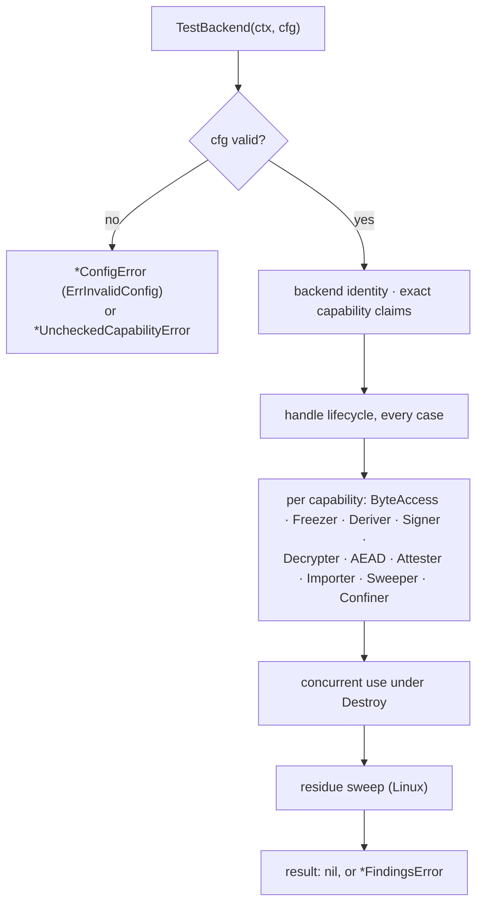
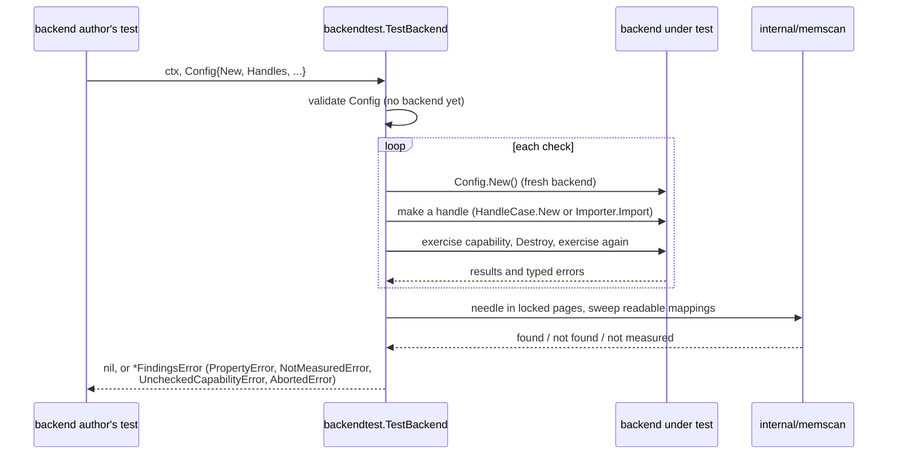

# Backend conformance — architecture

> **Status: NORMATIVE** · Scope: go-enclave · Last verified: 2026-10-12
> The conformance suite for the [backend seam](../backends/architecture.md). Conflicts with this document are defects. For shipped behavior the code is canonical: fix this document to match it.

## Problem

The seam's signatures say what a backend's methods take and return. They do
not say that a destroyed handle answers `ErrEnclaveDestroyed` on every
error-returning method, that `Destroy` waits out a borrow, that a claimed
capability is the method set and nothing else, that an `Importer` wipes the
source on every path, or that an `Attester` binds its nonce rather than
returning evidence that merely differs between calls. Hardware backends are
written in other modules, so the check has to ship to them, as
[provider conformance](../provider-conformance/architecture.md) does for
providers.

## Shape chosen

A subpackage, `backendtest`, in the shape of `testing/fstest.TestFS` and of
`providertest`: one call, `TestBackend(ctx, cfg)`. It does not import
`testing`, adds no dependency, and nothing in go-enclave depends on it. It
fails closed: a check that cannot run is a finding, not a pass, unless the
config accepts that with a reason.

The checks run in that order; each one calls `Config.New` for a fresh backend,
so a check that leaves a backend in a terminal state cannot change the meaning
of the next. Once `ctx` ends no further check starts, and an `*AbortedError`
joins the findings.

- **Two sides, declared apart.** A secure element's signing, decryption, AEAD
  and attestation keys have different method sets, so the backend declares
  its own capabilities (`BackendCapabilities`) and each kind of handle is a
  named `HandleCase` with its own factory and its own exact list. `Attester`
  may appear on either side, so platform evidence and key attestation are told
  apart.
- **A claim is checked in both directions.** Each claimed capability must be
  found by type assertion, and each unclaimed one must not be, so a claim
  cannot drift from the method set.
- **A capability the suite cannot exercise is refused, never passed**
  (`ErrUncheckedCapability`). Attestation is the main case: only the relying
  party can tell evidence that binds a nonce from evidence that differs
  between calls, so the suite certifies `Attester` only when `VerifyEvidence`
  is set.
- **Panics are findings.** A check that panics, including in a concurrent-use
  goroutine, is reported as **panic safety** instead of crashing the caller.

## Rejected alternatives

| Alternative | Why rejected |
|---|---|
| One `NewHandle` and one flat capability list | Cannot express a device whose keys differ in method set. |
| A `Capabilities() []Capability` method read by the suite | It can disagree with the method set; the type assertion is the truth. |
| Certify `Attester` by checking that evidence differs between nonces | Evidence can differ between calls without binding the nonce. `VerifyEvidence` stays, and attestation binding is certified only with it. |
| Drop `VerifyEvidence` and skip `Attester` silently | A green run would claim a capability it never measured. The unchecked capability is an error instead. |
| A boolean to skip the residue sweep | A reason string is required and echoed to `Logf`, so a green run records what it did not measure. |
| Report a failure seen after the context ended as a finding | A compliant backend fails its calls with the context's error after it ends, so a later failure is the abort, not a finding. |
| Require `Config.New` to return the same backend each call | A hardware module opens its device in `New`; a fresh backend per check keeps one check from changing the next. |
| Measure mid-call cancellation | Only the backend can hold a call open; the suite measures the refusal of already-ended contexts. |

## Data flow

Everything happens in the author's process and test binary. Nothing is
persisted or sent anywhere. The suite generates its own random material
(imported material, nonces, derivation info) and wipes what it holds; the
residue sweep reads this process's own mappings through `/proc/self/maps` and
`/proc/self/mem`, and wipes its scan buffer so it cannot plant what it looks
for.

## Component boundaries

| Concern | File |
|---|---|
| `Config`, `HandleCase`, `TestBackend`, the lifecycle, concurrency and config checks | [backendtest/backendtest.go](../../backendtest/backendtest.go) |
| Per-capability checks, capability sets | [backendtest/capabilities.go](../../backendtest/capabilities.go) |
| Residue sweep | [backendtest/residue.go](../../backendtest/residue.go); the `/proc/self/mem` scan it shares with the root package's tests is [internal/memscan](../../internal/memscan/memscan_linux.go) |
| `ErrInvalidConfig`/`ConfigError`, `ErrAborted`/`AbortedError`, `ErrNotMeasured`/`NotMeasuredError`, `ErrUncheckedCapability`/`UncheckedCapabilityError`, `FindingsError`, `PropertyError` | [backendtest/errors.go](../../backendtest/errors.go) |

The backend under test is the author's and lives in the author's module; the
seam it implements is go-enclave's
([backends](../backends/architecture.md#component-boundaries)). The suite never
parses or appraises evidence; the author's `VerifyEvidence` stands in for the
relying party.

## Trust boundaries

A passing run is evidence about the properties the suite **could measure on
that host**, nothing more. What it could not measure is a
`*NotMeasuredError`, a `*UncheckedCapabilityError`, or a note on `Logf`. A
backend that holds keys in a device is certified only for the surface the seam
models; the device's own native interface is outside the suite.

## What it does not do

Not a performance or load test; no device liveness checks; no mid-call
cancellation measurement; no check of a backend's native interface; no
verification of evidence beyond calling the author's `VerifyEvidence`.
