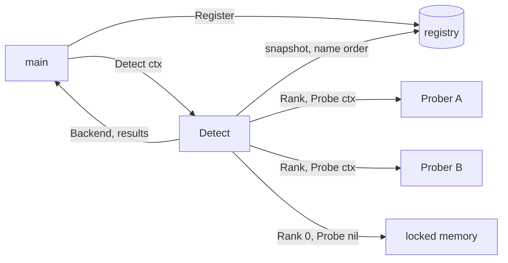

# Backend detection — architecture

> **Status: NORMATIVE** · Scope: go-enclave · Last verified: 2026-10-14
> Conflicts with this document are defects. For shipped behavior the code is canonical: fix this document to match it.

## Problem

`main` registers the backends it links in ([backends](../backends/architecture.md)):
a TEE, a secure element, locked memory. Which one a process should use
depends on the host. The TEE module is linked, but the machine may lack
the TEE, and the secure element may be unplugged. Without detection,
configuration names one with `Lookup`, so every deployment must know its host.
A deployment wants the most secure backend this host can run, chosen by go-enclave, with
locked memory as the floor. The choice must also stay observable: an operator
must see what was chosen and why each other backend was not.

Three constraints follow from the rest of the design:

- Only registered backends are considered, and probing is each backend's own
  code. `main` decides what is linked and trusted, and only a backend knows
  how to find its device.
- Probing runs on an explicit call from `main`, and importing changes no
  process state. A library import must not touch devices or the registry.
- Rank is a property each backend reports and go-enclave compares, not a table
  in go-enclave. A table would have to name hardware this module does not ship.

## Shape chosen

One optional backend capability, `Prober`, carries both the rank and the
probe:

```go
type Prober interface {
	Backend
	Rank() int
	Probe(ctx context.Context) error
}
```

One function, `Detect(ctx)`, compares them:



- **Rank is an `int`, and higher is more secure.** Locked memory reports 0,
  the floor. A backend chooses its own rank, so adding one changes nothing in
  go-enclave. A backend usable but weaker than locked memory reports below 0
  and is never selected.
- **Probe says whether this host can run the backend.** It returns nil or the
  backend's own error, which `Detect` wraps in a `*ProbeError` with the
  backend's name. Only the backend knows its device, so the check is its own
  code.
- **`Detect` probes every registered backend**, in name order, and returns the
  highest-ranked one that probed usable, with one `ProbeResult` per backend.
  It always returns a backend: locked memory is registered from the start and
  always usable.
- **Ties are deterministic.** A backend replaces the current selection only
  when it ranks strictly higher. The selection starts at locked memory, and
  backends are visited in byte order of name. So a tie goes to locked memory
  first, then to the name that sorts first. Map order never decides.
- **A backend that is no `Prober` is never selected.** It has no rank to
  compare, so `Detect` passes it over with a `*CapabilityError` for
  `CapabilityProbe`. It stays reachable by name through `Lookup`.
- **Nothing runs at init.** `Register` does not probe; only `Detect` does, each
  time it is called. The registry is read once, under its read lock, and the
  probes run without holding it, so a slow probe never blocks `Register` or
  `Lookup`.

Because `Prober` is optional, `Backend` keeps its single method and no existing
backend breaks; the change is additive.

## Rejected alternatives

- **A rank table in go-enclave.** It would name hardware this module does not
  ship, and it would need a release for every new backend. Rank is the
  backend's own property instead.
- **Rank and probe as methods of `Backend`.** That would break every
  out-of-tree backend for a feature some never need, such as a backend chosen
  only by name. It would also contradict the capability design: a capability
  is a method set reached by type assertion.
- **Two capabilities, `Ranker` and `Prober`.** A rank with no probe cannot be
  selected safely, and a probe with no rank cannot be compared. Detection needs
  both, so they form one capability.
- **Self-registration from `init`.** Rejected: importing must change no
  process state, and hidden registration is what [backends](../backends/architecture.md#rejected-alternatives)
  already rejects.
- **Stop at the first usable backend in rank order.** It saves probes, but
  the results would no longer say why every higher-ranked backend was passed
  over, and that observability is a requirement. Probing is a startup cost
  paid once.
- **Return an error when nothing but locked memory is usable.** Locked memory
  is the correct floor, attested through the host's platform (see the scope
  fence), not a failure. A
  deployment that requires hardware checks what was selected.
- **Detect selects and installs a process-wide backend.** No process-wide
  backend exists to install. `Detect` returns the interface, and `main` hands
  it on (`WithBackend`, `OpenIn`) as it would a `Lookup` result.

## Component boundaries

| Component | Owns | Does not own |
|---|---|---|
| `Detect` (`detection.go`) | The snapshot, the probe order, the comparison, the tie-break, the results | What any rank means beyond its order; how a device is found |
| A `Prober` backend | Its rank and its probe of the host | Other backends; the selection |
| The registry (`backend.go`) | Which backends exist | When probing happens |
| `main` | Registering, calling `Detect`, logging the results, using the selection | — |

## Trust boundaries

A backend's `Rank` and `Probe` are trusted code that `main` linked in and
registered. `Detect` does not check that a rank is honest. A backend reporting
too high a rank wins, so registering one is a trust decision, as `Register`
already is. `Detect` recovers no panic from a `Probe`, because the conformance
suite already fails a backend that panics. Error texts from a probe reach logs
as the backend wrote them, and the backend name in a `ProbeError` is quoted.

## Scope fence

- The root module ships two backends: locked memory (rank 0) and
  [linux-secretmem](../linux-secretmem/architecture.md) (rank 1), which `main`
  registers itself. The `backends/armtrustzone` module ships a hardware
  backend that reports rank 2. With no hardware backend registered, detection
  selects linux-secretmem if `main` registered it and the host allows
  `memfd_secret`, and locked memory otherwise.
- Attestation is out of scope: `Detect` neither attests nor compares
  attestation, and selects by rank only. A deployment that needs hardware
  evidence checks what was selected for the
  [`Attester`](../backends/architecture.md#attestation) capability. Locked
  memory's environment is attested through the host's platform
  ([SPEC boundaries](../SPEC.md#boundaries)).
- Rank has no shared scale beyond "0 is locked memory, higher is more secure".
  Out-of-tree backends that must order against each other agree on their ranks
  themselves.
