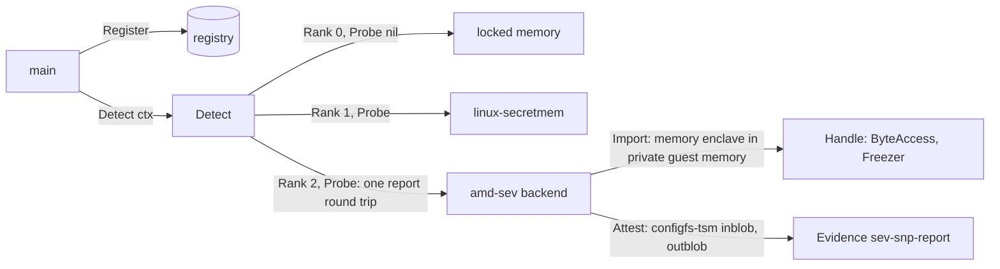

# AMD SEV-SNP backend — architecture (proposal)

> **Status: NORMATIVE** · Scope: go-enclave · Last verified: 2026-10-27
> Conflicts with this document are defects. A future feature ([SPEC](../SPEC.md#features), row `amd-sev`): no code exists, and no code is written until the owner decides the [open questions](#open-questions); each answer then replaces its options here. The backend's own docs move to its module with its code.

## Problem

The memory enclave keeps material in `mlock`'d, guarded pages
([platform contract](../memory-enclave/engineering.md#platform-contract)), and
[linux-secretmem](linux-secretmem.md) would take those pages out of the
kernel's direct map. Both defend against the kernel and processes of the
machine the program runs on. When that machine is a virtual machine, neither
defends against what sits below it:

- the hypervisor and the host kernel, which map all guest RAM and can read it,
  write it, remap it or replay an older copy of a page;
- the host's devices, which can DMA into guest RAM;
- anyone with physical access to the DIMMs or the memory bus (cold boot,
  interposers), who reads plaintext.

The guest's own swap, core dumps and hibernation images also land on virtual
disks the host reads, so in a VM the memory enclave's `mlock` and
`MADV_DONTDUMP` keep material from the host as well as from the disk.

AMD SEV-SNP (Secure Encrypted Virtualization with Secure Nested Paging) closes
those paths in hardware: guest memory is encrypted with a per-guest key that
the host never holds, and the Reverse Map Table (RMP) refuses any host write,
remap or replay of a guest's private page. The guest can ask the AMD Secure
Processor (ASP) for an attestation report signed by a key unique to the chip,
so the environment attests itself rather than through the host's platform.
The backend proposed here is for a program that runs inside an SNP guest:
from the guest's point of view an ordinary process in the guest OS's user
space, whose memory is the guest's encrypted private memory.

## What amd-sev adds over the memory enclave and linux-secretmem

The program runs in a VM in every column; the amd-sev column is an SNP guest.

| Path to the material | Memory enclave | linux-secretmem | amd-sev |
|---|---|---|---|
| Hypervisor or host kernel reads guest RAM | plaintext | plaintext | ciphertext: encrypted with the guest's key, which only the ASP holds |
| Host writes, remaps or replays a guest page | possible | possible | refused by the RMP (Secure Nested Paging) |
| Host device DMA into guest RAM | possible | possible | refused for private pages |
| DIMM or bus read, cold boot | plaintext | plaintext | ciphertext |
| Guest kernel, guest root, `ptrace` in the guest | readable | GUP paths refused, direct map removed | readable: SNP does not isolate inside the guest ([Q5](#q5-handle-memory)) |
| Swap, core dump, hibernation in the guest | locked, `MADV_DONTDUMP` | locked, `VM_DONTDUMP`, hibernation refused | as the memory enclave: the handles are memory enclaves ([Q5](#q5-handle-memory)) |
| Attestation of the environment | through the host's platform ([SPEC boundaries](../SPEC.md#boundaries)) | the same | its own: an SNP attestation report, signed by the chip's VCEK, over a caller's nonce |

It does not stop the guest kernel or code inside the process, side channels
the platform's TCB version does not mitigate, or material the program sends
out of the guest: network and disk I/O pass through shared (unencrypted)
bounce buffers, so anything the caller writes to a socket or a file leaves
the encrypted boundary in whatever form the caller wrote it.

## Hardware, firmware and kernel requirements

Sources, each cited at the revision this proposal was written against. They
were recorded offline: the implementing slice confirms the latest revision,
pins it, and copies each into `docs/reference/` with the code
([standards first](../reference/README.md)).

- AMD, [SEV Secure Nested Paging Firmware ABI Specification](https://www.amd.com/content/dam/amd/en/documents/epyc-technical-docs/specifications/56860.pdf),
  publication 56860, revision 1.55: the guest messages (`MSG_REPORT_REQ`,
  `MSG_KEY_REQ`), the `ATTESTATION_REPORT` structure, guest policy and TCB
  version.
- AMD, [SEV-ES Guest-Hypervisor Communication Block Standardization](https://www.amd.com/content/dam/amd/en/documents/epyc-technical-docs/specifications/56421.pdf),
  publication 56421, revision 2.03: the guest request path and the
  certificate table the host may return with a report.
- AMD, [Secure VM Service Module for SEV-SNP Guests](https://www.amd.com/content/dam/amd/en/documents/epyc-technical-docs/specifications/58019.pdf),
  publication 58019, revision 1.00: the SVSM calling convention and its
  attestation protocol.
- AMD, [Versioned Chip Endorsement Key (VCEK) Certificate and KDS Interface Specification](https://www.amd.com/content/dam/amd/en/documents/epyc-technical-docs/specifications/57230.pdf),
  publication 57230: the VCEK and VLEK certificates and the AMD Key
  Distribution Service a verifier fetches them from.
- AMD, [AMD64 Architecture Programmer's Manual Volume 2](https://www.amd.com/content/dam/amd/en/documents/processor-tech-docs/programmer-references/24593.pdf),
  publication 24593, section 15.36 (Secure Nested Paging): the RMP, page
  validation and VMPLs.
- Linux: [The Definitive SEV Guest API Documentation](https://docs.kernel.org/virt/coco/sev-guest.html)
  (`/dev/sev-guest`), the configfs-tsm report ABI
  ([Documentation/ABI/testing/configfs-tsm](https://git.kernel.org/pub/scm/linux/kernel/git/torvalds/linux.git/tree/Documentation/ABI/testing/configfs-tsm)),
  [AMD Memory Encryption](https://docs.kernel.org/arch/x86/amd-memory-encryption.html)
  and KVM's [Secure Encrypted Virtualization](https://docs.kernel.org/virt/kvm/x86/amd-memory-encryption.html).
  Kernel docs are cited at the tree; the implementing slice pins a tag.

### Hardware and firmware

- **AMD EPYC 7003 (Milan) or later.** SNP needs Zen 3; EPYC 7002 (Rome) has
  SEV and SEV-ES only, which this backend refuses
  ([rejected alternatives](#rejected-alternatives)).
- **BIOS:** SME (memory encryption) and SEV-SNP enabled, the IOMMU enabled, and
  the RMP covering system memory.
- **ASP firmware** with SNP support, loaded by the host kernel; its version is
  part of the TCB the report carries, and a verifier sets the minimum.

### The host (hypervisor) side

Untrusted by design; listed because the test runner is the host
([test plan](#test-plan-on-the-real-hardware)). Linux 6.11 or later with KVM's
SNP support (`kvm_amd` with `sev_snp=1`), QEMU 9.1 or later with KVM
acceleration (the `sev-snp-guest` object; never TCG), and OVMF built for SNP.

### The guest side: the Linux interfaces the backend uses

- **The SNP guest device, `/dev/sev-guest`** (`CONFIG_SEV_GUEST`, Linux 5.19).
  The `sev-guest` driver binds only when SNP is active and holds the secrets
  page the ASP gave the guest at launch, with the VM platform communication
  keys (VMPCKs) that encrypt and authenticate each guest request. Its ioctls
  are `SNP_GET_REPORT`, `SNP_GET_EXT_REPORT` and `SNP_GET_DERIVED_KEY`; the
  device is root-only by default.
- **configfs-tsm reports** (`CONFIG_TSM_REPORTS`, Linux 6.7), mounted at
  `/sys/kernel/config/tsm/report`. A caller `mkdir`s an entry, writes up to 64
  bytes of report data to `inblob`, optionally a VMPL to `privlevel`, and
  reads the report from `outblob` and the host's certificate table, if any,
  from `auxblob`. `provider` reads `sev_guest` in an SNP guest (`tdx_guest` in
  TDX). `generation` counts writes, so a reader detects another writer that
  raced it on the same entry. The `sev-guest` driver is the provider, so the
  report is the same one `SNP_GET_REPORT` returns.
- **The VMPL and SVSM model.** SNP divides a guest into four VM Privilege
  Levels; VMPL0 is the most privileged, and the RMP carries per-VMPL page
  permissions. Without an SVSM the guest kernel runs at VMPL0. With one (an
  SVSM such as COCONUT-SVSM at VMPL0, Linux 6.11 or later in the guest), the
  guest kernel runs at a lower privilege (`privlevel_floor` names it), and the
  SVSM provides services such as a vTPM and its own attestation protocol,
  which configfs-tsm reaches through `service_provider`. Every report carries
  the VMPL that requested it, so the verifier sees whether it came from the
  guest kernel or the SVSM ([Q7](#q7-vmpl-and-the-svsm)).
- **Keeping material in encrypted guest memory.** An SNP guest's pages are
  private (encrypted, validated in the RMP) unless the guest kernel converts
  them to shared, which it does only for DMA bounce buffers (swiotlb) and the
  GHCB. User-space anonymous memory is private, so a memory enclave allocated
  in the guest is encrypted with the guest's key, and its `mlock` keeps it off
  the guest's swap device, a virtual disk the host reads. Nothing in user
  space selects private memory; the backend relies on the guest kernel's
  default and never maps device or shared memory for a handle.

## Attestation

The backend implements `Attester` on the backend, placing platform evidence
there as the [seam requires](architecture.md#attestation):

- **Evidence.** `Attest(ctx, nonce)` creates its own configfs-tsm entry,
  writes `nonce` (1 to 64 bytes) to `inblob`, reads `outblob`, checks that
  `generation` did not move, and removes the entry. It returns
  `Evidence{Format: "sev-snp-report", Data: report}`, where `report` is the
  1184-byte `ATTESTATION_REPORT` structure of firmware ABI 56860, byte for
  byte. The firmware places the report data in `REPORT_DATA`, zero-padded to
  64 bytes by the kernel ([Q6](#q6-evidence-shape)).
- **What it binds.** The report is signed with ECDSA P-384 by the chip's VCEK
  (or a VLEK a cloud provider registered) and carries the launch
  `MEASUREMENT`, the guest `POLICY` (debug, migration agent, SMT), the
  requesting `VMPL`, the TCB versions, `CHIP_ID`, `HOST_DATA`, the ID-block
  digests and `REPORT_DATA`.
- **Who verifies.** The relying party, through the `sev-snp-report` format's
  verifier, outside this module: go-enclave never parses or appraises evidence
  ([SPEC boundaries](../SPEC.md#boundaries)); platform attestation belongs to
  go-xkms and go-trusted-platform. The verifier checks the signature, the
  chain VCEK → ASK → ARK for the product (from the `auxblob` certificate table
  or AMD's KDS), `REPORT_DATA` against the nonce it issued, and its policy on
  measurement, guest policy, VMPL and minimum TCB.
- **What the measurement covers.** The launch measurement covers the initial
  guest image: the firmware, and the kernel, initrd and command line only when
  the firmware measures them (OVMF's hashes table for a direct-boot kernel) or
  an SVSM vTPM records them. A deployment that boots an unmeasured kernel
  attests the firmware, not the code that runs the program; the user doc will
  say so.

## Shape proposed

Recommended answers to the open questions are marked; none is decided.

- **Out of tree** (Q1), a module of its own (`go-enclave-amd-sev`), in the
  shape of the [TDX sketch](architecture.md#an-out-of-tree-backend); it depends
  on go-enclave and `golang.org/x/sys`, never the reverse. `main` registers it
  explicitly; nothing registers it at import.
- **Name** `amd-sev`.
- **Capabilities**, as the [TEE-memory class](architecture.md#what-each-backend-class-provides)
  provides: `Importer`, `Attester` (backend), `Confiner`, `Sweeper` and
  `Prober` on the backend; `ByteAccess` and `Freezer` on its handles; no
  `AEAD`, `Deriver`, `crypto.Signer` or `crypto.Decrypter` (Q8).
- **Handles** wrap a memory enclave made with `enclave.NewMemory` inside the
  guest (Q5), so the memory enclave's guard pages, canary, wipe, freeze and
  release rules hold unchanged; `Import` resolves the `ImportSpec` and accepts
  every purpose, since `ByteAccess` meets each purpose's contract.
- **`ConfinesProcess` is true**: construction succeeded only inside an SNP
  guest, whose private memory holds the whole process.
- **`Sweep`** destroys every handle the backend made and returns the count it
  could not; `WipeAll`'s first phase reaches the same memory enclaves.
- **Rank 2** (Q3); the probe runs only from `Detect` (Q4), and the constructor
  checks the same interface, so a backend that cannot attest is never built.
- **Reports through configfs-tsm** (Q2).
- It passes `backendtest` with `VerifyEvidence` set (Q9).
- **Linux on amd64 only** (owner, 2026-10-15). On any other GOOS or GOARCH a
  stub compiles whose constructor and probe return the typed unavailable
  error, so a cross-platform `main` that registers it builds everywhere.

## Failure modes

Every failure is a typed error. The names are proposals, named for the
mechanism (the SNP guest request), not the contents, and live in the
backend's module; go-enclave's existing errors are reused where their meaning
holds.

| Failure | Where | Proposed error |
|---|---|---|
| Not an SNP guest: no `tsm/report` (`ENOENT`), `provider` not `sev_guest`, configfs not mounted, the `sev-guest` driver not bound; an SEV or SEV-ES guest | probe, construction | `*SNPGuestError{Op, Cause}` matching `ErrSNPGuestUnavailable`; `Op` names the step (`mkdir`, `provider`, `inblob`, `outblob`), `Cause` the `*os.PathError` or `*os.SyscallError` |
| Not permitted (`EACCES`, `EPERM`: not root, or an LSM refuses configfs) | probe, construction | the same, `Cause` the errno |
| Non-Linux or non-amd64 build | probe, construction | `ErrSNPGuestUnavailable` with no cause |
| The firmware or the host refuses the request (`EIO`, the VMPCK disabled after a sequence error, the host's throttling outlasting `ctx`) | `Attest` | `*SNPReportError{Op, Cause}` matching `ErrSNPReport` |
| Another writer moved `generation` while the report was read | `Attest` | the same, `Op` `generation`; never a report of unknown provenance |
| `outblob` not the 1184 bytes of an `ATTESTATION_REPORT` | `Attest` | the same, `Op` `outblob` |
| A requested `privlevel` below `privlevel_floor` | `Attest` | the same, `Op` `privlevel` |
| A nonce empty or over 64 bytes | `Attest` | go-enclave's existing `ErrInvalidNonce`, before any request |
| `ctx` ended | every call | `ctx.Err()`, as the seam requires |
| Budget refused, an `ImportSpec` refused | `Import` | the existing `*BudgetError`, `ErrInvalidImport`, `*CapabilityError` |
| `mprotect`, `munmap` refused; canary mismatch | `Freeze`, `Destroy` | the memory enclave's existing `ErrLockedMemoryUnavailable`, `ErrReleasedWithoutWipe`, `ErrEnclaveCorrupted` |

`ErrSNPGuestUnavailable` means "not here"; `ErrSNPReport` means "here, and
this request failed". A probe failure reaches `main` wrapped in `Detect`'s
`*ProbeError`, and a lower-ranked backend stays selected. A backend that
probed usable and then fails returns its error; it never falls back to locked
memory ([a missing capability](architecture.md#a-missing-capability)).

## Test plan on the real hardware

The backend is proven on the real part only: no simulator, emulator or mock
device (owner, 2026-10-17). The hardware is the owner's HPE ProLiant DL380
Gen10 Plus v2 with an AMD EPYC CPU, ruled a CI runner and the SEV development
system. QEMU in this plan is the VMM driving KVM on that CPU, with SNP enforced
by its ASP; it emulates nothing the backend touches, and a report that verifies
to AMD's ARK proves the chip.

1. **Record the host.** Before the first run, record the exact server model,
   the CPU family and model (`/proc/cpuinfo`), the BIOS settings above, the
   ASP firmware's SNP API version and build (the host kernel logs them), and
   the host kernel, QEMU and OVMF versions. HPE sells its EPYC model of this
   generation as the DL385 Gen10 Plus v2; the record settles which part is
   installed. A Rome (7002) CPU cannot run SNP, and the plan stops there for
   the owner. The first record is [below](#host-record); the CPU is Milan,
   so that stop does not apply.
2. **The runner.** A self-hosted runner on that host launches a fresh SNP
   guest per job from a pinned, measured image (OVMF plus a direct-boot
   kernel, initrd and command line covered by the launch measurement), with
   guest policy debug off and no migration agent, and runs the backend
   module's tests inside it as root. The expected launch measurement is
   computed from the image at build time and handed to the test.
3. **Conformance inside the guest.** `backendtest.TestBackend` with
   `VerifyEvidence` set to a verifier that checks the VCEK chain to the
   product's ARK, the signature, `REPORT_DATA` against the suite's nonce, the
   expected measurement, debug off and the requesting VMPL. The residue sweep
   runs (the guest is Linux).
4. **Detection inside the guest.** With locked memory and amd-sev registered
   (and linux-secretmem once it ships), `Detect` selects amd-sev, and every
   `ProbeResult` is nil.
5. **The host cannot read the material.** The test imports a random needle
   into a handle and holds it; on the host, as root, a scan of the QEMU
   process's whole address space (`/proc/<pid>/maps` and `/proc/<pid>/mem`,
   the scan `internal/memscan` does in-process) must not find it. The
   control: the same image booted as a plain KVM guest on the same host, where
   the same scan must find it, proving the scan reaches guest RAM when it is
   readable.
6. **Refusals on the same machine.** The test binary on the host itself, in a
   plain KVM guest and in an SEV-ES guest: the probe returns
   `ErrSNPGuestUnavailable` naming the step, and `Detect` keeps the next
   backend. In an SNP guest as a non-root user: the same error with `EACCES`.
   Concurrent `Attest` calls from many goroutines each return a report that
   verifies against its own nonce.
7. **Under an SVSM** (if Q7 is taken): the same guest under COCONUT-SVSM at
   VMPL0; the reports carry the guest kernel's VMPL, and a `privlevel` below
   the floor is refused.

**Kit.** `scripts/amdsev-guest.sh snp|sev-es|plain` launches one guest of
steps 2 and 6 from a pinned local OVMF build and a direct-boot kernel, initrd
and command line (snp: `sev-snp-guest`, debug off, `kernel-hashes=on`; sev-es:
`sev-guest` with the SEV-ES policy bit; plain: no SEV object), with no network
device, and exits with the status the guest's init reports on the serial
console; `--dry-run` prints the QEMU command. `scripts/amdsev-host-scan.sh
<qemu-pid> <hex-needle>` is step 5's scan: exit 0 not found, 1 found, 2 on an
error. Neither downloads anything.

### Host record

The development host is an AMD EPYC 73F3 (Milan) server. Surveyed read-only
on 2026-11-12 from an unprivileged container on that host:

| Item | Value |
| --- | --- |
| CPU (`/proc/cpuinfo`) | AMD EPYC 73F3 16-Core Processor; family 25 (0x19), model 1, stepping 1: Zen 3, EPYC 7003 (Milan), SNP-capable |
| Microcode | `0xa0011e0` |
| CPU flags | `sev`, `sev_es`; no `sev_snp` |
| `kvm_amd` parameters | `sev=Y`, `sev_es=Y`, `sev_snp=N` |
| Device nodes | `/dev/sev`, `/dev/kvm`, `/dev/sev-guest`: not visible from the container |
| Host kernel | Linux 7.0 (`7.0.0-43-generic`) |
| ASP firmware, SNP API version and build | not visible from the container (the kernel log is not readable there) |
| QEMU, OVMF | not yet recorded |

SEV and SEV-ES are enabled. SNP is not yet: the missing `sev_snp` flag and
`sev_snp=N` say the BIOS or host kernel has not turned it on. Enabling SNP and
granting the runner access to `/dev/sev` and `/dev/kvm` are pending, and the
record is completed (ASP firmware SNP API version and build, QEMU, OVMF, the
server model) when they land. Until then no step of this plan past step 1
runs: an SEV-ES guest refuses the backend's probe by design (step 6).

## Open questions

### Q1: in-tree or out-of-tree

- **Out of tree** (recommended): its own module, as the SPEC row and the
  boundary "no hardware backend or hardware-specific code in this module"
  ([SPEC](../SPEC.md#boundaries)) say. It needs nothing unexported: the TDX
  sketch shows a TEE-memory backend built from `enclave.NewMemory` and the
  seam alone.
- **In tree:** it would need no new dependency (configfs and ioctls through
  `golang.org/x/sys`), but it is hardware-specific code, which the boundary
  excludes.

Proposed answer (for owner sign-off): out of tree, its own module; the SPEC
boundary excludes hardware-specific code here, and the host record adds
nothing that needs an unexported API.

### Q2: the report interface

- **configfs-tsm** (recommended): the kernel's vendor-neutral report ABI, the
  same the TDX sketch uses, so the two backends share their shape; per-entry
  `generation` detects racing writers; the SVSM's attestation is reachable
  through it. Needs Linux 6.7 or later in the guest.
- **`/dev/sev-guest` ioctls** (`SNP_GET_REPORT`, `SNP_GET_EXT_REPORT`): work
  from Linux 5.19, but tie the backend to the driver's ioctl structures and
  give no SVSM path. Only `SNP_GET_DERIVED_KEY` has no configfs equivalent
  ([Q8](#q8-derived-keys)).

Proposed answer (for owner sign-off): configfs-tsm; the host kernel (7.0) is
well past 6.7, the pinned guest image's kernel is chosen at or above it, and
it keeps the SVSM path Q7 needs.

### Q3: rank

- **Rank 2** (recommended): above locked memory (0) and linux-secretmem's
  proposed 1 ([its Q3](linux-secretmem.md#q3-rank)). The hardware rows' order
  among themselves is for the owner to rule once across the sibling
  proposals; this one recommends that secure elements, whose keys never leave
  the device, rank above TEE memory, which the guest kernel can read.
- **A wide band** (for example 100 for TEE memory, 200 for secure elements):
  room between classes, at the cost of numbers with no meaning but their
  order ([detection scope fence](../backend-detection/architecture.md#scope-fence)).

Proposed answer (for owner sign-off): left to the owner, who rules the
hardware rows' order once across the sibling proposals; this proposal's input
stays rank 2, and the host record does not bear on it.

### Q4: the detection probe

- **Recommended:** `Probe(ctx)` checks `ctx`, reads `provider` (must be
  `sev_guest`), then requests one report over a fresh random nonce and checks
  that `outblob` is 1184 bytes with that nonce at `REPORT_DATA`'s offset; it
  verifies nothing else and removes its entry. It costs one guest request to
  the ASP per `Detect`, and it passes only a guest that can attest, which
  every environment must ([SPEC boundaries](../SPEC.md#boundaries)).
- **Presence only** (the `tsm/report` directory and `provider`): no ASP round
  trip, but it passes a guest whose VMPCK the driver disabled or whose user
  may not create entries, which then fails at the first `Attest`.

Proposed answer (for owner sign-off): the full probe, one report over a fresh
nonce; test plan step 6 needs a probe that refuses the SEV-ES guests this host
already runs and passes only a guest that can attest.

### Q5: handle memory

- **A memory enclave** (recommended): `enclave.NewMemory` in private guest
  memory, through go-enclave's exported API only; the guest kernel can still
  read it, as the table above says.
- **secretmem inside the guest**, once [linux-secretmem](linux-secretmem.md)
  ships: SNP against the host plus secretmem against the guest kernel's GUP
  paths and direct map. It needs go-enclave to export a secretmem
  constructor, which that row's Q1 (in tree, unexported) does not give, and it
  fails on the guests that refuse `memfd_secret`. Recommended as a later
  change, after both rows ship.

Proposed answer (for owner sign-off): a memory enclave now, secretmem inside
the guest as a later change once both rows ship; go-enclave exports no
secretmem constructor today.

### Q6: evidence shape

- **The report alone** (recommended): `Data` is the `ATTESTATION_REPORT` as
  firmware ABI 56860 defines it, the format `sev-snp-report` the seam already
  names; the host's certificate table (`auxblob`) is reached through the
  backend's native interface, and a verifier without it fetches the VCEK
  from AMD's KDS by `CHIP_ID` and TCB. The nonce goes to `inblob` as given,
  zero-padded by the kernel to 64 bytes, as the ABI defines; the verifier
  compares against the nonce it issued and its length.
- **Report and certificates in one wrapper**, such as the IETF RATS
  Conceptual Message Wrapper (draft-ietf-rats-msg-wrap): one value carries
  everything, but it adopts a draft, to be pinned and watched, for a
  convenience the native interface already gives.

Proposed answer (for owner sign-off): the report alone, in the
`sev-snp-report` format the seam already names; the certificate table stays on
the native interface, and no draft is adopted.

### Q7: VMPL and the SVSM

- **Support a guest under an SVSM** (recommended): reports are requested at
  `privlevel_floor` (the guest kernel's own VMPL), which the report records;
  the verifier's policy says which VMPL it accepts. The SVSM's vTPM is a TPM,
  go-xkms's backend, not this one.
- **VMPL0 guests only:** simpler, but refuses the deployments where an SVSM
  gives the guest a measured boot through its vTPM.

Proposed answer (for owner sign-off): support a guest under an SVSM; Milan's
SNP has the VMPLs it needs, so test plan step 7 runs on this host once SNP is
enabled.

### Q8: derived keys

- **Not in this row** (recommended): the backend attests and confines; it
  holds no device key. `SNP_GET_DERIVED_KEY` derives a key bound to the
  guest's measurement, policy, VMPL and TCB from the chip's VCEK or the VMRK,
  which would seal material to this guest on this chip; that is a sealing
  provider (`RootUnsealer`), with its own questions (material sealed on one
  chip does not open on another), for a row of its own.
- **A `Deriver` handle in this row:** wider at first ship, and it decides the
  sealing questions inside a memory-backend row.

Proposed answer (for owner sign-off): not in this row; sealing to a chip is a
`RootUnsealer` with questions of its own, for a row of its own.

### Q9: the verifier the tests use

- **The `sev-snp-report` verifier of go-trusted-platform** (recommended), the
  project that owns platform attestation, so the test proves the evidence the
  portfolio's relying party accepts. If it has no SEV-SNP verifier when this
  row is moved, that is its row to add first.
- **A third-party verifier** (for example `github.com/google/go-sev-guest`'s
  `verify`) as a test-only dependency of the backend module: available now,
  but it proves a verifier the portfolio does not run.

Proposed answer (for owner sign-off): left to the owner. The proposal's
recommendation stands (go-trusted-platform's `sev-snp-report` verifier, added
there first if missing); the host record does not bear on it, and the choice
decides a dependency of another project.

## Rejected alternatives

- **A simulator, emulator or mock ASP for tests.** Ruled out by the owner: a
  hardware backend is proven on the real part, and only a real chip signs a
  report that verifies to AMD's root.
- **SEV or SEV-ES without SNP.** Memory is encrypted, but nothing stops the
  host remapping or replaying pages, and the guest cannot ask for a report at
  run time: SEV measures only at launch, through the host. The probe refuses
  them.
- **A helper SNP VM holding material for a process on the host.** It would
  move material across a VM boundary, a transport go-enclave never carries
  ([SPEC boundaries](../SPEC.md#boundaries)).
- **Holding material at VMPL0 in the SVSM.** The SVSM specification defines no
  key-store protocol beyond its vTPM, which is a TPM and go-xkms's.
- **Parsing or appraising the report in go-enclave.** Ruled out by the SPEC;
  the probe's length and `REPORT_DATA` checks are the backend module's sanity
  check of its own request, not an appraisal.

## What it does not do

No code in this module, no protection inside the guest beyond the memory
enclave's, no evidence verification, no derived keys or sealing, no SVSM
vTPM, no live migration, and nothing off Linux on amd64.
