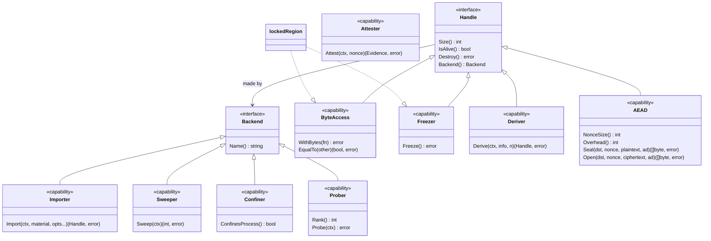
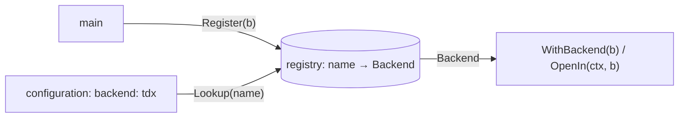
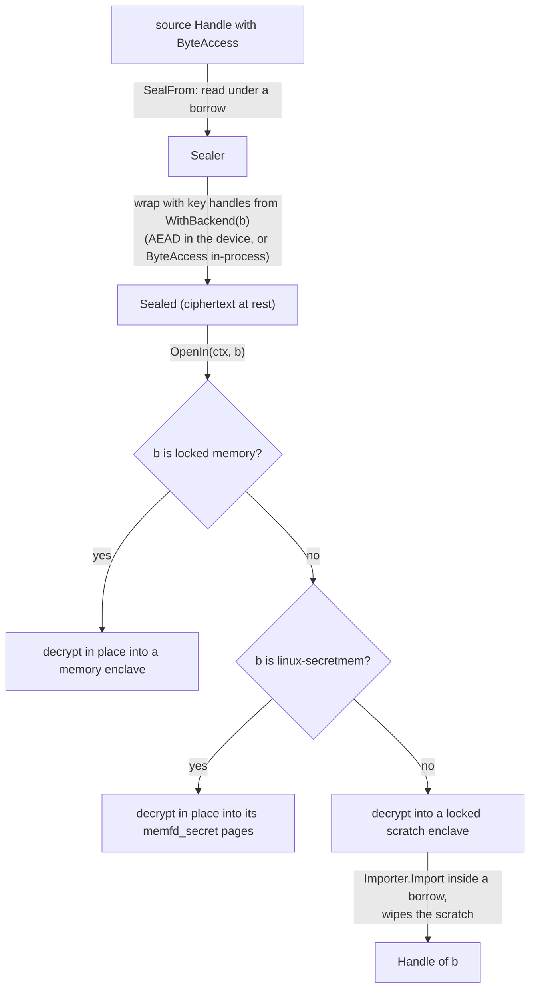
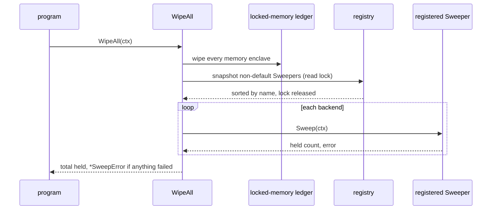

# Backends — architecture

> **Status: NORMATIVE** · Scope: go-enclave · Last verified: 2026-11-12
> The backend seam. The declarations in [backend.go](../../backend.go) and [errors.go](../../errors.go) are canonical; exact signatures are in [engineering.md](engineering.md#interface-signatures) and the conformance suite is [backend-conformance](../backend-conformance/architecture.md). Conflicts with this document are defects.

## Problem

go-enclave will hold material in hardware enclaves: TEEs (Intel SGX), secure
elements and TPMs, and NVIDIA Blackwell confidential computing. A confidential
VM (AMD SEV-SNP, Intel TDX) is not a backend: it protects every page of the
guest alike, so its attestation and sealing are proposed apart from this seam
([confidential-vm](confidential-vm.md)). Locked, guarded, zeroized memory (the memory enclave) is the strategy
for a node that has none of them, and stands in as its enclave. The API must
not freeze around that one memory-backed implementation. It needs a seam that:

- lets another backend's enclave stand where a memory enclave stands (sealing
  into it, opening into it, sweeping it at shutdown);
- lets a caller reach a backend's own, richer interface;
- keeps the core module at one dependency (`golang.org/x/sys`), with every
  hardware backend in its own module;
- changes nothing at import: no backend registers itself.

## Shape chosen

A **small core plus optional capabilities**, discovered by type assertion, and
a **named registry** beside explicit injection.



- **Handle** is the core every enclave provides: size, liveness, destroy, and
  the backend that made it.
- **Backend** is the core every backend provides: its name.
- **Capabilities** are separate interfaces. A handle's: `ByteAccess`,
  `Freezer`, `Deriver`, `AEAD`, and the standard library's `crypto.Signer` and
  `crypto.Decrypter`. A backend's: `Importer`, `Sweeper`, `Confiner`, `Prober`. Either's:
  `Attester`. A capability that embeds `Handle` or `Backend` yields a usable
  value from one assertion.
- **A missing capability** is a `*CapabilityError` from any operation of this
  package that needs it: never a panic, never a fallback to another backend.
- **The registry** maps a name to a backend. The locked-memory backend is in it
  from the start, as a value; anything else is added by an explicit
  `Register(b)`. Injection (`WithBackend(b)`) needs no registration; the
  registry exists so configuration can select a backend by name. A name is a
  configuration label, not an instance identity
  ([registry semantics](#registry-semantics)).
- **Detection.** `Detect(ctx)` probes every registered backend that
  implements `Prober` and returns the highest-ranked one usable on this host,
  or the locked-memory backend when none ranks above it
  ([backend detection](../backend-detection/architecture.md)).
- **Native interfaces** are reached by type assertion, or by `As(v, target)`
  when a backend or handle wraps another and exposes it through an
  `As(any) bool` method.

## Naming

Names follow Effective Go: the package name is part of every identifier, so
nothing repeats it, and types are named for their mechanism, never their
contents (no `Secret`, `SecureBytes`).

| Name | Rationale | Rejected |
|---|---|---|
| `Handle` | What the caller holds is a reference to material a backend holds: pages for locked memory, a key slot for a secure element. `enclave.Handle` names that and claims nothing about the contents. | `Enclave` (`enclave.Enclave` stutters; revive's `exported` rule reports it). `Region` (memory only). `Key` (names the contents; not all material is a key). `Slot` (device only). |
| `Backend` | What makes and holds handles; `enclave.Backend` reads as "an enclave backend". | `Provider` (the `KeyProtector`/`RootUnsealer` seam's word, a different role). `Device` (locked memory is not one). `Strategy` (a pattern, not a mechanism). |
| `ByteAccess`, `Freezer`, `Deriver`, `Attester`, `Importer`, `Sweeper`, `Confiner`, `Prober` | One verb each takes the `-er` form; byte access is a property, not a verb. | `Reader` (implies `io.Reader`'s stream). |
| `AEAD` | The construction's own name, as `cipher.AEAD` uses it; `enclave.AEAD` is a handle that is one. | `Sealer` (taken by the sealing type). `Cipher` (not every cipher authenticates). |
| `Purpose`, `Algorithm`, `ImportSpec`, `ImportOption`, `WithPurpose`, `WithAlgorithm`, `NewImportSpec` | What an import asks for; the options follow `SealerOption`'s `With…` form. | `KeyUsage` (material is not always a key). |
| `Register`, `Lookup` | Their `Backend` parameter or result says what they register; compare `sql.Register`. | `RegisterBackend`, `LookupBackend` (repeat the signature). |
| `BackendNames`, `DefaultBackend`, `LockedMemoryBackendName` | Nouns need the qualifier: `enclave.Names()` would not say whose. | |
| `Capability`, `CapabilityError`, `Evidence` | Named for what they carry. | |

`Sealed` carries no `Enclave` suffix because `enclave.SealedEnclave` would
repeat the package; the memory enclave's type is internal, and callers hold
its `ByteAccess`.

### What each backend class provides

| Capability | On | Locked memory | TEE memory (SGX, GPU CC) | Secure element, TPM[^tpm] |
|---|---|---|---|---|
| `ByteAccess` | handle | yes | yes | no: material never leaves the device |
| `Freezer` | handle | yes | where the platform can protect pages | no: read-only by nature |
| `AEAD`, `crypto.Signer`, `crypto.Decrypter` | handle | no | no (byte access suffices) | per key type |
| `Deriver` | handle | no | no | where the device has a KDF |
| `Attester` | handle or backend | no: the host's platform attests its environment ([SPEC boundaries](../SPEC.md#boundaries)) | backend: platform evidence | handle: key attestation |
| `Importer` | backend | yes (`Allocator`) | yes | where policy allows import, per purpose |
| `Sweeper` | backend | no: `WipeAll`'s first phase sweeps every locked-memory enclave, an `Allocator`'s included | yes | releases sessions and transient objects |
| `Confiner` | backend | no | yes, when this process runs inside the TEE | no: the process is outside the device |
| `Prober` | backend | yes: rank 0, always usable | yes: ranks itself, probes for the TEE | yes: ranks itself, probes for the device |

[^tpm]: no TPM backend ships. The column says what one would provide. The
    TPM support in this repository is a `KeyProtector` provider, the nested
    module `backends/tpm` ([hardware providers](../sealing/hardware-providers.md#tpm-provider)).

Two backends ship beside the locked-memory default:

- The [secretmem backend](../linux-secretmem/architecture.md)
  (`NewSecretMemory`, in this module) is locked memory in `memfd_secret(2)`
  pages. It provides what the locked-memory column does, except that its
  `Prober` ranks 1 and probes for `memfd_secret`.
- The [arm-trustzone backend](arm-trustzone-design.md) (the nested module
  `backends/armtrustzone`) reaches a trusted application in OP-TEE. Its
  `Prober` ranks 2. Its handles are `ByteAccess` memory enclaves filled with
  random bytes from the secure world by its native `Random`. It is no
  `Importer`, so `OpenIn` and `WithBackend` refuse it with a
  `*CapabilityError`. Its key sealing is a separate `KeyProtector`.

### Opaque operations

Opaque signing and decryption handles implement the standard library's
shapes, so they plug into what already takes them: `tls.Certificate{PrivateKey: h}`,
`x509.CreateCertificate`. Every method of those two that can fail returns an
error, so a destroyed handle answers `ErrEnclaveDestroyed`; `Public()`, which
cannot, keeps returning the public key after `Destroy`, since a public key is
not secret. `AEAD` and `Deriver` are this package's own: no standard shape
exists for derivation, and `cipher.AEAD`'s `Seal` has no error result, so a
destroyed or failing device key could only panic, fail silently or stay
usable. `AEAD` keeps `cipher.AEAD`'s arguments and adds the error;
`NonceSize` and `Overhead` are constants of the algorithm and stay valid
after `Destroy`. The seam's opaque shapes take no `context.Context`; a backend
bounds those device calls with its own configured timeout. A hardware module that needs
context-taking signing or decryption, or key agreement such as ECDH, exposes
it as its native interface, reached through `As`.

### Attestation

`Attester` is one interface with two placements: a backend attests the
platform (a TDX quote, an SEV-SNP report), a handle attests one key (TPM2
certification, a secure element's key attestation). `Evidence` is a `Format`
name the backend documents plus the raw `Data`. The nonce is 1 to 64 bytes,
the report-data size of TDX and SEV-SNP; a backend that cannot bind every byte
refuses rather than truncating. Verification belongs to the format's verifier,
outside this module, which never parses evidence. `Attester` does not embed
`Backend`, so a value outside any backend can implement it too: the
[confidential-vm proposal](confidential-vm.md#attestation-a-standalone-attester)
attests a confidential VM that way.

### A missing capability

A type assertion answers "does it have it" with `ok`. An operation of this
package that needs a capability (sealing from a handle, opening into a
backend) returns `&CapabilityError{Backend: h.Backend().Name(), Capability: …}`
before touching anything, matching `ErrCapabilityUnsupported`. It never
substitutes another backend: a sealed value opened into a secure element that
cannot import fails; it does not quietly open into locked memory.

A handle's capabilities are known only once the handle exists, so each
operation checks them where it obtains the handle: after `Import`, `Derive`
or a module's own constructor returns, before the handle is used. A
`Backend` declares nothing about the handles it will make, so a backend
passed to a constructor can be refused eagerly only for a backend capability
it lacks, such as `Importer`, never for a handle capability.

### Importing with a purpose

A raw byte slice cannot tell arbitrary 32-byte material from an AES-256 key,
and a secure element needs an object class, an algorithm and a usage policy
to accept either. `Import` therefore takes an `ImportOption` set, which the
backend resolves with `NewImportSpec` (`ErrInvalidImport` for a nil option, a
missing or unknown purpose, or an algorithm the purpose does not take). The
purpose fixes the contract of the handle `Import` returns:

| Purpose | Algorithm | Who imports it | The handle |
|---|---|---|---|
| `PurposeMaterial` (`"material"`) | none | `OpenIn`, for arbitrary opened material | `ByteAccess`; the view holds exactly the material; `Size` is its length. |
| `PurposeWrappingKey` (`"wrapping-key"`) | required, e.g. `AlgorithmAES256GCM` | `NewSealer(…, WithBackend(b))`, for the wrapping key and each KEK | `AEAD` for that algorithm (wraps in the device), or `ByteAccess` (wraps in this process), or both; `Size` is the key length; a device that enforces usage limits it to wrapping. |
| `PurposeDataKey` (`"data-key"`) | required | a caller holding a DEK in a backend | As `PurposeWrappingKey`, with usage limited to encrypting data. |

- **Refusals.** A backend that cannot hold a purpose and algorithm refuses
  with `*CapabilityError{Capability: CapabilityImport}`, and material whose
  length the algorithm does not take is `ErrInvalidImport`, both before any
  device work. `material` is wiped on every path.
- **Persistence.** Every import is transient: it lives until `Destroy` or the
  backend's `Sweep`, and is never persisted on the device. Persistent
  provisioning is a module's own API.
- **Room to grow.** Usage and persistence attributes join `ImportSpec` as new
  fields with new `With…` options, each defaulting to what the purpose implies
  and to transient, so an existing call keeps its meaning.
- **A handle that misses its purpose's contract** is refused where it is
  obtained: the operation destroys it and returns a `*CapabilityError` naming
  the capability the purpose needed (`CapabilityBytes` for material,
  `CapabilityAEAD` for a key with neither).

## Registry semantics

| Question | Answer |
|---|---|
| Concurrency | One `sync.RWMutex`. `Register` takes it for writing, `Lookup` and `BackendNames` for reading. `Name()` is called before the lock, so backend code never runs under it. |
| Duplicate name | `*BackendExistsError{Name}`, matching `ErrBackendExists`. The name is never rebound. Registering the same backend twice is also a duplicate: telling "the same backend" apart would need `==` on arbitrary dynamic types, which panics for uncomparable ones. |
| Unknown name | `*BackendNotRegisteredError{Name}`, matching `ErrBackendNotRegistered`. |
| Invalid backend | `ErrInvalidBackend` for a nil or typed-nil backend or an invalid name, as `ErrInvalidProvider` treats a nil provider: a lost configuration step, never a request for the default. |
| Default | `"locked-memory"` (`LockedMemoryBackendName`), in the map from the start as a static value, not through `init`. It cannot be registered again. |
| Name | A configuration and registry label, not an instance identity. Two instances may share a name (two devices of one module; an `Allocator` and the default), and at most one is registered. A handle's identity is the value `h.Backend()` returns; `Lookup(h.Backend().Name())` returns it only when the registered instance made `h`. |
| Unregister | None, so a configuration binding is stable: once `main` registers a backend, every `Lookup` of that name, from any subsystem and at any time, resolves to the same instance, and a component that read `backend: tdx` at startup cannot later be handed a different backend under it. A backend's lifetime is its owner's: closing it is the module's own API, after which its handles report destroyed; the registry keeps only the reference. Tests use injection, or a unique name. |
| Cost | A map read under a read lock. Selection happens at configuration time, never on a borrow. |

Registration is optional. A backend passed by `WithBackend(b)` is used
without being registered; the registry is for selecting by name, as a
configuration file does (`backend: tdx`). An injected backend's name may
equal a registered one's; nothing compares them.

## How the existing types map onto the seam

| Type | Role in the seam |
|---|---|
| `ByteAccess` from `NewMemory` | The locked-memory backend's handle, a memory enclave whose internal type is `Handle`, `ByteAccess` and `Freezer` (`Freezer` reached with `As`). Its `Backend()` returns the admitting `Allocator`, else `DefaultBackend()`. |
| `Allocator` | The locked-memory backend's budget, and the locked-memory backend type itself (below). |
| `Sealer`, `Sealed` | Open into a chosen backend; seal from any handle with byte access. |
| `KeyProtector`, `RootUnsealer`, `HealthReporter` | A separate seam a hardware module may also implement. |
| `WipeAll` | Sweeps locked memory, then a snapshot of the registered `Sweeper`s other than the default ([below](#wipeall-and-the-shutdown-sweep)). |
| `HardenProcess` | The locked-memory backend's process hardening ([below](#hardenprocess)). |

The default backend's type stays unexported: callers name it by
`DefaultBackend()` or `LockedMemoryBackendName`, and the exported
locked-memory backend type is `Allocator`.

### `Allocator`: a locked-memory budget

The budget is **specific to locked memory**. Its unit is page-rounded locked
bytes (`LockedSize`), its ceiling is `RLIMIT_MEMLOCK`, and `ForceLimit` and
`TransferTo` are defined against that ceiling. Other backends' scarce resources
have other units: SGX EPC pages, a secure element's key slots, a TPM's
transient-object slots. A generic budget would either fake one unit for all
or need a per-backend cost function, and its `NewAllocatorWithinRLimit` would
mean nothing outside locked memory. A backend with a scarce resource budgets
it in its own module, in its own unit.

`Allocator` is the locked-memory backend: it implements `Backend`
(name `"locked-memory"`) and `Importer`, so a budgeted locked memory is
injected like any other backend, `WithBackend(a)`. A memory enclave's
`Backend()` then returns the admitting `Allocator`, or `DefaultBackend()` for an
unbudgeted enclave. An `Allocator` is not registered: the registered
`"locked-memory"` stays the unbudgeted default, so `Lookup("locked-memory")`
for a budgeted enclave returns the default, not its `Allocator`; the name is
a label ([registry semantics](#registry-semantics)). The budget's own design is
in [locked-memory-budget](../locked-memory-budget/architecture.md).

### `Sealer` and `Sealed`

- **Open into a backend.** `(*Sealed).Open(ctx)` returns a locked-memory
  enclave, the common case, statically typed. Beside it,
  `OpenIn(ctx, b Backend) (Handle, error)` opens into any backend. For locked
  memory (`DefaultBackend()` or an `Allocator`) it decrypts in place, as
  `Open` does. For the [linux-secretmem](../linux-secretmem/architecture.md)
  backend, whose handles are locked regions over its own pages, it decrypts
  straight into a region that backend admits. For any other backend that
  implements `Importer` it decrypts
  into a locked scratch enclave, left writable (never frozen) because the
  importer wipes it, and imports from inside a borrow of it:

  ```go
  imp := b.(enclave.Importer) // checked above
  var h enclave.Handle
  err := scratch.WithBytes(func(p []byte) error {
  	var err error
  	h, err = imp.Import(ctx, p, enclave.WithPurpose(enclave.PurposeMaterial))
  	return err // Import wiped p on every path
  })
  scratch.Destroy() // its pages are already zero
  ```

  The plaintext still never reaches the heap. A backend without `Importer` is
  a `*CapabilityError{Capability: CapabilityImport}` before anything is
  decrypted; a returned handle without `ByteAccess` is destroyed and refused
  with `CapabilityBytes`.
- **The sealer's own keys.** `NewSealer(…, WithBackend(b))` chooses where a
  `ModeRootKey` sealer holds its wrapping key and KEKs (default: locked
  memory), importing each with `PurposeWrappingKey` and
  `AlgorithmAES256GCM`. A key handle that implements `AEAD` wraps inside the
  device; one with only `ByteAccess` wraps in-process. `NewSealer` refuses a
  `b` without `Importer` eagerly, but it cannot refuse one whose handles will
  lack both: no handle exists at construction, and a `Backend` declares
  nothing about future handles. That check runs where each key is imported,
  when the sealer first unseals its root or creates a KEK, which destroys the
  handle and fails with `*CapabilityError{Capability: CapabilityAEAD}`.
- **Seal from an enclave.** `Sealer.SealFrom(ctx, src Handle)` and
  `NewSealedFrom(ctx, src Handle)`, named to pair with `Seal` and `NewSealed`.
  `src` needs `ByteAccess` (else `CapabilityBytes`), is read under its own
  borrow, and is left intact: not destroyed and, unlike `Seal`'s `data`, not
  wiped, since it may be frozen. Material that never leaves its device cannot
  be sealed here; exporting it wrapped is the device's own feature, reached
  through its native interface.
- **A frozen source.** `Seal` and `NewSealed` wipe `data` on every path. A
  `data` that is a view into a frozen enclave (passed from inside `WithBytes`)
  makes that wipe fault, and a fault on a protected page kills the process.
  `Seal` first probes `data`: it writes each end back unchanged with
  `debug.SetPanicOnFault` set, so a read-only page panics recoverably instead,
  and refuses it with `ErrSealSourceReadOnly`, wiping nothing, before any key
  is touched. Any read-only memory is caught, not only an enclave's. The
  remedy it names is `SealFrom`.

### `KeyProtector`, `RootUnsealer` and `HealthReporter`

The provider seam and the backend seam answer different questions. A provider
protects the keys sealing uses (wrap a DEK, unseal a root); a backend holds
material and hands out handles. Neither embeds the other, so neither is
duplicated: a hardware module that does both, such as a TPM that seals a root
under a PCR policy and also holds signing keys, implements both, on one value
or on two values from one constructor. A sealer takes them independently:
`WithKeyProtector(p)` or `WithRootUnsealer(r)` for its provider,
`WithBackend(b)` for its keys. `HealthReporter` stays a provider capability:
it reports whether a sweep took in-process key material the provider depends
on, which is a sealing question.

### `WipeAll` and the shutdown sweep

`WipeAll(ctx)` runs in two phases, inside the one sweep slot it already takes:

1. **Locked memory**: every memory enclave in the ledger, an `Allocator`'s
   included. The built-in backend does not implement `Sweeper`, so it is never
   swept twice and `WipeAll` never recurses.
2. **Registered sweepers.** Under the registry's read lock, `WipeAll`
   snapshots every registered backend other than the default that implements
   `Sweeper`, sorted by name, and releases the lock before calling any of
   them, so backend code never runs under it and a `Sweep` may call `Lookup`.
   A backend registered after the snapshot is not swept by this call; the
   next `WipeAll` includes it. Each `Sweep(ctx)` runs in turn, under the same
   `ctx`; a failing one does not stop the rest.

`ctx` means for each `Sweep` what it means for `WipeAll`: it bounds only
waiting, everything not held is released even under a done or nil `ctx`, a
nil `ctx` never waits and never panics, and a `ctx` ending mid-sweep is not an
error. `WipeAll` passes `ctx` through unchanged, `nil` included, so every
`Sweeper` handles a nil `ctx` itself ([backend.go](../../backend.go)). The
count it returns is the sum of every held count.

Backend failures extend the existing `*SweepError` with `Backends
[]BackendSweepFailure` (one entry per backend whose `Sweep` failed, in name
order) and `Unwrap() []error`; there is no second error type, so one
`errors.As(err, &se)` covers the whole sweep. `Is` keeps matching
`ErrEnclaveCorrupted` and `ErrReleasedWithoutWipe` from the counts; `Unwrap`
makes each backend's own typed error reachable with `errors.Is` and
`errors.As`. `WipeAll` returns a `*SweepError` when any of the three is
non-zero, and `Error()` adds one line per failed backend, its name quoted. The
sweep's own design is in [shutdown-sweep](../shutdown-sweep/architecture.md).

`Sweep` releases what lives for the process: TEE memory, device sessions,
transient objects. It never deletes persistent device material, such as a key
provisioned in a secure element before the process started; that is the
module's explicit API. A backend that was injected but never registered is its
owner's to sweep, by calling its `Sweep` directly.

### `HardenProcess`

Hardening is a package function specific to locked memory, not a backend
capability; its design is in
[memory-enclave/architecture.md](../memory-enclave/architecture.md). A backend
that needs device setup does it in its own constructor, which `main` calls
explicitly.

## Key-schedule exposure

Every in-process AES operation leaves its key schedule on the heap
([sealing](../sealing/architecture.md#what-each-mode-buys-against-a-live-memory-reader)).
Three things close that exposure, and a backend can supply two of them:

| How | Mechanism | Reported by |
|---|---|---|
| **Erase** | `runtime/secret` erases the schedule at the next collection. | `KeyScheduleErasure()`, a property of the build. |
| **Confine** | The process runs inside a TEE whose boundary includes its heap (TDX, SEV-SNP, a GPU CC VM, SGX under a library OS): a schedule left there is unreadable from outside. | The sealer's backend implements `Confiner` and `ConfinesProcess()` reports true (`CapabilityConfine`). |
| **Offload** | The AEAD runs in the device: the key handle implements `AEAD` and its key never enters the process. | The handle's type (`CapabilityAEAD`). |

`KeyScheduleErasure()` reports the build. `WithRequireKeyScheduleErasure()` is
the opt-in strict mode, with `ErrKeyScheduleExposed` and the typed error
`KeyScheduleExposedError`, whose `Name` is the key class: `"wrapping-key"` or
`"dek"`. With the option, `NewSealer` refuses a configuration in which any key
class's schedule would be exposed, naming the first such class. A class is
covered when the build erases, the sealer's backend confines, or, for the
wrapping key and the KEKs, their handles offload. DEKs are generated per value
in the process, so only erasure or confinement covers them.

A `ModeRootKey` sealer whose keys stay in this process's locked memory (no
importing backend) is refused naming `"wrapping-key"`, the first class it
finds exposed; every other configuration is refused naming `"dek"`.

**Offload alone never satisfies the option.** Offloading the wrapping key and
KEKs still leaves every DEK's schedule in-process, so a sealer without
erasure or confinement is refused (naming `"dek"`) whatever its keys'
handles do. Strict mode therefore needs a build with erasure or a confining
backend; offload narrows the exposure but never closes it. That is also why
the check needs no handle: erasure is a property of the build and
confinement a backend capability, both known at construction, and offload
cannot change the outcome. It runs once, in `NewSealer`; nothing on the seal
and open path changes.

## Lifetime and ownership

- **Ownership.** Whoever constructed a handle owns it and destroys it. A
  backend is owned by whoever constructed it; registering it lends the
  registry a reference, not ownership.
- **Shared state.** Every handle's dynamic type is a pointer to shared state,
  so every copy of a `Handle` is the same enclave and one `Destroy` reaches
  all. The memory enclave's internal type carries a `noCopy` field, so
  `go vet`'s copylocks check reports a dereferenced copy; a backend module's
  handle struct can do the same. `backendtest` checks the pointer kind.
- **Destroy** is idempotent, safe for concurrent use, waits out in-flight
  borrows and device operations, and returns only typed errors. A nil error
  means the material is gone. After it: `IsAlive` is false, `Size` is 0,
  every capability method that returns an error returns `ErrEnclaveDestroyed`
  (one sentinel for every backend), the methods without one keep reporting
  their non-secret constants (`AEAD`'s `NonceSize` and `Overhead`, the public
  key from `Public()`), and `Backend()` is unchanged.
- **Nil receivers** are outside the `Handle` contract: a handle is bound to
  the backend instance that made it, which a nil pointer cannot recover.
  A type that supports one documents it; the memory enclave's type is
  internal, so callers never hold a nil one. A backend documents which errors
  leave material held and whether `Destroy` again resumes, as `NewMemory`
  does for a memory enclave; held material stays in the backend's `Sweep`.
- **What Destroy deletes.** What the handle owns. A handle over persistent
  device material it did not create (a loaded, provisioned key) releases its
  reference, not the key.
- **Freeze and read-only.** `Freezer` is a capability. A handle whose material
  is final when it is returned (moved, copied, imported, opened) is frozen
  where the backend can freeze, as locked memory is; opaque handles are
  read-only by nature and do not implement `Freezer`.
- **Borrows.** A `WithBytes` view is valid only inside `fn`, on every backend.
- **No panics.** No function or method of the seam panics on the inputs its
  contract covers: live and destroyed handles, a nil or typed-nil backend, an
  invalid name, a nil or typed-nil `As` value, a bad `As` target, invalid import
  options and a missing capability all return typed errors or `false`. A nil
  receiver is outside the `Handle` contract; the memory enclave's internal
  `*lockedRegion` accepts one, a guarantee inside the package only. A panic raised by a backend's own `As` method is the backend's
  defect and is not recovered. Out-of-tree backends are held to it by
  [backend conformance](../backend-conformance/architecture.md).

## Data flow

Three paths cross the seam. Nothing is persisted by the seam, and nothing
crosses a process or host boundary except through a backend's own device
interface.

**Selection, at configuration time.** `main` constructs a backend and calls
`Register`; configuration later names it and `Lookup` resolves the name to the
registered instance. The registry is a map under a read-write lock and never
runs backend code under it.



**Sealing and opening, per request.** A sealed value moves between a handle and
ciphertext without the plaintext reaching the heap.



A missing capability on any step is a `*CapabilityError` before anything is
touched.

**Shutdown.** `WipeAll` sweeps locked memory, then calls each registered
non-default `Sweeper` outside the registry lock and folds their failures into
one `*SweepError`.



## An out-of-tree backend

A sketch of `go-enclave-tdx`: a backend for code running inside an Intel TDX
trust domain. Guest memory is already private to the TD, so its handles are
locked-memory enclaves; what it adds is attestation and confinement. It
depends on go-enclave, never the reverse. A backend can equally be a nested
module in this repository, as `backends/armtrustzone` is; the dependency rule
is the same. The sketch shows the seam's mechanics only: go-enclave will not
ship a TDX backend, because inside a trust domain such a handle is ordinary
guest memory ([why not a backend](confidential-vm.md#why-not-a-backend)).

```go
package tdx // module github.com/jeremyhahn/go-enclave-tdx

// Backend is the TDX backend. Its own methods are its native interface.
type Backend struct {
	quotes *configfsTSM // /sys/kernel/config/tsm/report
}

// New opens the TD's quote interface. Nothing happens at import.
func New() (*Backend, error) { /* … */ }

func (b *Backend) Name() string { return "tdx" }

// ConfinesProcess satisfies enclave.Confiner: New succeeded only inside a TD,
// whose private memory holds this whole process.
func (b *Backend) ConfinesProcess() bool { return true }

// Import satisfies enclave.Importer: the material goes into locked memory
// inside the TD. A locked-memory handle has ByteAccess, which meets every
// purpose's contract, so any valid spec is accepted.
func (b *Backend) Import(ctx context.Context, material []byte, opts ...enclave.ImportOption) (enclave.Handle, error) {
	if _, err := enclave.NewImportSpec(opts...); err != nil {
		enclave.Wipe(material)
		return nil, err
	}
	if err := ctx.Err(); err != nil {
		enclave.Wipe(material)
		return nil, err
	}
	m, err := enclave.NewMemory(material)
	if err != nil {
		return nil, err
	}
	var f enclave.Freezer
	enclave.As(m, &f) // every memory enclave is a Freezer
	return &Handle{m: m, f: f, b: b}, nil
}

// Attest satisfies enclave.Attester with a TD quote over nonce.
func (b *Backend) Attest(ctx context.Context, nonce []byte) (enclave.Evidence, error) { /* … */ }

// Report is native: a raw TDREPORT, which the seam does not model.
func (b *Backend) Report(reportData [64]byte) (*Report, error) { /* … */ }

// Handle wraps a locked-memory enclave and reports the TDX backend instance
// that made it. Its methods dereference h: a nil *Handle is outside the
// contract.
type Handle struct {
	noCopy noCopy
	m      enclave.ByteAccess
	f      enclave.Freezer
	b      *Backend
}

func (h *Handle) Size() int                             { return h.m.Size() }
func (h *Handle) IsAlive() bool                         { return h.m.IsAlive() }
func (h *Handle) Destroy() error                        { return h.m.Destroy() }
func (h *Handle) Backend() enclave.Backend              { return h.b }
func (h *Handle) WithBytes(fn func([]byte) error) error { return h.m.WithBytes(fn) }
func (h *Handle) EqualTo(o []byte) (bool, error)        { return h.m.EqualTo(o) }
func (h *Handle) Freeze() error                         { return h.f.Freeze() }

// As exposes the wrapped enclave, so enclave.As reaches its capabilities.
func (h *Handle) As(target any) bool { return enclave.As(h.m, target) }

var (
	_ enclave.Importer   = (*Backend)(nil)
	_ enclave.Attester   = (*Backend)(nil)
	_ enclave.Confiner   = (*Backend)(nil)
	_ enclave.ByteAccess = (*Handle)(nil)
	_ enclave.Freezer    = (*Handle)(nil)
)
```

A program registers it explicitly, selects it by name, and reaches the native
interface:

```go
b, err := tdx.New()
if err != nil {
	return err // not in a TD: fall back deliberately, or stop
}
if err := enclave.Register(b); err != nil {
	return err
}

be, err := enclave.Lookup(cfg.Backend) // "tdx" from configuration
if err != nil {
	return err
}
var t *tdx.Backend
if enclave.As(be, &t) {
	report, err := t.Report(bindingFor(peer))
	// …
}
```

## Conformance: `backendtest`

`backendtest.TestBackend` holds a backend to this contract. Its design, checks,
errors and use are in [backend-conformance](../backend-conformance/architecture.md).

## Component boundaries

| Concern | File |
|---|---|
| Interfaces, capabilities, `Evidence`, import intent (`Purpose`, `Algorithm`, `ImportSpec`, its options), registry, `As`, the locked-memory backend value | [backend.go](../../backend.go) |
| Sentinels (`ErrInvalidImport`, `ErrInvalidNonce`, `ErrAEADAuthentication` among them), `BackendNotRegisteredError`, `BackendExistsError`, `CapabilityError`, `CleanupError` | [errors.go](../../errors.go) |
| The memory enclave's `Backend()` | [enclave.go](../../enclave.go) |
| `Detect`, `ProbeResult` | [detection.go](../../detection.go) |
| The secretmem backend | [secretmem.go](../../secretmem.go), [secretmem_linux.go](../../secretmem_linux.go) |
| Conformance suite | [backendtest](../../backendtest/doc.go) |
| Hardware backends and providers | nested modules under [backends/](../../backends), never the root module |

go-enclave owns this seam (the `Backend`, `Handle` and capability interfaces)
along with [locked memory](../memory-enclave/architecture.md#component-boundaries).
Hardware support ships as nested modules, each with its own `go.mod` that
requires the root module and never the reverse:
[`backends/armtrustzone`](../../backends/armtrustzone) (a backend and a
`KeyProtector`) and [`backends/tpm`](../../backends/tpm) (a `KeyProtector`).
A hardware module implements this seam rather than extending it. This module
carries attestation evidence as `Evidence` and never parses or appraises it.

## Rejected alternatives

| Alternative | Why rejected |
|---|---|
| Backends register themselves in `init`, as `database/sql` drivers do | An import with a side effect. |
| One wide interface with every operation, unsupported ones returning an error | Every backend implements methods it cannot serve, and a caller cannot ask what a handle can do without calling it. |
| A `Capabilities() []Capability` method | It can disagree with the method set; the type assertion is the truth. |
| Name the core `Enclave` | Stutters. |
| A generic `Allocator` over every backend, `NewAllocator(WithBackend(b))` | Scarce resources differ in unit from backend to backend ([above](#allocator-a-locked-memory-budget)). |
| `Unregister` | A configuration binding must be stable: a name resolves to one instance for the process's life. |
| A second error type for backend sweep failures | One `errors.As` covers the whole sweep. |
| A `Hardener` capability that `HardenProcess` calls on registered backends | Only locked memory's protection depends on process state. |
| `Open(ctx, opts ...OpenOption)` returning `Handle` | Every existing caller would need an assertion to read what it opened. |
| Context-taking copies of `crypto.Signer` and `crypto.Decrypter` in the seam | They would not plug into existing callers; a hardware module exposes them natively through `As`. |
| Key the registry by type | Configuration carries names. |
| Require every backend to implement `As` | Boilerplate for the common unwrapped case, where a type assertion suffices. |
| Use `errors.As` for backends | It panics on a bad target and is about error chains. |
| `cipher.AEAD` as the AEAD capability, or exempting it from the lifecycle rule | Its `Seal` has no error result: a destroyed device key could only panic, fail silently or stay usable. |
| Nil-receiver safety on every `Handle` | A nil pointer cannot recover the instance that made it (two devices, an `Allocator`). |
| `Import(ctx, material)` with no intent | A secure element cannot tell material from a key, nor which algorithm and usage. |
| A `Backend` method declaring its future handles' capabilities | A second list that can drift from the method set, as `Capabilities()` would. |
| Recovering a panic from a custom `As` | Hides a backend defect; `As` refuses only the malformed inputs it can see. |
| Calling `Sweep` under the registry lock | Backend code under the lock could deadlock on `Lookup` and stalls `Register`. |
| Offload alone satisfying strict key-schedule mode | DEKs stay in-process. |

## What it does not do

No hardware-specific code and no new dependency in the root module: hardware
backends live in nested modules. The seam does not parse evidence, persist device material, or model a
device's native operations (key agreement, context-taking signing); those are
the backend module's own API, reached through `As`.
