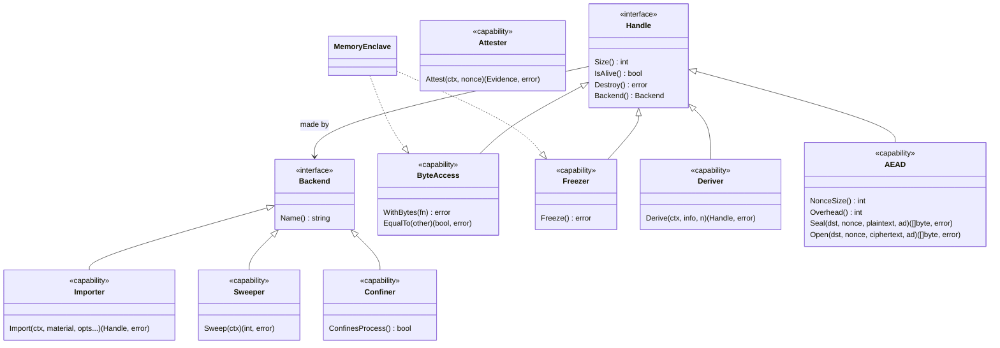

# Backends — architecture

> **Status: ACCEPTED** (coordinator, 2026-10-08, #135) · Scope: go-enclave · Last verified: 2026-10-08
> The backend seam. The declarations in [backend.go](../../backend.go) and [errors.go](../../errors.go) ship now and are canonical; every item marked **T1** is decided here and built by the hardening train (T1) in v0.9.0-alpha. Conflicts with this document are defects.

## Problem

go-enclave will hold material in hardware enclaves: TEEs (Intel TDX and SGX,
AMD SEV-SNP), secure elements and TPMs, and NVIDIA Blackwell confidential
computing. Locked, guarded, zeroized memory (`MemoryEnclave`) is the strategy
for a node that has none of them, and stands in as its enclave. The API must
not freeze, at v0.9.0-rc.1, around that one memory-backed implementation. It
needs a seam that:

- lets another backend's enclave stand where a `MemoryEnclave` stands (sealing
  into it, opening into it, sweeping it at shutdown);
- lets a caller reach a backend's own, richer interface;
- keeps the core module at one dependency (`golang.org/x/sys`), with every
  hardware backend in its own module;
- changes nothing at import: no backend registers itself.

## Shape chosen

A **small core plus optional capabilities**, discovered by type assertion, and
a **named registry** beside explicit injection.



- **Handle** is the core every enclave provides: size, liveness, destroy, and
  the backend that made it.
- **Backend** is the core every backend provides: its name.
- **Capabilities** are separate interfaces. A handle's: `ByteAccess`,
  `Freezer`, `Deriver`, `AEAD`, and the standard library's `crypto.Signer` and
  `crypto.Decrypter`. A backend's: `Importer`, `Sweeper`, `Confiner`. Either's:
  `Attester`. A capability that embeds `Handle` or `Backend` yields a usable
  value from one assertion.
- **A missing capability** is a `*CapabilityError` from any operation of this
  package that needs it: never a panic, never a fallback to another backend.
- **The registry** maps a name to a backend. The locked-memory backend is in it
  from the start, as a value; anything else is added by an explicit
  `Register(b)`. Injection (`WithBackend(b)`, **T1**) needs no registration;
  the registry exists so configuration can select a backend by name. A
  name is a configuration label, not an instance identity
  ([registry semantics](#registry-semantics)).
- **Native interfaces** are reached by type assertion, or by `As(v, target)`
  when a backend or handle wraps another and exposes it through an
  `As(any) bool` method.

## Naming

Names follow Effective Go: the package name is part of every identifier, so
nothing repeats it, and types are named for their mechanism, never their
contents (no `Secret`, `SecureBytes`).

| Name | Rationale | Rejected |
|---|---|---|
| `Handle` | What the caller holds is a reference to material a backend holds: pages for locked memory, a key slot for a secure element. `enclave.Handle` names that and claims nothing about the contents. | `Enclave` (`enclave.Enclave` stutters; revive's `exported` rule reports it). `Region` (memory only). `Key` (names the contents; not all material is a key). `Slot` (device only). |
| `Backend` | What makes and holds handles; `enclave.Backend` reads as "an enclave backend". | `Provider` (the `KeyProtector`/`RootUnsealer` seam's word, a different role). `Device` (locked memory is not one). `Strategy` (a pattern, not a mechanism). |
| `ByteAccess`, `Freezer`, `Deriver`, `Attester`, `Importer`, `Sweeper`, `Confiner` | One verb each takes the `-er` form; byte access is a property, not a verb. | `Reader` (implies `io.Reader`'s stream). |
| `AEAD` | The construction's own name, as `cipher.AEAD` uses it; `enclave.AEAD` is a handle that is one. | `Sealer` (taken by the sealing type). `Cipher` (not every cipher authenticates). |
| `Purpose`, `Algorithm`, `ImportSpec`, `ImportOption`, `WithPurpose`, `WithAlgorithm`, `NewImportSpec` | What an import asks for; the options follow `SealerOption`'s `With…` form. | `KeyUsage` (material is not always a key). |
| `Register`, `Lookup` | Their `Backend` parameter or result says what they register; compare `sql.Register`. | `RegisterBackend`, `LookupBackend` (repeat the signature). |
| `BackendNames`, `DefaultBackend`, `LockedMemoryBackendName` | Nouns need the qualifier: `enclave.Names()` would not say whose. | |
| `Capability`, `CapabilityError`, `Evidence` | Named for what they carry. | |

### Renames (T1)

T1 renames these in v0.9.0-alpha as a clean break under
`### Changed — BREAKING:`, with **no deprecated aliases**: the pre-release
policy forbids them. Until T1 the existing names stand.

| Today | After T1 | Why |
|---|---|---|
| `MemoryEnclave` | `Memory` | `enclave.MemoryEnclave` repeats the package; `enclave.Memory` is the locked-memory backend's handle. |
| `NewMemoryEnclave`, `NewMemoryEnclaveCopy`, `NewMemoryEnclaveSized` | `NewMemory`, `NewMemoryCopy`, `NewMemorySized` | Follow the type. |
| `SealedEnclave` | `Sealed` | `NewSealed` already returns it; `enclave.Sealed` matches. |
| `(*SealedEnclave).OpenWith(ctx, a)` | `(*Sealed).OpenIn(ctx, a)` | An `*Allocator` is a backend ([decision 8](#decisions)). |

## Interfaces

Exact signatures; the godoc in [backend.go](../../backend.go) is the full
contract of each method.

```go
// Core.
type Handle interface {
	Size() int        // bytes of material; 0 once destroyed
	IsAlive() bool    // still holds its material
	Destroy() error   // idempotent, waits out borrows, typed errors only
	Backend() Backend // never nil, also once destroyed
}

type Backend interface {
	Name() string // [a-z0-9][a-z0-9.-]*[a-z0-9], 1 to 64 bytes, stable
}

// Handle capabilities.
type ByteAccess interface {
	Handle
	WithBytes(fn func([]byte) error) error
	EqualTo(other []byte) (bool, error)
}

type Freezer interface {
	Handle
	Freeze() error
}

type Deriver interface {
	Handle
	Derive(ctx context.Context, info []byte, n int) (Handle, error)
}

type AEAD interface {
	Handle
	NonceSize() int // constant of the algorithm, valid after Destroy
	Overhead() int  // constant of the algorithm, valid after Destroy
	Seal(dst, nonce, plaintext, additionalData []byte) ([]byte, error)
	Open(dst, nonce, ciphertext, additionalData []byte) ([]byte, error)
}

// Handle or backend capability.
type Attester interface {
	Attest(ctx context.Context, nonce []byte) (Evidence, error)
}

type Evidence struct {
	Format string // e.g. "tdx-quote", "sev-snp-report"
	Data   []byte
}

// Backend capabilities.
type Importer interface {
	Backend
	Import(ctx context.Context, material []byte, opts ...ImportOption) (Handle, error)
}

// Import intent.
type Purpose string   // PurposeMaterial "material", PurposeWrappingKey "wrapping-key", PurposeDataKey "data-key"
type Algorithm string // AlgorithmAES256GCM "aes-256-gcm"; a backend module may name its own

type ImportSpec struct {
	Purpose   Purpose
	Algorithm Algorithm
}

type ImportOption func(*ImportSpec)

func WithPurpose(p Purpose) ImportOption
func WithAlgorithm(a Algorithm) ImportOption
func NewImportSpec(opts ...ImportOption) (ImportSpec, error)

type Sweeper interface {
	Backend
	Sweep(ctx context.Context) (held int, err error)
}

type Confiner interface {
	Backend
	ConfinesProcess() bool // this whole process runs inside the backend's boundary
}

// Registry.
const LockedMemoryBackendName = "locked-memory"

func DefaultBackend() Backend
func Register(b Backend) error
func Lookup(name string) (Backend, error)
func BackendNames() []string
func As(v, target any) bool

// Errors.
var ErrBackendNotRegistered, ErrBackendExists, ErrInvalidBackend, ErrCapabilityUnsupported error
var ErrInvalidImport, ErrInvalidNonce, ErrAEADAuthentication error

type BackendNotRegisteredError struct{ Name string }
type BackendExistsError struct{ Name string }
type CapabilityError struct {
	Backend    string
	Capability Capability
}

type Capability string // "bytes", "freeze", "sign", "decrypt", "aead", "derive", "attest", "import", "sweep", "confine"
```

`*MemoryEnclave` satisfies `Handle`, `ByteAccess` and `Freezer`, asserted at
compile time; its new `Backend()` returns `DefaultBackend()`. The default
backend's type stays unexported: callers name it by `DefaultBackend()` or
`LockedMemoryBackendName`, and the exported locked-memory backend type is
`*Allocator` (**T1**, [Allocator](#allocator-a-locked-memory-budget)).

### What each backend class provides

| Capability | On | Locked memory | TEE memory (TDX, SEV-SNP, SGX, GPU CC) | Secure element, TPM |
|---|---|---|---|---|
| `ByteAccess` | handle | yes | yes | no: material never leaves the device |
| `Freezer` | handle | yes | where the platform can protect pages | no: read-only by nature |
| `AEAD`, `crypto.Signer`, `crypto.Decrypter` | handle | no | no (byte access suffices) | per key type |
| `Deriver` | handle | no | no | where the device has a KDF |
| `Attester` | handle or backend | no | backend: platform evidence | handle: key attestation |
| `Importer` | backend | yes (**T1**: `*Allocator`) | yes | where policy allows import, per purpose |
| `Sweeper` | backend | no: `WipeAll`'s first phase sweeps every locked-memory enclave, an `*Allocator`'s included | yes | releases sessions and transient objects |
| `Confiner` | backend | no | yes, when this process runs inside the TEE | no: the process is outside the device |

### Opaque operations

Opaque signing and decryption handles implement the standard library's
shapes, so they plug into what already takes them: `tls.Certificate{PrivateKey: h}`,
`x509.CreateCertificate`. Every method of those two that can fail returns an
error, so a destroyed handle answers `ErrEnclaveDestroyed`; `Public()`, which
cannot, keeps returning the public key after `Destroy`, since a public key is
not secret. `AEAD` and `Deriver` are this package's own: no standard shape
exists for derivation, and `cipher.AEAD`'s `Seal` has no error result, so a
destroyed or failing device key could only panic, fail silently or stay
usable. `AEAD` keeps `cipher.AEAD`'s arguments and adds the error;
`NonceSize` and `Overhead` are constants of the algorithm and stay valid
after `Destroy`. The seam's opaque shapes take no `context.Context`; a backend
bounds those device calls with its own configured timeout. A hardware module that needs
context-taking signing or decryption, or key agreement such as ECDH, exposes
it as its native interface, reached through `As`.

### Attestation

`Attester` is one interface with two placements: a backend attests the
platform (a TDX quote, an SEV-SNP report), a handle attests one key (TPM2
certification, a secure element's key attestation). `Evidence` is a `Format`
name the backend documents plus the raw `Data`. The nonce is 1 to 64 bytes,
the report-data size of TDX and SEV-SNP; a backend that cannot bind every byte
refuses rather than truncating. Verification belongs to the format's verifier,
outside this module, which never parses evidence.

### A missing capability

A type assertion answers "does it have it" with `ok`. An operation of this
package that needs a capability (sealing from a handle, opening into a
backend) returns `&CapabilityError{Backend: h.Backend().Name(), Capability: …}`
before touching anything, matching `ErrCapabilityUnsupported`. It never
substitutes another backend: a sealed value opened into a secure element that
cannot import fails; it does not quietly open into locked memory.

A handle's capabilities are known only once the handle exists, so each
operation checks them where it obtains the handle: after `Import`, `Derive`
or a module's own constructor returns, before the handle is used. A
`Backend` declares nothing about the handles it will make, so a backend
passed to a constructor can be refused eagerly only for a backend capability
it lacks, such as `Importer`, never for a handle capability.

### Importing with a purpose

A raw byte slice cannot tell arbitrary 32-byte material from an AES-256 key,
and a secure element needs an object class, an algorithm and a usage policy
to accept either. `Import` therefore takes an `ImportOption` set, which the
backend resolves with `NewImportSpec` (`ErrInvalidImport` for a nil option, a
missing or unknown purpose, or an algorithm the purpose does not take). The
purpose fixes the contract of the handle `Import` returns:

| Purpose | Algorithm | Who imports it | The handle |
|---|---|---|---|
| `PurposeMaterial` (`"material"`) | none | `OpenIn` (**T1**), for arbitrary opened material | `ByteAccess`; the view holds exactly the material; `Size` is its length. |
| `PurposeWrappingKey` (`"wrapping-key"`) | required, e.g. `AlgorithmAES256GCM` | `NewSealer(…, WithBackend(b))` (**T1**), for the wrapping key and each KEK | `AEAD` for that algorithm (wraps in the device), or `ByteAccess` (wraps in this process), or both; `Size` is the key length; a device that enforces usage limits it to wrapping. |
| `PurposeDataKey` (`"data-key"`) | required | a caller holding a DEK in a backend | As `PurposeWrappingKey`, with usage limited to encrypting data. |

- **Refusals.** A backend that cannot hold a purpose and algorithm refuses
  with `*CapabilityError{Capability: CapabilityImport}`, and material whose
  length the algorithm does not take is `ErrInvalidImport`, both before any
  device work. `material` is wiped on every path.
- **Persistence.** Every import is transient: it lives until `Destroy` or the
  backend's `Sweep`, and is never persisted on the device. Persistent
  provisioning is a module's own API.
- **Room to grow.** Usage and persistence attributes join `ImportSpec` as new
  fields with new `With…` options, each defaulting to what the purpose implies
  and to transient, so an existing call keeps its meaning.
- **A handle that misses its purpose's contract** is refused where it is
  obtained: the operation destroys it and returns a `*CapabilityError` naming
  the capability the purpose needed (`CapabilityBytes` for material,
  `CapabilityAEAD` for a key with neither).

## Registry semantics

| Question | Answer |
|---|---|
| Concurrency | One `sync.RWMutex`. `Register` takes it for writing, `Lookup` and `BackendNames` for reading. `Name()` is called before the lock, so backend code never runs under it. |
| Duplicate name | `*BackendExistsError{Name}`, matching `ErrBackendExists`. The name is never rebound. Registering the same backend twice is also a duplicate: telling "the same backend" apart would need `==` on arbitrary dynamic types, which panics for uncomparable ones. |
| Unknown name | `*BackendNotRegisteredError{Name}`, matching `ErrBackendNotRegistered`. |
| Invalid backend | `ErrInvalidBackend` for a nil or typed-nil backend or an invalid name, as `ErrInvalidProvider` treats a nil provider: a lost configuration step, never a request for the default. |
| Default | `"locked-memory"` (`LockedMemoryBackendName`), in the map from the start as a static value, not through `init`. It cannot be registered again. |
| Name | A configuration and registry label, not an instance identity. Two instances may share a name (two devices of one module; an `*Allocator` and the default), and at most one is registered. A handle's identity is the value `h.Backend()` returns; `Lookup(h.Backend().Name())` returns it only when the registered instance made `h`. |
| Unregister | None, so a configuration binding is stable: once `main` registers a backend, every `Lookup` of that name, from any subsystem and at any time, resolves to the same instance, and a component that read `backend: tdx` at startup cannot later be handed a different backend under it. A backend's lifetime is its owner's: closing it is the module's own API, after which its handles report destroyed; the registry keeps only the reference. Tests use injection, or a unique name. |
| Cost | A map read under a read lock. Selection happens at configuration time, never on a borrow. |

Registration is optional. A backend passed by `WithBackend(b)` (**T1**) is used
without being registered; the registry is for selecting by name, as a
configuration file does (`backend: tdx`). An injected backend's name may
equal a registered one's; nothing compares them.

## How the existing types map onto the seam

| Type | Role in the seam |
|---|---|
| `MemoryEnclave` | The locked-memory backend's handle: `Handle`, `ByteAccess`, `Freezer`. |
| `Allocator` | The locked-memory backend's budget, and in **T1** the locked-memory backend type itself (below). |
| `Sealer`, `SealedEnclave` | Open into a chosen backend; seal from any handle with byte access. |
| `KeyProtector`, `RootUnsealer`, `HealthReporter` | Unchanged; a separate seam a hardware module may also implement. |
| `WipeAll` | Sweeps locked memory, then a snapshot of the registered `Sweeper`s other than the default ([below](#wipeall-and-the-shutdown-sweep)). |
| `HardenProcess` | The locked-memory backend's process hardening; takes over the import-time `RLIMIT_CORE` change. |

### `Allocator`: a locked-memory budget

The budget is **specific to locked memory**. Its unit is page-rounded locked
bytes (`LockedSize`), its ceiling is `RLIMIT_MEMLOCK`, and `ForceLimit` and
`TransferTo` are defined against that ceiling. Other backends' scarce resources
have other units: SGX EPC pages, a secure element's key slots, a TPM's
transient-object slots. A generic budget would either fake one unit for all
or need a per-backend cost function, and its `NewAllocatorWithinRLimit` would
mean nothing outside locked memory. A backend with a scarce resource budgets
it in its own module, in its own unit.

**T1:** `*Allocator` becomes the locked-memory backend: it implements `Backend`
(name `"locked-memory"`) and `Importer`, so a budgeted locked memory is
injected like any other backend, `WithBackend(a)`. `(*MemoryEnclave).Backend()`
then returns the admitting `*Allocator`, or `DefaultBackend()` for an
unbudgeted enclave. An `*Allocator` is not registered: the registered
`"locked-memory"` stays the unbudgeted default, so `Lookup("locked-memory")`
for a budgeted enclave returns the default, not its `*Allocator`; the name is
a label ([registry semantics](#registry-semantics)).

### `Sealer` and `SealedEnclave`

**T1:**

- **Open into a backend.** `(*SealedEnclave).Open(ctx)` keeps returning a
  locked-memory enclave, the common case, statically typed. Beside it,
  `OpenIn(ctx, b Backend) (Handle, error)` opens into any backend and replaces
  `OpenWith(ctx, a)`, since `*Allocator` is a backend. For locked memory
  (`DefaultBackend()` or an `*Allocator`) it decrypts in place, as today. For
  any other backend that implements `Importer` it decrypts into a locked
  scratch enclave, left writable (never frozen) because the importer wipes
  it, and imports from inside a borrow of it:

  ```go
  imp := b.(enclave.Importer) // checked above
  var h enclave.Handle
  err := scratch.WithBytes(func(p []byte) error {
  	var err error
  	h, err = imp.Import(ctx, p, enclave.WithPurpose(enclave.PurposeMaterial))
  	return err // Import wiped p on every path
  })
  scratch.Destroy() // its pages are already zero
  ```

  The plaintext still never reaches the heap. A backend without `Importer` is
  a `*CapabilityError{Capability: CapabilityImport}` before anything is
  decrypted; a returned handle without `ByteAccess` is destroyed and refused
  with `CapabilityBytes`.
- **The sealer's own keys.** `NewSealer(…, WithBackend(b))` chooses where a
  `ModeRootKey` sealer holds its wrapping key and KEKs (default: locked
  memory), importing each with `PurposeWrappingKey` and
  `AlgorithmAES256GCM`. A key handle that implements `AEAD` wraps inside the
  device; one with only `ByteAccess` wraps in-process, as today. `NewSealer`
  refuses a `b` without `Importer` eagerly, but it cannot refuse one whose
  handles will lack both: no handle exists at construction, and a `Backend`
  declares nothing about future handles. That check runs where each key is
  imported, when the sealer first unseals its root or creates a KEK, which
  destroys the handle and fails with `*CapabilityError{Capability:
  CapabilityAEAD}`.
- **B1, seal from an enclave.** `(*Sealer).SealFrom(ctx, src Handle)` and
  `NewSealedFrom(ctx, src Handle)`, named to pair with `Seal` and `NewSealed`.
  `src` needs `ByteAccess` (else `CapabilityBytes`), is read under its own
  borrow, and is left intact: not destroyed and, unlike `Seal`'s `data`, not
  wiped, since it may be frozen. Material that never leaves its device cannot
  be sealed here; exporting it wrapped is the device's own feature, reached
  through its native interface.
- **B1, `ErrSealSourceReadOnly`.** `Seal` and `NewSealed` wipe `data` on every
  path. A `data` that is a view into a frozen enclave (passed from inside
  `WithBytes`) makes that wipe fault, and a fault on a protected page kills the
  process; it is not a recoverable panic. `Seal` will check `data` against the
  frozen mappings in the ledger and refuse it with the new sentinel
  `ErrSealSourceReadOnly`, wiping nothing, before any key is touched. The
  remedy it names is `SealFrom`.

### `KeyProtector`, `RootUnsealer` and `HealthReporter`

The provider seam and the backend seam answer different questions. A provider
protects the keys sealing uses (wrap a DEK, unseal a root); a backend holds
material and hands out handles. Neither embeds the other, so neither is
duplicated: a hardware module that does both, such as a TPM that seals a root
under a PCR policy and also holds signing keys, implements both, on one value
or on two values from one constructor. A sealer takes them independently:
`WithKeyProtector(p)` or `WithRootUnsealer(r)` for its provider,
`WithBackend(b)` for its keys. `HealthReporter` stays a provider capability:
it reports whether a sweep took in-process key material the provider depends
on, which is a sealing question.

### `WipeAll` and the shutdown sweep

**T1:** `WipeAll(ctx)` runs in two phases, inside the one sweep slot it
already takes:

1. **Locked memory**, as today: every `MemoryEnclave` in the ledger, an
   `*Allocator`'s included. The built-in backend does not implement
   `Sweeper`, so it is never swept twice and `WipeAll` never recurses.
2. **Registered sweepers.** Under the registry's read lock, `WipeAll`
   snapshots every registered backend other than the default that implements
   `Sweeper`, sorted by name, and releases the lock before calling any of
   them, so backend code never runs under it and a `Sweep` may call `Lookup`.
   A backend registered after the snapshot is not swept by this call; the
   next `WipeAll` includes it. Each `Sweep(ctx)` runs in turn, under the same
   `ctx`; a failing one does not stop the rest.

`ctx` means for each `Sweep` what it means for `WipeAll`: it bounds only
waiting, everything not held is released even under a done or nil `ctx`, a
nil `ctx` never waits and never panics, and a `ctx` ending mid-sweep is not an
error. `WipeAll` passes `ctx` through unchanged, `nil` included, so every
`Sweeper` handles a nil `ctx` itself ([backend.go](../../backend.go)). The
count it returns is the sum of every held count.

Backend failures extend the existing `*SweepError`; there is no second error
type, so one `errors.As(err, &se)` covers the whole sweep:

```go
type SweepError struct {
	Corrupt  int                   // unchanged
	Unwiped  int                   // unchanged
	Backends []BackendSweepFailure // T1: one entry per backend whose Sweep failed, in name order
}

// BackendSweepFailure is a record, not an error type.
type BackendSweepFailure struct {
	Backend string // the backend's name
	Err     error  // what its Sweep returned
}

func (e *SweepError) Unwrap() []error // T1: every Backends[i].Err
```

`Is` keeps matching `ErrEnclaveCorrupted` and `ErrReleasedWithoutWipe` from the
counts; `Unwrap` makes each backend's own typed error reachable with
`errors.Is` and `errors.As`. `WipeAll` returns a `*SweepError` when any of the
three is non-zero, and `Error()` adds one line per failed backend, its name
quoted.

`Sweep` releases what lives for the process: TEE memory, device sessions,
transient objects. It never deletes persistent device material, such as a key
provisioned in a secure element before the process started; that is the
module's explicit API. A backend that was injected but never registered is its
owner's to sweep, by calling its `Sweep` directly.

### `HardenProcess` (M1)

**T1:** the import-time `RLIMIT_CORE` change moves into `HardenProcess`, so
importing the package changes no process state (BREAKING: `CoreDumpsDisabled`
then reports what `HardenProcess` did, and `ProcessHardening` gains a field for
the limit). Hardening stays a package function specific to locked memory, not
a backend capability. That backend's protection is relative to the process, so
dumps and same-uid readers are its threat. A TEE's protection holds without
it, because the host is outside the boundary; hardening still limits readers
inside the guest. Process-wide state is the binary's choice, made once in
`main`; a backend that needs device setup does it in its own constructor,
which `main` also calls explicitly.

## The approved review items

| Item | How it fits the seam |
|---|---|
| **B1** | `SealFrom`/`NewSealedFrom` take the core `Handle` and require `ByteAccess`; `ErrSealSourceReadOnly` refuses a frozen view passed to `Seal`. See [Sealer](#sealer-and-sealedenclave). |
| **B3** | Every handle's dynamic type is a pointer to shared state, so every copy of a `Handle` is the same enclave and one `Destroy` reaches all. Handle structs carry a `noCopy` field, so `go vet`'s copylocks check reports a dereferenced copy, in this module and in backend modules alike. `backendtest` checks the pointer kind. The refactor itself is **T1**. |
| **B4** | Below. |
| **M1** | See [`HardenProcess`](#hardenprocess-m1). |
| **L6** | No function or method of the seam panics on the inputs its contract covers: live and destroyed handles, a nil or typed-nil backend, an invalid name, a nil or typed-nil `As` value, a bad `As` target, invalid import options and a missing capability all return typed errors or `false`. A nil receiver is outside the `Handle` contract; `*MemoryEnclave` accepts one as its own guarantee. A panic raised by a backend's own `As` method is the backend's defect and is not recovered. Out-of-tree backends are held to it by `backendtest`. |

### B4: generalising `KeyScheduleErasure`

Every in-process AES operation leaves its key schedule on the heap
([sealing](../sealing/architecture.md#what-each-mode-buys-against-a-live-memory-reader)).
Three things close that exposure, and a backend can supply two of them:

| How | Mechanism | Reported by |
|---|---|---|
| **Erase** | `runtime/secret` erases the schedule at the next collection. | `KeyScheduleErasure()`, a property of the build. |
| **Confine** | The process runs inside a TEE whose boundary includes its heap (TDX, SEV-SNP, a GPU CC VM, SGX under a library OS): a schedule left there is unreadable from outside. | The sealer's backend implements `Confiner` and `ConfinesProcess()` reports true (`CapabilityConfine`). |
| **Offload** | The AEAD runs in the device: the key handle implements `AEAD` and its key never enters the process. | The handle's type (`CapabilityAEAD`). |

`KeyScheduleErasure()` keeps its meaning. **T1** adds the approved opt-in
strict mode:

| Name | Declaration |
|---|---|
| Option | `WithRequireKeyScheduleErasure() SealerOption` |
| Sentinel | `ErrKeyScheduleExposed`: "enclave: a sealing key's AES key schedule would reach the heap without being erased" |
| Typed error | `type KeyScheduleExposedError = nameError[keyScheduleExposed]`; `Name` is the key class: `"wrapping-key"`, `"kek"` or `"dek"` |

With the option, `NewSealer` refuses a configuration in which any key class's
schedule would be exposed, naming the first such class. A class is covered
when the build erases (`KeyScheduleErasure()`), the sealer's backend confines
(`Confiner`), or, for the wrapping key and the KEKs, their handles offload
(`AEAD`). DEKs are generated per value in the process, so only erasure or
confinement covers them.

**Offload alone never satisfies the option.** Offloading the wrapping key and
KEKs still leaves every DEK's schedule in-process, so a sealer without
erasure or confinement is refused (naming `"dek"`) whatever its keys'
handles do. Strict mode therefore needs a build with erasure or a confining
backend; offload narrows the exposure but never closes it. That is also why
the check needs no handle: erasure is a property of the build and
confinement a backend capability, both known at construction, and offload
cannot change the outcome. It runs once, in `NewSealer`; nothing on the seal
and open path changes.

## Lifetime and ownership

- **Ownership.** Whoever constructed a handle owns it and destroys it. A
  backend is owned by whoever constructed it; registering it lends the
  registry a reference, not ownership.
- **Destroy** is idempotent, safe for concurrent use, waits out in-flight
  borrows and device operations, and returns only typed errors. A nil error
  means the material is gone. After it: `IsAlive` is false, `Size` is 0,
  every capability method that returns an error returns `ErrEnclaveDestroyed`
  (one sentinel for every backend), the methods without one keep reporting
  their non-secret constants (`AEAD`'s `NonceSize` and `Overhead`, the public
  key from `Public()`), and `Backend()` is unchanged.
- **Nil receivers** are outside the `Handle` contract: a handle is bound to
  the backend instance that made it, which a nil pointer cannot recover.
  A type that supports one documents it, as `*MemoryEnclave` does (every
  method, `Destroy` included). A backend documents which errors
  leave material held and whether `Destroy` again resumes, as `MemoryEnclave`
  does; held material stays in the backend's `Sweep`.
- **What Destroy deletes.** What the handle owns. A handle over persistent
  device material it did not create (a loaded, provisioned key) releases its
  reference, not the key.
- **Freeze and read-only.** `Freezer` is a capability. A handle whose material
  is final when it is returned (moved, copied, imported, opened) is frozen
  where the backend can freeze, as locked memory is today; opaque handles are
  read-only by nature and do not implement `Freezer`.
- **Borrows.** A `WithBytes` view is valid only inside `fn`, on every backend.
- **No panics** (L6): see the table above.

## An out-of-tree backend

A sketch of `go-enclave-tdx`: a backend for code running inside an Intel TDX
trust domain. Guest memory is already private to the TD, so its handles are
locked-memory enclaves; what it adds is attestation and confinement. It
depends on go-enclave, never the reverse.

```go
package tdx // module github.com/jeremyhahn/go-enclave-tdx

// Backend is the TDX backend. Its own methods are its native interface.
type Backend struct {
	quotes *configfsTSM // /sys/kernel/config/tsm/report
}

// New opens the TD's quote interface. Nothing happens at import.
func New() (*Backend, error) { /* … */ }

func (b *Backend) Name() string { return "tdx" }

// ConfinesProcess satisfies enclave.Confiner: New succeeded only inside a TD,
// whose private memory holds this whole process.
func (b *Backend) ConfinesProcess() bool { return true }

// Import satisfies enclave.Importer: the material goes into locked memory
// inside the TD. A locked-memory handle has ByteAccess, which meets every
// purpose's contract, so any valid spec is accepted.
func (b *Backend) Import(ctx context.Context, material []byte, opts ...enclave.ImportOption) (enclave.Handle, error) {
	if _, err := enclave.NewImportSpec(opts...); err != nil {
		enclave.Wipe(material)
		return nil, err
	}
	if err := ctx.Err(); err != nil {
		enclave.Wipe(material)
		return nil, err
	}
	m, err := enclave.NewMemoryEnclave(material)
	if err != nil {
		return nil, err
	}
	return &Handle{m: m, b: b}, nil
}

// Attest satisfies enclave.Attester with a TD quote over nonce.
func (b *Backend) Attest(ctx context.Context, nonce []byte) (enclave.Evidence, error) { /* … */ }

// Report is native: a raw TDREPORT, which the seam does not model.
func (b *Backend) Report(reportData [64]byte) (*Report, error) { /* … */ }

// Handle wraps a locked-memory enclave and reports the TDX backend instance
// that made it. Its methods dereference h: a nil *Handle is outside the
// contract.
type Handle struct {
	noCopy noCopy
	m      *enclave.MemoryEnclave
	b      *Backend
}

func (h *Handle) Size() int                             { return h.m.Size() }
func (h *Handle) IsAlive() bool                         { return h.m.IsAlive() }
func (h *Handle) Destroy() error                        { return h.m.Destroy() }
func (h *Handle) Backend() enclave.Backend              { return h.b }
func (h *Handle) WithBytes(fn func([]byte) error) error { return h.m.WithBytes(fn) }
func (h *Handle) EqualTo(o []byte) (bool, error)        { return h.m.EqualTo(o) }
func (h *Handle) Freeze() error                         { return h.m.Freeze() }

// As exposes the wrapped enclave, so enclave.As reaches *enclave.MemoryEnclave.
func (h *Handle) As(target any) bool { return enclave.As(h.m, target) }

var (
	_ enclave.Importer   = (*Backend)(nil)
	_ enclave.Attester   = (*Backend)(nil)
	_ enclave.Confiner   = (*Backend)(nil)
	_ enclave.ByteAccess = (*Handle)(nil)
	_ enclave.Freezer    = (*Handle)(nil)
)
```

A program registers it explicitly, selects it by name, and reaches the native
interface:

```go
b, err := tdx.New()
if err != nil {
	return err // not in a TD: fall back deliberately, or stop
}
if err := enclave.Register(b); err != nil {
	return err
}

be, err := enclave.Lookup(cfg.Backend) // "tdx" from configuration
if err != nil {
	return err
}
var t *tdx.Backend
if enclave.As(be, &t) {
	report, err := t.Report(bindingFor(peer))
	// …
}
```

## Conformance: `backendtest`

`providertest.TestProvider(ctx, cfg)` holds every provider to the seam's
contract; `backendtest.TestBackend(ctx, cfg)` does the same for backends. It is
designed here and built by T2 or a follow-up, in this module, with no new
dependency. Like `providertest` it is one call that returns an error naming
every property that failed, does not import `testing`, fails closed (a check
that cannot run returns an error matching `ErrNotMeasured` unless the config
accepts that with a reason), and refuses an ended context with `ErrAborted`.

Backend capabilities and handle capabilities are declared apart, because a
secure element's signing, decryption, AEAD and attestation keys have
different method sets: the backend declares its own, and each kind of handle
is a named case with its own factory and its own exact list. `Attester` may
appear in either list, so platform evidence and key attestation are told
apart.

```go
type Config struct {
	// New returns a fresh backend; it is called once per check.
	New func() (enclave.Backend, error)
	// BackendCapabilities is exactly what the backend itself claims:
	// CapabilityImport, CapabilitySweep, CapabilityConfine, CapabilityAttest.
	BackendCapabilities []enclave.Capability
	// Handles are the kinds of handle the backend makes; at least one.
	Handles []HandleCase
	// SkipResidueSweep, if set, is the reason the residue sweep may not run.
	SkipResidueSweep string
	Logf func(format string, args ...any)
}

// HandleCase is one kind of handle. Exactly one of New and Import is set.
type HandleCase struct {
	// Name is unique among the cases and names the case in every failure.
	Name string
	// New returns a live handle of b, such as a key the device generates.
	New func(ctx context.Context, b enclave.Backend) (enclave.Handle, error)
	// Import, for an Importer, is the option set the suite imports
	// ImportSize random bytes with; the case then also checks the purpose's
	// handle contract.
	Import     []enclave.ImportOption
	ImportSize int
	// Capabilities is exactly what this case's handles claim: CapabilityBytes,
	// CapabilityFreeze, CapabilitySign, CapabilityDecrypt, CapabilityAEAD,
	// CapabilityDerive, CapabilityAttest.
	Capabilities []enclave.Capability
}

func TestBackend(ctx context.Context, cfg Config) error
```

A backend capability in a handle list, or the reverse, is a configuration
error, as are duplicate case names.

What it checks:

1. **Core.** `Name` is valid and stable. For every case, on live and
   destroyed handles only: the dynamic type is a pointer; `Backend()` is
   never nil and is the backend under test (by `As`); `Size` and `IsAlive`
   agree with the material; `Destroy` is idempotent and leaves `IsAlive`
   false, `Size` 0, every capability method that returns an error returning
   `ErrEnclaveDestroyed`, and `NonceSize`, `Overhead` and `Public()`
   unchanged. No nil receiver is manufactured.
2. **Capabilities are exact**, per list: each capability the backend or a
   case claims is found by type assertion on the backend or on that case's
   handles, and each unclaimed one is not, so a claim cannot drift from the
   method set (as `providertest` fails an under-claimed mode list).
3. **Per capability.** `ByteAccess`: the view holds the material, `EqualTo` is
   correct. `Importer`: the source is wiped on every path, an ended context
   is refused before any device work with an error matching `ctx.Err()`,
   invalid options are `ErrInvalidImport`, and an imported case's handle
   meets its purpose's contract. `Attester`, on the backend or a case:
   evidence differs for different nonces, a 65-byte nonce is refused.
   `crypto.Signer`/`crypto.Decrypter`: round trips against `Public()`.
   `AEAD`: `Open` reverses `Seal`, a wrong-length nonce is
   `ErrInvalidNonce`, and a flipped bit is `ErrAEADAuthentication`.
   `Sweeper`: every handle of every case is dead afterwards and the held
   count is 0, also under a nil and a done `ctx`, neither of which is an
   error. `Confiner`: the answer is stable.
4. **Concurrency.** `Destroy` races borrows and operations under `-race`, with
   no panic and no borrow seeing freed material.
5. **Residue (Linux).** After `Destroy` of a `ByteAccess` handle, the
   `internal/memscan` sweep finds no copy of the material, preceded by a
   control that proves the sweep can see it.

## Decisions

Settled by the coordinator, 2026-10-08 (#135).

1. **Allocator:** the budget stays specific to locked memory and `*Allocator`
   becomes the locked-memory backend (**T1**), because scarce resources differ
   in unit from backend to backend.
2. **Renames:** `MemoryEnclave` → `Memory`, `SealedEnclave` → `Sealed`, their
   constructors and `OpenWith` → `OpenIn` land in T1 as a clean break with no
   deprecated aliases, because the pre-release policy forbids aliases.
3. **Opaque operations:** the seam names the standard `crypto.Signer` and
   `crypto.Decrypter`, because they plug into existing callers, and its own
   `AEAD`, because `cipher.AEAD`'s `Seal` cannot return an error; a hardware
   module exposes context-taking variants through `As`.
4. **Unregister:** none, because a configuration binding must be stable: a
   name resolves to one instance for the process's life. A name is a label,
   not an instance identity.
5. **Sweep failures:** `*SweepError` gains `Backends []BackendSweepFailure` and
   `Unwrap() []error` (**T1**), with no second error type, so one `errors.As`
   covers the sweep.
6. **Hardening:** `HardenProcess` stays specific to locked memory, because
   only that backend's protection depends on process state.
7. **B4 strict mode:** `WithRequireKeyScheduleErasure()`, `ErrKeyScheduleExposed`
   and `KeyScheduleExposedError` (**T1**); confinement is the `Confiner`
   capability (`CapabilityConfine`, declared now) and offload is `AEAD`
   (`CapabilityAEAD`), because each names the mechanism that removes the
   exposure. Offload alone never satisfies the option, because DEKs stay
   in-process.
8. **Opening:** `OpenIn(ctx, b)` beside `Open(ctx)` (**T1**), because the common
   case keeps its static locked-memory type.
9. **Smaller points:**
   - `Evidence` is a backend-documented `Format` plus raw `Data`, with a 1 to
     64-byte nonce, because that is the report-data size of TDX and SEV-SNP and
     this module never parses evidence.
   - `LockedMemoryBackendName` keeps its name, because it says whose name it is.
   - The default backend's type stays unexported, because callers need only
     `DefaultBackend()` and `*Allocator` is the exported locked-memory type.
   - ECDH and other key agreement stay native interfaces reached through `As`,
     because no standard library shape fits every device.
10. **Design review** (Codex, settled by the coordinator 2026-10-08):
    - **AEAD:** the package's `AEAD` replaces `cipher.AEAD`; `Seal` and `Open`
      return errors, `NonceSize` and `Overhead` are constants valid after
      `Destroy`, and `Public()` keeps returning the public key. The lifecycle
      rule covers methods that return an error, because the others cannot
      report one.
    - **Nil receivers:** not part of the `Handle` contract, because a nil
      pointer cannot name the instance that made it; `*MemoryEnclave` keeps
      its own nil safety.
    - **Import:** `Import` takes an `ImportOption` set naming a purpose and an
      algorithm, and each purpose fixes the handle's contract, because a raw
      slice cannot tell material from a key; capability checks run where the
      handle is obtained, because `NewSealer` has none to check.
    - **`As`:** a typed-nil `v` is refused before reflection, because its
      `As` method would run on a nil receiver; a custom `As` that panics is
      not recovered.
    - **Names:** a name is a configuration label; the `Lookup` invariant
      holds only for handles of the registered instance.
    - **Sweep:** `WipeAll` snapshots the registered non-default `Sweeper`s
      under the lock and calls them after releasing it, because backend code
      must never run under the registry lock.
    - **Conformance:** backend and handle capabilities are declared apart,
      with named handle cases, because one device's keys differ in method set.

## Component boundaries

| Concern | File |
|---|---|
| Interfaces, capabilities, `Evidence`, import intent (`Purpose`, `Algorithm`, `ImportSpec`, its options), registry, `As`, the locked-memory backend value | [backend.go](../../backend.go) |
| Sentinels (`ErrInvalidImport`, `ErrInvalidNonce`, `ErrAEADAuthentication` among them), `BackendNotRegisteredError`, `BackendExistsError`, `CapabilityError` | [errors.go](../../errors.go) |
| `(*MemoryEnclave).Backend` | [enclave.go](../../enclave.go) |
| Hardware backends | their own modules, never this one |

## Rejected alternatives

| Alternative | Why rejected |
|---|---|
| Backends register themselves in `init`, as `database/sql` drivers do | An import with a side effect; ruled out with M1. |
| One wide interface with every operation, unsupported ones returning an error | Every backend implements methods it cannot serve, and a caller cannot ask what a handle can do without calling it. |
| A `Capabilities() []Capability` method | It can disagree with the method set; the type assertion is the truth. |
| Name the core `Enclave` | Stutters. |
| A generic `Allocator` over every backend, `NewAllocator(WithBackend(b))` | Decision 1. |
| Deprecated aliases for the renamed types | Decision 2. |
| `Unregister` | Decision 4. |
| A second error type for backend sweep failures | Decision 5. |
| A `Hardener` capability that `HardenProcess` calls on registered backends | Decision 6. |
| `Open(ctx, opts ...OpenOption)` returning `Handle` | Decision 8: every existing caller would need an assertion to read what it opened. |
| Context-taking copies of `crypto.Signer` and `crypto.Decrypter` in the seam | Decision 3. |
| Key the registry by type | Configuration carries names. |
| Require every backend to implement `As` | Boilerplate for the common unwrapped case, where a type assertion suffices. |
| Use `errors.As` for backends | It panics on a bad target and is about error chains. |
| `cipher.AEAD` as the AEAD capability, or exempting it from the lifecycle rule | Its `Seal` has no error result: a destroyed device key could only panic, fail silently or stay usable. Decision 10. |
| Nil-receiver safety on every `Handle` | A nil pointer cannot recover the instance that made it (two devices, an `*Allocator`). Decision 10. |
| `Import(ctx, material)` with no intent | A secure element cannot tell material from a key, nor which algorithm and usage. Decision 10. |
| A `Backend` method declaring its future handles' capabilities | A second list that can drift from the method set, as `Capabilities()` would. |
| Recovering a panic from a custom `As` | Hides a backend defect; `As` refuses only the malformed inputs it can see. |
| Calling `Sweep` under the registry lock | Backend code under the lock could deadlock on `Lookup` and stalls `Register`. Decision 10. |
| One `NewHandle` and one flat capability list in `backendtest` | Cannot express a device whose keys differ in method set. Decision 10. |

## Scope fence

No hardware backend, no hardware-specific code, and no new dependency in this
module. This issue declares the seam and changes no behaviour; the
`WithBackend` options, the `Allocator`, `Sealer` and `SealedEnclave` wiring,
`OpenIn`, `SealFrom`, strict mode, the `SweepError` extension, the B3 handle
refactor and the renames are T1's, and `backendtest` is T2's or a
follow-up's.
