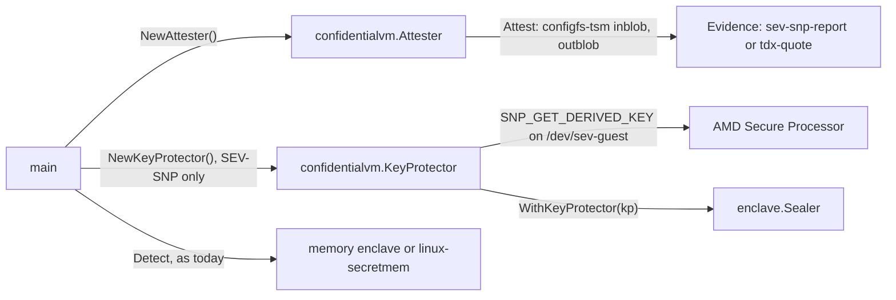

# Confidential VM support — architecture (proposal)

> **Status: REFERENCE** · Scope: go-enclave · Last verified: 2026-11-12
> Proposal — not implemented. A design for the future feature in [SPEC](../SPEC.md#features) row `confidential-vm`. No code exists, and every identifier here is a proposal, not an API you can call. The [open questions](#open-questions) mark a recommended answer; none is decided.

## Problem

The memory enclave keeps material in `mlock`'d, guarded pages
([platform contract](../memory-enclave/engineering.md#platform-contract)), and
[linux-secretmem](../linux-secretmem/architecture.md) takes those pages out of
the kernel's direct map. Both defend against the kernel and processes of the
machine the program runs on. When that machine is a virtual machine, neither
defends against what sits below it:

- the hypervisor and the host kernel, which map all guest RAM and can read it,
  write it, remap it or replay an older copy of a page;
- the host's devices, which can DMA into guest RAM;
- anyone with physical access to the DIMMs or the memory bus (cold boot,
  interposers), who reads plaintext.

A confidential VM (CVM) closes those paths in hardware. AMD SEV-SNP (Secure
Encrypted Virtualization with Secure Nested Paging) and Intel TDX (Trust
Domain Extensions) both encrypt the whole guest with a key the host never
holds, refuse host access to the guest's private pages, and let the guest ask
the platform for signed evidence of what it was launched with.

A program in a CVM needs two things from go-enclave:

- **Evidence** that it runs in a CVM, over a nonce its peer chose, so a relying
  party or a key broker can decide to trust it.
- **Sealing bound to the guest**, so a data key protected in this guest opens
  only in a guest with the same measurement on the same chip. SEV-SNP offers
  this through a derived key. TDX does not.

## Why not a backend

A backend is worth having when its handles hold material somewhere the
process's own memory does not reach. A CVM protects every page of the guest
against the host, and adds nothing inside the guest: the guest kernel, guest
root and other guest processes read a process's memory exactly as they would
outside a CVM. A "CVM backend" handle would be a memory enclave in ordinary
guest memory, the same thing the memory enclave or linux-secretmem already
gives. It would add nothing per handle.

So confidential-vm is not a backend. It does not implement `Backend`,
`Importer` or `Prober`, and `Detect` never selects it. The program keeps
whichever backend it already uses (linux-secretmem where the guest kernel
allows `memfd_secret`, the memory enclave otherwise), and every page of it is
encrypted against the host by the CVM. What confidential-vm adds is the two
things the CVM can do that a backend seam does not model per handle:
attestation of the guest, and on SEV-SNP a sealing key bound to it.

## Threat model

| Path to the material | Memory enclave or linux-secretmem, plain VM | The same, in a CVM |
|---|---|---|
| Hypervisor or host kernel reads guest RAM | plaintext | ciphertext: encrypted with the guest's key, which the host never holds |
| Host writes, remaps or replays a guest page | possible | refused (SNP's Reverse Map Table; the TDX module) |
| Host device DMA into guest RAM | possible | refused for private pages |
| DIMM or bus read, cold boot | plaintext | ciphertext |
| Guest kernel, guest root, `ptrace` in the guest | as the backend allows | unchanged: a CVM does not isolate inside the guest |
| Swap, core dump, hibernation in the guest | as the backend allows | unchanged; the guest's swap is a virtual disk the host reads, so `mlock` and `MADV_DONTDUMP` matter more, not less |
| Evidence of the environment | through the host's platform ([SPEC boundaries](../SPEC.md#boundaries)) | the CVM's own: an SNP attestation report or a TD quote over a caller's nonce |

It does not stop the guest kernel or code inside the process, side channels
the platform's TCB version does not mitigate, or material the program sends
out of the guest. Network and disk I/O pass through shared (unencrypted)
bounce buffers, so anything written to a socket or a file leaves the
encrypted boundary in whatever form the program wrote it.

## Shape proposed

- **A nested module, `backends/confidentialvm`** (package `confidentialvm`),
  requiring the root module and `golang.org/x/sys`, never the reverse
  ([Q1](#q1-where-the-module-lives)). It sits beside `backends/tpm`, which
  likewise ships a `KeyProtector` and no backend.
- **Linux on amd64 only.** On any other target a stub compiles whose
  constructors return the typed unavailable error, so a cross-platform `main`
  that links the module builds everywhere.

### Attestation: a standalone `Attester`

`NewAttester() (*Attester, error)` returns a value that implements
`enclave.Attester` and nothing else of the seam. It succeeds only inside an
SEV-SNP or TDX guest whose kernel has configfs-tsm reports.

Why standalone, and not a capability added to the memory enclave or the
secretmem backend when they run in a CVM:

- **`Attester` does not embed `Backend`.** It is a one-method interface
  ([backend.go](../../backend.go)), so a value outside any backend satisfies it
  with no change to the seam. A caller that takes an `enclave.Attester` takes
  this one unchanged.
- **The evidence describes the guest, not a backend's handles.** The same
  report covers every page of the process, whatever backend holds the
  material. Hanging it on one backend would suggest it says something about
  that backend.
- **A backend's capabilities are fixed by its type.** A memory enclave that
  is an `Attester` only on some hosts would claim a capability it cannot
  serve elsewhere, which the conformance suite refuses
  ([backend-conformance](../backend-conformance/architecture.md)).
- **The root module carries no hardware code.** configfs-tsm and the SNP
  guest device belong in a nested module, as the TPM and TrustZone code does
  ([SPEC boundaries](../SPEC.md#boundaries)).

The doc comment on `Attester` names two placements today, a backend and a
handle. This adds a third, a standalone value; the comment gains one sentence
with the code. No signature changes.

### Sealing: an SEV-SNP `KeyProtector`

`NewKeyProtector(opts ...Option) (*KeyProtector, error)` returns an
`enclave.KeyProtector` for `ModePerOperation`, given to a sealer with
`enclave.WithKeyProtector(kp)`. It succeeds only in an SEV-SNP guest with
`/dev/sev-guest`. In a TDX guest it returns `ErrDerivedKeyUnavailable`:
TDX has no derived sealing key ([below](#tdx-has-no-sealing-key)).

## Kernel and platform interfaces

### configfs-tsm reports (SEV-SNP and TDX)

`CONFIG_TSM_REPORTS`, Linux 6.7, mounted at `/sys/kernel/config/tsm/report`.
A caller `mkdir`s an entry, writes up to 64 bytes of report data to `inblob`,
and reads the evidence from `outblob`. The same interface serves both
platforms:

| Attribute | SEV-SNP guest | TDX guest |
|---|---|---|
| `provider` | `sev_guest` | `tdx_guest` |
| `outblob` | the 1184-byte `ATTESTATION_REPORT`, signed by the chip's VCEK (or a cloud provider's VLEK) | a TD quote, signed by the Quoting Enclave's key under the platform's PCK chain |
| `auxblob` | the host's certificate table, if the host supplies one | not used |
| `privlevel`, `privlevel_floor` | the VMPL the report is requested at; the floor is the guest kernel's own | not used |
| `service_provider` (6.10) | `svsm`, to reach an SVSM's attestation | not used |

`generation` counts writes to an entry, so a reader detects another writer
that raced it. On SEV-SNP the `sev-guest` driver is the provider, so the
report is the one `SNP_GET_REPORT` returns. On TDX the kernel turns the
request into the GetQuote hypercall, which the VMM forwards to the host's
Quote Generation Service (QGS); a quote too large for the kernel's buffer
fails the read with `EFBIG`. Entries are root's as the kernel creates them; a
non-root service needs access granted by the deployment.

### SEV-SNP

- **Hardware.** AMD EPYC 7003 (Milan) or later; SNP needs Zen 3. EPYC 7002
  (Rome) has SEV and SEV-ES only, which this feature refuses. The BIOS enables
  SME, SEV-SNP and the IOMMU, and ASP firmware with SNP support is loaded by
  the host kernel. Its version is part of the TCB the report carries.
- **The host** is untrusted by design. It is listed because the test fixture
  is one ([test strategy](#test-strategy)): Linux 6.11 or later with KVM's SNP
  support (`kvm_amd` with `sev_snp=1`), QEMU 9.1 or later with KVM (the
  `sev-snp-guest` object; never TCG), and OVMF built for SNP.
- **`/dev/sev-guest`** (`CONFIG_SEV_GUEST`, Linux 5.19). The driver binds only
  when SNP is active and holds the VM platform communication keys (VMPCKs)
  that encrypt and authenticate each guest request. Its ioctls are
  `SNP_GET_REPORT`, `SNP_GET_EXT_REPORT` and `SNP_GET_DERIVED_KEY`; the device
  is root-only by default. Only `SNP_GET_DERIVED_KEY` has no configfs-tsm
  equivalent, so the `KeyProtector` uses the device and the `Attester` does
  not.
- **VMPLs and the SVSM.** SNP divides a guest into four VM Privilege Levels;
  VMPL0 is the most privileged. Without an SVSM the guest kernel runs at
  VMPL0. With one (COCONUT-SVSM at VMPL0, Linux 6.11 or later in the guest)
  the guest kernel runs lower, and the SVSM provides a vTPM and its own
  attestation protocol. Every report carries the VMPL that requested it
  ([Q5](#q5-vmpl-and-the-svsm)).

### TDX

- **Hardware.** An Intel Xeon with TDX (5th Gen Xeon Scalable or Xeon 6),
  with TME-MK and TDX enabled in the BIOS and the TDX module loaded. Quotes
  need SGX enabled with Intel's DCAP stack on the host: the TD Quoting
  Enclave, QGS, and a provisioning certificate cache (PCCS). Without them the
  TD gets reports but no quotes.
- **The host:** Linux 6.16 or later with KVM TDX support, and a VMM that
  forwards GetQuote to QGS (QEMU 10.1 with `quote-generation-socket`).
- **`/dev/tdx_guest`** (`CONFIG_TDX_GUEST_DRIVER`, Linux 6.2) returns a
  TDREPORT, which is MAC'd for the local platform only. A remote peer cannot
  check it, so it is never `Evidence`.

## Attestation flow

Roles follow the RATS architecture ([RFC 9334](https://www.rfc-editor.org/rfc/rfc9334)):

- **Attester:** the guest. `Attest(ctx, nonce)` checks `ctx` and the nonce,
  creates its own configfs-tsm entry, writes the nonce to `inblob`
  ([Q3](#q3-how-the-nonce-reaches-the-report)), reads `outblob`, checks that
  `generation` counts exactly its own write, and removes the entry on every
  path. Concurrent calls never share an entry.
- **Evidence:** `Evidence{Format, Data}` with `Data` exactly as `outblob`
  returned it. `Format` is `sev-snp-report` or `tdx-quote`, the names the
  `Evidence` doc comment already uses ([Q4](#q4-evidence-format-names)).
  - An SNP report carries the launch `MEASUREMENT`, the guest `POLICY` (debug,
    migration agent, SMT), the requesting `VMPL`, the TCB versions,
    `CHIP_ID`, `HOST_DATA` and `REPORT_DATA`, signed with ECDSA P-384.
  - A TD quote carries MRTD, RTMR0 to RTMR3, MRCONFIGID, MROWNER,
    MROWNERCONFIG, the TD's attributes (DEBUG among them), the TDX module's
    identity and TCB level, and REPORTDATA.
- **Verifier:** outside go-enclave, which never parses or appraises evidence
  ([SPEC boundaries](../SPEC.md#boundaries)). For SNP it checks the chain VCEK
  → ASK → ARK (from `auxblob` or AMD's Key Distribution Service), the
  signature, `REPORT_DATA` and its policy on measurement, guest policy, VMPL
  and minimum TCB. For TDX it checks the PCK chain against Intel's collateral,
  REPORTDATA, the DEBUG bit, the TCB status and the measurements.
- **Relying party:** the peer that chose the nonce and acts on the verdict,
  for example a key broker that releases a key to the guest.

**What the measurement covers.** On SNP the launch measurement covers the
initial guest image: the firmware, and the kernel, initrd and command line
only when the firmware measures them (OVMF's hashes table for a direct-boot
kernel) or an SVSM vTPM records them. On TDX, MRTD covers the initial image
and the RTMRs what the firmware and kernel extend into them. A deployment that
boots an unmeasured kernel attests the firmware, not the code that runs the
program. The user doc will say so.

## SEV-SNP derived-key `KeyProtector`

`SNP_GET_DERIVED_KEY` asks the ASP for a 32-byte key derived from a root key
the guest never sees, mixed with fields of the guest's own launch state the
request selects. The same request in the same guest on the same chip returns
the same key; a guest with another measurement, or on another chip, gets
another key.

| Request field | Meaning | Proposed |
|---|---|---|
| `root_key_select` | VCEK (per chip and TCB) or VMRK (shared with a migration agent) | VCEK ([Q6](#q6-derived-key-binding)) |
| `guest_field_select` | Which of guest policy, image ID, family ID, measurement, guest SVN and TCB version are mixed in | measurement and guest policy, plus TCB version |
| `vmpl` | The VMPL to derive for; never more privileged than the caller's | the guest kernel's own |
| `guest_svn`, `tcb_version` | Values to derive for; the firmware refuses values above the current ones | recorded at construction |

**Protect(ctx, key)** checks `ctx`, derives the SNP key into locked memory,
seals `key` with AES-256-GCM under it with a random 96-bit nonce, wipes the
derived key, and returns a blob: a version byte, the request fields above,
the nonce, and the ciphertext with its tag. The header is the GCM additional
data.

**Unprotect(ctx, blob, key)** reads the header, derives the key the header
names, and opens into `key`. A changed header derives a different key or
fails the additional data, so any blob this guest's `Protect` did not make
fails with an error matching `enclave.ErrSealedAuthentication`, as the
[provider contract](../sealing/engineering.md#blob-contract-v1) requires. A
refused derivation (no device, VMPCK disabled, a TCB above the current one)
is the provider's own typed error, never `ErrSealedAuthentication`.

**What it binds, and what that costs.**

- A blob opens only in a guest with the selected fields on the same chip. A
  new guest image, a guest policy change or a move to another host makes it
  unopenable. That is the protection, and the caller must plan for it: keep
  another path to the data key, or treat the sealed values as tied to this
  guest image.
- Recording the TCB version at construction lets a blob survive a firmware
  upgrade (the firmware still derives for an older TCB) and fail after a
  rollback below it.
- The derived key exists in this process for the length of one call, in
  locked guest memory, and is wiped before the call returns. Each seal and
  open is one guest request to the ASP ([Q7](#q7-per-call-derivation)).

It passes `providertest.TestProvider`
([provider conformance](../provider-conformance/user.md)).

### TDX has no sealing key

The TDX module gives a TD no sealing key and no key derivation. A TD that
needs a key after attestation gets it from a key broker service (KBS) that
appraises its quote first. That broker and its protocol are the caller's,
outside go-enclave: confidential-vm gives the caller the quote, and the
caller's KBS client does the rest.

## Failure modes

Every failure is a typed error, named for the mechanism. The names are
proposals for the module's own `errors.go`; go-enclave's errors are reused
where their meaning holds.

| Failure | Where | Proposed error |
|---|---|---|
| Not a CVM: no `tsm/report` (`ENOENT`), configfs not mounted, `provider` neither `sev_guest` nor `tdx_guest`; an SEV or SEV-ES guest | `NewAttester` | `*TSMReportError{Op, Cause}` matching `ErrTSMReportUnavailable`; `Op` names the step (`mkdir`, `provider`, `inblob`, `outblob`) |
| Not permitted (`EACCES`, `EPERM`) | `NewAttester`, `Attest` | the same, `Cause` the errno |
| The platform refuses the request (`EIO`; a disabled VMPCK; TDX with no QGS on the host; `EFBIG`) | `Attest` | the same |
| Another writer moved `generation` | `Attest` | the same, `Cause` `ErrTSMReportConflict`; never a report of unknown provenance |
| A nonce empty or over 64 bytes | `Attest` | `enclave.ErrInvalidNonce`, before any request |
| No `/dev/sev-guest` (`ENOENT`: a TDX guest or not a CVM), refused (`EACCES`), or `SNP_GET_DERIVED_KEY` failed | `NewKeyProtector`, `Protect`, `Unprotect` | `*DerivedKeyError{Op, Cause}` matching `ErrDerivedKeyUnavailable` |
| A blob not made by this guest's `Protect`, truncated or altered | `Unprotect` | matches `enclave.ErrSealedAuthentication` |
| Not Linux on amd64 | constructors | `ErrTSMReportUnavailable` or `ErrDerivedKeyUnavailable` with no cause |
| `ctx` ended | every call taking one | an error matching `ctx.Err()`, as the provider contract requires |

## Test strategy

The feature is proven inside a real SEV-SNP guest. No simulator, emulator or
mock ASP stands in for it, because only a real chip signs a report that
verifies to AMD's root and derives a key bound to a real measurement. QEMU is
the VMM driving KVM on that CPU; it emulates nothing the module touches.

1. **Record the host.** Before the first run, record the CPU family and model,
   the BIOS settings above, the ASP firmware's SNP API version, and the host
   kernel, QEMU and OVMF versions.
2. **A fresh guest per run**, from a pinned, measured image (OVMF plus a
   direct-boot kernel, initrd and command line covered by the launch
   measurement), guest policy debug off, no migration agent. The module's
   integration tests run inside it as root. The expected measurement is
   computed from the image at build time and handed to the test.
3. **Attestation.** `Attest` over a fresh nonce returns a report that an
   established `sev-snp-report` verifier accepts: the chain to the product's
   ARK, the signature, `REPORT_DATA` against the nonce, the expected
   measurement, debug off and the requesting VMPL ([Q8](#q8-the-verifier-the-tests-use)).
   The report fails verification against another nonce. Many concurrent
   `Attest` calls each return a report bound to their own nonce and leave no
   entry behind.
4. **The `KeyProtector`.** `providertest.TestProvider` passes. A blob from one
   guest image opens after a reboot of the same image, and fails with
   `ErrSealedAuthentication` in a guest booted from an image with a changed
   command line (another measurement).
5. **The host cannot read the material.** The test holds a random needle in a
   memory enclave. On the host, as root, a scan of the QEMU process's address
   space (`/proc/<pid>/maps` and `/proc/<pid>/mem`, the scan
   `internal/memscan` does in-process) must not find it. The control: the same
   image booted as a plain KVM guest, where the same scan must find it.
6. **Refusals.** On the host itself, in a plain KVM guest and in an SEV-ES
   guest, `NewAttester` returns `ErrTSMReportUnavailable` naming the step and
   `NewKeyProtector` returns `ErrDerivedKeyUnavailable`. In the SNP guest as a
   non-root user, both fail with `EACCES` as the cause.

The TDX path of `Attest` shares all code but the `provider` check and the
format name. It is proven the same way, inside a TD, before it is documented
as supported. Unit tests cover only what touches no device: the blob layout,
the nonce checks, and error texts and unwrapping.

## Open questions

### Q1: where the module lives

- **A nested module, `backends/confidentialvm`** (recommended), beside
  `backends/tpm` and `backends/armtrustzone`, released with the repository.
- **A repository of its own:** released on its own, but split from the
  conformance suites it is tested against.

### Q2: what `NewAttester` checks

- **`provider` and one report round trip** (recommended): it reads `provider`,
  requests one report over a random nonce and checks its length, so a guest
  that cannot attest (a disabled VMPCK, a TDX host without QGS) fails at
  construction, not at the first `Attest`.
- **Presence only** (the `tsm/report` directory and `provider`): no round
  trip, but it accepts a guest that then fails every `Attest`.

### Q3: how the nonce reaches the report

- **The nonce, zero-padded to 64 bytes** (recommended): what `inblob` takes
  and what AMD's and Intel's verifiers compare, so a relying party checks it
  with no construction of ours. A short nonce and the same nonce with trailing
  zeros give one report data; a relying party that cares sends 64 bytes, and
  the user doc will say so.
- **SHA-512 of the nonce:** binds its length, but every verifier must know a
  construction go-enclave designed.

### Q4: evidence format names

- **`sev-snp-report` and `tdx-quote`** (recommended): the names the `Evidence`
  doc comment already gives as examples.
- **The kernel's `provider` values, `sev_guest` and `tdx_guest`:** invented by
  nobody, but they name the kernel driver, not the format.

### Q5: VMPL and the SVSM

- **Support a guest under an SVSM** (recommended): reports are requested at
  `privlevel_floor`, which the report records, and the derived key for the
  guest kernel's own VMPL. The verifier's policy says which VMPL it accepts.
  The SVSM's vTPM is a TPM, reached through `backends/tpm`.
- **VMPL0 guests only:** simpler, but refuses the deployments where an SVSM
  gives the guest a measured boot through its vTPM.

### Q6: derived-key binding

- **VCEK root, measurement and guest policy, TCB version recorded at
  construction** (recommended): binds the blob to this guest image and this
  chip, and survives a firmware upgrade.
- **Also the image ID, family ID or guest SVN:** lets a deployment that signs
  its images with an ID block keep blobs across image updates of one family.
  An `Option`, once a deployment needs it.
- **VMRK root:** survives migration through a migration agent, which this
  feature does not support.

### Q7: per-call derivation

- **Derive on every `Protect` and `Unprotect`** (recommended): the derived key
  lives only for one call. Each seal and open costs one ASP round trip.
- **Derive once and hold the key in locked memory:** one round trip per
  process, but the derived key then lives in the process as long as the
  provider does. That is a `RootUnsealer`, a different sealing mode, and a
  separate decision.

### Q8: the verifier the tests use

- **An established verifier as a test-only dependency** (recommended): for
  SNP, `github.com/google/go-sev-guest`'s `verify` package; for TDX, Intel's
  Quote Verification Library. Each checks the chain and signature as the
  specification owner defines them.
- **A verifier written for these tests:** no new dependency, but the test
  would prove a verifier nobody else runs.

### Q9: key-schedule confinement

[Key-schedule exposure](architecture.md#key-schedule-exposure) counts a
process as confined when the sealer's backend implements `Confiner`. Inside a
CVM every AES key schedule on the heap is encrypted against the host, but
with no CVM backend nothing reports it, so strict key-schedule mode in a CVM
needs a build with `runtime/secret` erasure.

- **Leave it so** (recommended for the first change): confinement stays a
  backend capability, and a CVM deployment that wants strict mode uses an
  erasing build.
- **Report CVM confinement another way:** a sealer option or a standalone
  `Confiner`. Either changes the seam (`Confiner` embeds `Backend` today)
  and needs its own design.

## Rejected alternatives

- **A CVM backend** whose handles are memory enclaves in guest memory. It adds
  nothing per handle ([why not a backend](#why-not-a-backend)).
- **One backend per platform** (`amd-sev`, `intel-tdx`). The same, twice, with
  the configfs-tsm client written twice.
- **A simulator, emulator or mock ASP or TDX module for tests.** Only real
  hardware signs evidence that verifies to the vendor's root or derives a
  bound key, so a stand-in proves nothing.
- **SEV or SEV-ES without SNP.** Memory is encrypted, but nothing stops the
  host remapping or replaying pages, and the guest cannot ask for a report at
  run time. `NewAttester` refuses them.
- **A TDREPORT as `Evidence`.** Only the local platform can check its MAC.
- **Intel's `libtdx_attest` through cgo, or a vsock link to QGS.** configfs-tsm
  is the upstream path, needs no network setup in the guest, and keeps the
  module free of cgo.
- **A key broker client in go-enclave.** Key release after attestation is a
  protocol between the caller and its broker.
- **Parsing or appraising evidence.** Outside the module's scope; the length
  and `generation` checks are a sanity check of its own request, not an
  appraisal.

## Standards and specifications

Each is cited at the revision this proposal was written against. The
implementation confirms the latest revision, pins it, and copies each into
`docs/reference/` with the code ([standards first](../reference/README.md)).

| Document | Used for |
|---|---|
| [RFC 9334](https://www.rfc-editor.org/rfc/rfc9334), RATS Architecture | Attester, Evidence, Verifier and Relying Party roles |
| AMD [SEV Secure Nested Paging Firmware ABI Specification](https://www.amd.com/content/dam/amd/en/documents/epyc-technical-docs/specifications/56860.pdf), publication 56860, revision 1.55 | `MSG_REPORT_REQ`, `MSG_KEY_REQ`, `ATTESTATION_REPORT`, guest policy, TCB version |
| AMD [SEV-ES Guest-Hypervisor Communication Block Standardization](https://www.amd.com/content/dam/amd/en/documents/epyc-technical-docs/specifications/56421.pdf), publication 56421, revision 2.03 | the guest request path and the certificate table |
| AMD [Secure VM Service Module for SEV-SNP Guests](https://www.amd.com/content/dam/amd/en/documents/epyc-technical-docs/specifications/58019.pdf), publication 58019, revision 1.00 | the SVSM calling convention and its attestation protocol |
| AMD [VCEK Certificate and KDS Interface Specification](https://www.amd.com/content/dam/amd/en/documents/epyc-technical-docs/specifications/57230.pdf), publication 57230 | the VCEK and VLEK certificates and the Key Distribution Service |
| AMD [AMD64 Architecture Programmer's Manual Volume 2](https://www.amd.com/content/dam/amd/en/documents/processor-tech-docs/programmer-references/24593.pdf), publication 24593, section 15.36 | the RMP, page validation and VMPLs |
| [Intel TDX Module ABI and Guest-Hypervisor Communication Interface](https://www.intel.com/content/www/us/en/developer/tools/trust-domain-extensions/documentation.html) | TDREPORT, ATTRIBUTES.DEBUG, GetQuote |
| [Intel TDX DCAP Quoting Library API](https://download.01.org/intel-sgx/latest/dcap-latest/linux/docs/Intel_TDX_DCAP_Quoting_Library_API.pdf), revision 0.8, appendices 4 and 5 | the quote format in `Evidence.Data` |
| Linux: [configfs-tsm-report](https://git.kernel.org/pub/scm/linux/kernel/git/torvalds/linux.git/tree/Documentation/ABI/testing/configfs-tsm-report), [The Definitive SEV Guest API Documentation](https://docs.kernel.org/virt/coco/sev-guest.html), [TDX guest API](https://docs.kernel.org/virt/coco/tdx-guest.html), [Intel TDX guest support](https://docs.kernel.org/arch/x86/tdx.html), [AMD Memory Encryption](https://docs.kernel.org/arch/x86/amd-memory-encryption.html) | the kernel interfaces above, cited at the tree; the implementation pins a tag |

## What it does not do

No backend, no `Detect` participation, no code in the root module and no
change to a seam signature. No protection inside the guest beyond the
backend the program already uses, no evidence verification, no key broker
client, no TDX sealing, no SVSM vTPM, no live migration, and nothing off
Linux on amd64.
