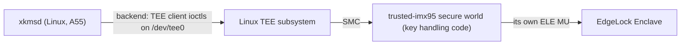

# imx-edgelock-enclave backend — architecture (proposal)

> **Status: NORMATIVE** · Scope: go-enclave · Last verified: 2026-10-27
> Conflicts with this document are defects. A planned feature ([SPEC](../SPEC.md#features)): no code exists, and no code is written until the owner decides the [open questions](#open-questions); each answer then replaces its options here. The feature gets its own `docs/imx-edgelock-enclave/` folder with its code, when it gains sources and tests in `scripts/features.map`.

## Problem

go-xkms's `hsm-appliance` feature runs xkmsd on an NXP FRDM-IMX95-PRO board
(i.MX 95) as a dedicated HSM appliance. On that board xkmsd's keys can sit in
the memory enclave, or in [linux-secretmem](../linux-secretmem/architecture.md) once that row
lands, but both keep the material in Linux's own memory: a kernel exploit, a
DMA-capable peripheral or a cold-boot attack on the board's DRAM reaches it.

The i.MX 95 carries the EdgeLock Enclave (ELE), a security subsystem with its
own core, memory, key store and true random number generator, which the
application cores reach only through a messaging unit (MU). Keys generated or
imported into it are used in it and never return to Linux. The secure world
that drives the ELE, and the secure key handling code, live in the device
repository trusted-imx95, not in any Go project. The backend proposed here
binds the Linux side (xkmsd) to that secure world through trusted-imx95's
interface, so `Detect` on the appliance selects it over the memory enclave and
a sealer's wrapping key never exists in Linux memory after import. Nothing
device-specific is implemented in go-enclave: the split is the SE052F row's,
with the driver and secure world in the device repository and the Go backend
here ([ROADMAP dependencies](../../ROADMAP.md#dependencies)).

## What imx-edgelock-enclave adds over the memory enclave and linux-secretmem

| Path to the material | Memory enclave | linux-secretmem | imx-edgelock-enclave |
|---|---|---|---|
| Swap, core dump, `fork` child | closed | closed | closed: the material is not in the process |
| `/proc/<pid>/mem`, `ptrace` peek, `process_vm_readv` | readable | refused | nothing to read: the process holds a key reference |
| Kernel direct map, kernel arbitrary read | mapped | removed while allocated | the key is in the ELE's memory, outside the kernel's reach |
| A DMA-capable peripheral, cold boot on DRAM | reachable | reachable | the key is not in DRAM in the clear |
| Code inside the process (an injected library) | reads the material | reads the material | can use the key while it runs, cannot extract it |
| Attestation | through the host's platform | through the host's platform | its own: platform evidence from the secure world, rooted in the ELE |

It does not stop an attacker who controls xkmsd from using a key while it
controls it, and it does not protect material the program holds outside a
handle. The material passes through the process once, at `Import`; a key the
secure world generates never does.

## Hardware, firmware and kernel requirements

Sources: [Linux TEE subsystem userspace API](https://www.kernel.org/doc/html/v6.12/userspace-api/tee.html)
and [`include/uapi/linux/tee.h`](https://git.kernel.org/pub/scm/linux/kernel/git/torvalds/linux.git/tree/include/uapi/linux/tee.h?h=v6.12)
(Linux v6.12); the [GlobalPlatform TEE Client API Specification v1.0](https://globalplatform.org/specs-library/tee-client-api-specification/)
(GPD_SPE_007); the [OP-TEE documentation](https://optee.readthedocs.io/en/latest/)
(the release trusted-imx95 pins); NXP's *i.MX 95 Applications Processor
Reference Manual* (IMX95RM) and *i.MX 95 Security Reference Manual* (IMX95SRM),
at the revision trusted-imx95 pins; NXP's Linux side of the ELE MU,
[`drivers/firmware/imx/se_ctrl.c`](https://github.com/nxp-imx/linux-imx/tree/lf-6.12.y/drivers/firmware/imx)
on `lf-6.12.y`, and its userspace library [imx-secure-enclave](https://github.com/nxp-imx/imx-secure-enclave).
The ELE's command ABI is in IMX95SRM, which NXP distributes under NDA: it is
trusted-imx95's to implement, never go-enclave's, so go-enclave neither cites
its contents nor copies it.

### The path from xkmsd to the ELE

The recommended transport ([Q1](#q1-the-transport-to-trusted-imx95)) is the
Linux TEE subsystem: the backend opens a session to trusted-imx95's trusted
application and invokes its commands, and only the secure world addresses the
ELE's messaging unit. The Linux side of the ELE MU that NXP's `se_ctrl` driver
exposes to non-secure Linux is then not used by go-enclave at all; whether
trusted-imx95 leaves it enabled is that repository's decision.

### What the board must run

- **Linux on arm64**, built with `CONFIG_TEE` and the TEE driver for
  trusted-imx95's secure world (`CONFIG_OPTEE` if it is OP-TEE), exposing the
  client device `/dev/tee0`. No other GOOS or GOARCH runs it (owner,
  2026-10-15).
- **trusted-imx95's secure world and trusted application** at a release tag,
  with whatever normal-world helper that secure world needs (OP-TEE's
  `tee-supplicant` for its secure storage, an ELE key-store storage daemon);
  trusted-imx95's image provides them, go-enclave does not.
- **Access for xkmsd's user** to `/dev/tee0` (a `tee` group or a udev rule in
  trusted-imx95's image), and no seccomp or LSM rule that refuses `ioctl` on it.
- **A closed device lifecycle** for production: AHAB secure boot enforced, so
  the secure world that answers is the one trusted-imx95 signed. The backend
  does not enforce it ([Q7](#q7-device-lifecycle-at-the-probe)); the evidence
  reports it.

### The kernel interface the backend uses

Everything below is the generic TEE subsystem ABI of `tee.h`; none of it is
specific to the i.MX 95, and the backend speaks it in pure Go through
`golang.org/x/sys/unix`, without cgo or libteec.

- `open("/dev/tee0", O_RDWR|O_CLOEXEC)`, then `TEE_IOC_VERSION` to check the
  implementation ID and that the driver is a GlobalPlatform client.
- `TEE_IOC_OPEN_SESSION` to trusted-imx95's trusted application UUID with
  `TEE_IOCTL_LOGIN_USER`, so the kernel computes the client identity from the
  calling uid (`tee_session_calc_client_uuid`) and the secure world can bind
  keys to xkmsd's user.
- `TEE_IOC_INVOKE` for each command, with memory references in shared memory
  from `TEE_IOC_SHM_ALLOC`, wiped before release.
- `TEE_IOC_CLOSE_SESSION`, and `close`.

### What trusted-imx95 must provide

The seam go-enclave needs from trusted-imx95's interface. Each item is that
repository's to design and implement; go-enclave implements only the Linux-side
client of it.

1. **A published, versioned command ABI** at each release tag: the trusted
   application's UUID, every command ID, its parameter layout, and its result
   codes. A version command (no key access) returns the ABI version and the
   ELE's firmware version and lifecycle state.
2. **Session-scoped transient keys.** Every key go-enclave makes lives until it
   is destroyed or its session closes, and is never persisted; a release of all
   of a session's keys serves `Sweep`. Persistent provisioning is the
   appliance's own business, reached through go-xkms.
3. **Key generation in the device**: AES-256 for `AEAD`, and ECDSA P-256 and
   P-384 for `crypto.Signer`, each returning an opaque key identifier.
4. **Import of a wrapping key or data key** (AES-256) under a usage policy the
   secure world enforces (wrap only, or encrypt data only), for
   `PurposeWrappingKey` and `PurposeDataKey`.
5. **AES-256-GCM seal and open in the device** with associated data, the open
   failing with a distinct result code on a tag mismatch; **ECDSA signing** of a
   digest; **key destruction**.
6. **Platform attestation** over a caller nonce of 1 to 64 bytes, binding every
   byte, in a named, documented evidence format with a published verification
   procedure and root ([Attestation](#attestation)). Key attestation where the
   ELE firmware supports it.
7. **The board image**: a Linux image for the FRDM-IMX95-PRO with the TEE
   driver, the secure world, the trusted application, its helpers and the
   device permissions above, at the same release tag.
8. **Concurrency limits**: how many sessions and keys a client may hold, and
   the result code when a limit is reached.

## Attestation

Every environment must be attestable (owner, 2026-10-14), and this backend
attests its own: the backend implements `Attester`
([attestation](architecture.md#attestation)).

- **Platform evidence** (`Attester` on the backend): the secure world produces
  evidence over the caller's nonce that names the device (the ELE's device
  identity, certified by NXP), its lifecycle state, the ELE firmware version
  and the measurement of the secure world and trusted application, signed by a
  key the ELE holds. `Evidence.Format` names trusted-imx95's format; `Data` is
  its bytes unchanged ([Q6](#q6-the-evidence-format)).
- **Key evidence** (`Attester` on a handle), where the ELE firmware can attest
  a key: evidence that the key was generated in, or imported into, the ELE with
  its usage policy.
- **Who verifies.** go-enclave never parses or appraises evidence. The relying
  party verifies it: go-xkms's `hsm-appliance` for the appliance's own startup
  checks and for its clients, with go-trusted-platform's verifier, against the
  NXP device-certificate root and trusted-imx95's published reference values.
- **Nonce.** 1 to 64 bytes, as the seam fixes. If trusted-imx95's format binds
  fewer bytes, the backend refuses a longer nonce with `ErrInvalidNonce`, never
  truncating.

## Shape proposed

Recommended answers to the open questions are marked; none is decided.

- An out-of-tree backend in its own Go module (Q2), registered by `main` like
  any other; nothing registers it at import. It depends on go-enclave, never
  the reverse, and its only dependencies are go-enclave and `golang.org/x/sys`.
- It reaches trusted-imx95 over the Linux TEE subsystem (Q1), with a pure-Go
  GlobalPlatform TEE client shared with [arm-trustzone](../SPEC.md#features),
  which binds to the OP-TEE secure world over the same kernel interface.
- **The backend** implements `Backend`, `Importer`, `Sweeper`, `Attester` and
  `Prober`; not `Confiner`, since xkmsd runs outside the secure world. Its
  constructor opens `/dev/tee0` and one session, and checks the ABI version.
- **Handles** are references to keys in the ELE: a key identifier, the session
  that owns it, and the key's public part where it has one. They implement the
  secure-element column of [what each backend class provides](architecture.md#what-each-backend-class-provides):
  never `ByteAccess` or `Freezer`; `AEAD` for an AES-256-GCM key; `crypto.Signer`
  for an ECDSA key; `Attester` where key attestation is available. `Destroy`
  destroys the key in the device and wipes the handle's state; every later
  method returns `ErrEnclaveDestroyed`, and `Public()` keeps answering.
- **Import** (Q5) takes `PurposeWrappingKey` and `PurposeDataKey` with
  `AlgorithmAES256GCM` and returns an `AEAD` handle; `PurposeMaterial` is
  refused with a `*CapabilityError{Capability: CapabilityImport}`, since the
  material would need byte access. So `NewSealer(…, WithBackend(b))` holds the
  wrapping key and each KEK in the ELE, and `OpenIn` into this backend is
  refused before any device work ([a missing capability](architecture.md#a-missing-capability)).
- **Native interface**, reached through `enclave.As`: `GenerateSigner(curve)`,
  `GenerateAEAD()`, `Random(ctx, n)` from the ELE's TRNG, the version
  command's result, and `Connect(endpoint)` for the conformance harness.
- **Device calls** are bounded by the backend's configured timeout, since the
  seam's opaque shapes take no `context.Context`
  ([opaque operations](architecture.md#opaque-operations)).
- Rank above arm-trustzone's (Q3); the probe runs only from `Detect` (Q4).
- It passes `backendtest` on the board ([test plan](#test-plan-on-the-real-hardware)).
- Off Linux arm64 a stub compiles whose constructor and probe return the typed
  unavailable error, so a `main` that registers it builds everywhere.

## Failure modes

Every failure is a typed error. The names are proposals for the backend's own
module, named for the mechanism (the TEE client session and its commands), not
the contents; go-enclave's existing errors are reused where their meaning
holds. If Q1 chooses another transport, the first three rows are renamed for
that mechanism.

| Failure | Where | Proposed error |
|---|---|---|
| `/dev/tee0` absent, refused or not a GlobalPlatform client (`ENOENT`, `EACCES`, `ENODEV`, wrong `TEE_IOC_VERSION`) | probe, construction | `*TEEDeviceError{Path, Cause}` matching `ErrTEEDeviceUnavailable`; `Cause` is the `*os.SyscallError` |
| Session refused: trusted application absent, login refused, out of sessions | probe, construction | `*TEESessionError{UUID, Code, Origin}` matching `ErrTEESessionUnavailable`; `Code` and `Origin` are the TEE Client API's result and return origin |
| The trusted application's ABI version is not one the backend speaks | probe, construction | `*ABIVersionError{Got, Want}` matching `ErrABIVersionUnsupported` |
| A command fails in the secure world (key store full, policy refusal, ELE error) | any device call | `*TEECommandError{Command, Code, Origin}` matching `ErrTEECommandFailed` |
| A command outlives the backend's timeout | any device call | the same, its `Cause` `context.DeadlineExceeded` |
| Off Linux arm64 | probe, construction | `ErrTEEDeviceUnavailable` with no cause |
| A purpose or algorithm the backend does not hold, `PurposeMaterial` included | `Import`, `OpenIn` | the existing `*CapabilityError` |
| Material of a length the algorithm does not take | `Import` | the existing `ErrInvalidImport` |
| GCM tag mismatch on open | `AEAD.Open` | the existing `ErrAEADAuthentication` |
| A nonce outside 1 to 64 bytes, or longer than the format binds | `Attest` | the existing `ErrInvalidNonce` |
| A handle used after `Destroy` | every handle method but `Public` | the existing `ErrEnclaveDestroyed` |
| A key not destroyed, or a session not closed, in `Sweep` | `Sweep` | the existing `*CleanupError` |

A probe failure reaches `main` wrapped in `Detect`'s `*ProbeError`, and the
next-ranked backend is selected. Construction never falls back to another
backend: a backend that probed usable and then fails returns its error
([a missing capability](architecture.md#a-missing-capability)).

## Test plan on the real hardware

A hardware backend is proven on the real part only (owner, 2026-10-17): the
plan names the board and nothing stands in for it.

- **The part.** An NXP FRDM-IMX95-PRO booted from trusted-imx95's board image
  at a pinned release tag (`TRUSTED_IMX95_TAG`), in the closed lifecycle, with
  its secure world and trusted application.
- **The runner.** The board is a self-hosted runner. The test binary is built
  in the devcontainer (`GOOS=linux GOARCH=arm64`, `-tags=integration,imx95`,
  `go test -c`) and run on the board by `make integration-test-imx-edgelock-enclave`,
  which passes `GO_ENCLAVE_IMX95_ENDPOINT` (the TEE device path) in. It refuses
  while `TRUSTED_IMX95_TAG` is empty.
- **The harness**, `test/integration/enclave/imx_edgelock_enclave_test.go`
  (`//go:build integration && imx95`), follows the
  [arm-trustzone harness](../backend-conformance/engineering.md#the-arm-trustzone-harness):
  the backend module supplies `imx_edgelock_enclave_register_test.go`, which
  registers it under `imx-edgelock-enclave` and supplies `VerifyEvidence` from
  the relying party's verifier; the harness finds it with `enclave.Lookup`,
  `Config.New` calls `Connect(endpoint)` for a fresh backend per check, and
  `TestBackendConformance_ImxEdgeLockEnclave` runs `backendtest.TestBackend`
  with `CapabilityImport`, `CapabilitySweep`, `CapabilityAttest` and
  `CapabilityProbe`, and handle cases `wrapping-key` (imported,
  `PurposeWrappingKey`, `AlgorithmAES256GCM`, `CapabilityAEAD`) and
  `signing-key` (`GenerateSigner` P-256, `CapabilitySign`, plus
  `CapabilityAttest` where key attestation exists).
- **The environment is attested.** Every run first takes the board's platform
  evidence over a fresh nonce and verifies it before any other check, and logs
  the trusted-imx95 tag, the ABI and ELE firmware versions and the lifecycle
  state from the version command. A run whose evidence does not verify fails.
- **Beyond `backendtest`**, on the same board: `Detect` selects
  `imx-edgelock-enclave` over locked memory; a sealer built
  `WithBackend` seals and opens, and a ciphertext tampered on the board fails
  `ErrAEADAuthentication`; after `Import` the imported bytes are absent from
  the process's memory (the residue sweep); `Sweep` leaves no key in the
  session; and the probe's typed errors are each produced on the board itself:
  `ErrTEEDeviceUnavailable` as a user without access to `/dev/tee0`,
  `ErrTEESessionUnavailable` with the trusted application removed from the
  image, `ErrABIVersionUnsupported` against a trusted-imx95 tag whose ABI the
  backend does not speak.
- **Fails, never skips.** An empty endpoint, a missing registration file or a
  missing backend fail as the arm-trustzone harness's do.
- **CI.** The job runs on the board's runner label under `ci:full` and on
  `main`; it is not on the PR tier until the board is in the runner fleet. No
  other GOOS or GOARCH runs it.

## Open questions

### Q1: the transport to trusted-imx95

- **The Linux TEE subsystem, GlobalPlatform TEE Client API** (recommended):
  trusted-imx95 publishes a trusted application and its command ABI; the
  backend speaks GPD_SPE_007's session and invoke model over `/dev/tee0`. The
  kernel interface is generic and documented, the client is shared with
  arm-trustzone, only the secure world addresses the ELE, and keys can be
  bound to the calling uid.
- **The Linux side of the ELE MU** through NXP's `se_ctrl` character device,
  with ELE messages framed by the backend: no secure-world hop, but the
  backend would encode the ELE's NDA command ABI, which is device-specific code
  in go-enclave, and the non-secure MU would carry key commands from Linux.
- **NXP's userspace library** (`imx-secure-enclave`, its HSM API) through cgo:
  device-specific, adds cgo and a C dependency, and bypasses trusted-imx95's
  key handling code.
- **A trusted-imx95 daemon** on a Unix socket: a second normal-world process
  every request trusts, and one more component to attest.

### Q2: where the module lives

- **Its own Go module in this repository, beside arm-trustzone's backend**
  (recommended): the Go backend is here, as the owner's correction puts it,
  and the root module still carries no hardware code ([SPEC boundaries](../SPEC.md#boundaries)).
  It costs a second module in the release tooling, which arm-trustzone's
  backend shares.
- **Its own repository** (`go-enclave-imx95`, as the
  [out-of-tree sketch](architecture.md#an-out-of-tree-backend) names one):
  cleanest separation, but splits the shared TEE client across repositories.
- **The root package**: refused by the SPEC's "carries hardware code", and it
  would make every consumer link a device client.
- **trusted-imx95**: refused by the owner's correction; it is not a Go project.

### Q3: rank

- **Above arm-trustzone** (recommended): on the i.MX 95 both may be registered
  and both probe usable; the ELE is a separate subsystem whose keys stay out
  of the application cores' memory, secure world included, so it ranks higher.
  The value is agreed with the arm-trustzone row, as detection requires of
  out-of-tree backends ([scope fence](../backend-detection/architecture.md#scope-fence)),
  and stays above linux-secretmem's proposed 1.
- **Equal to arm-trustzone**: the tie goes to the name that sorts first,
  `arm-trustzone`, which selects the weaker backend.
- **Below arm-trustzone**: only if the secure world kept the keys in its own
  memory rather than the ELE, which item 3 of trusted-imx95's list excludes.

### Q4: the detection probe

- **Recommended:** `Probe(ctx)` checks `ctx`, opens `/dev/tee0`, checks
  `TEE_IOC_VERSION`, opens a session to the trusted application, runs the
  version command, checks the ABI version, and closes the session and the
  device, leaving nothing behind. No key is made, and nothing touches the ELE's
  key store. Each refusal is the typed error above, so the `ProbeResult` says
  why the backend was passed over.
- **Device open only**: cheaper, but passes a board whose secure world lacks
  the trusted application or speaks another ABI version.
- **A full key round trip** (generate, sign, destroy): proves more but writes
  to the key store on every `Detect`; `backendtest` covers it instead.

### Q5: what `Import` holds

- **Wrapping and data keys only, as `AEAD` handles** (recommended):
  `PurposeWrappingKey` and `PurposeDataKey` with `AlgorithmAES256GCM`;
  `PurposeMaterial` refused. The imported bytes pass through the process once
  and are wiped; a caller that wants no exposure at all uses the native
  `GenerateAEAD`.
- **No `Importer`**: keys only from native generation. No exposure, but
  `NewSealer(…, WithBackend(b))` could not use the backend, and that is
  xkmsd's main use.
- **`PurposeMaterial` too**, holding arbitrary material in the secure world and
  returning it on request: that is byte access across the boundary, which the
  secure-element class does not give.

### Q6: the evidence format

- **trusted-imx95 emits an Entity Attestation Token** ([RFC 9711](https://www.rfc-editor.org/rfc/rfc9711))
  within the [RATS architecture](https://www.rfc-editor.org/rfc/rfc9334) (RFC 9334),
  signed by an ELE-held key and carrying the ELE's own attestation, with
  `Evidence.Format` naming its profile (recommended): a standard the relying
  party's verifier already parses, as the standards-first rule asks.
- **The ELE's native attestation blob passed through**: no work in the secure
  world, but every verifier parses an NDA format and it cannot carry the
  secure world's measurement.
- Either way go-enclave passes the bytes through unparsed; the choice is
  trusted-imx95's, recorded here because go-xkms's verifier depends on it.

### Q7: device lifecycle at the probe

- **The probe does not refuse an open lifecycle** (recommended): `Detect`
  selects by rank and never attests ([scope fence](../backend-detection/architecture.md#scope-fence));
  the evidence reports the lifecycle, and go-xkms's `hsm-appliance` refuses an
  open part as its relying party.
- **The probe refuses unless the lifecycle is closed**: safer by default, but
  a development board would fall back to locked memory with no way to test the
  backend, and it puts an appraisal decision in go-enclave.

### Q8: consumers

No seam changes: the backend implements the existing interfaces, so go-xkms's
`hsm-appliance` gains it when xkmsd's `main` registers it and calls `Detect`.
go-xkms names the seam on its side. Recommended: no other consumer's SPEC
gains a row, since only the appliance runs on the part.

## Rejected alternatives

- **A simulator, emulator or mock device as the test fixture** (a QEMU i.MX 95,
  a fake trusted application): refused by the owner's ruling of 2026-10-17. The
  backend is proven on the FRDM-IMX95-PRO only.
- **ELE command code in go-enclave**: refused by the owner's correction of
  2026-10-13; the secure world and the key handling code are trusted-imx95's.
- **A PKCS#11 module for the ELE as the seam**: PKCS#11 crypto belongs to
  go-xkms ([SPEC boundaries](../SPEC.md#boundaries)), and it would add a C
  library to the path.
- **Copying IMX95SRM into `docs/reference/`**: it is NDA material and
  trusted-imx95's to implement. The GlobalPlatform TEE Client API
  Specification, which the backend implements, is copied into
  `docs/reference/` with the code, at the revision cited above.

## What it does not do

No device-specific code, ELE firmware, secure-world or trusted-application
code, persistent key provisioning, PKCS#11, evidence parsing or appraisal,
byte access to keys, protection against an attacker who controls xkmsd while
they control it, platform other than Linux on arm64, simulated fixture, or
change to the backend seam.
