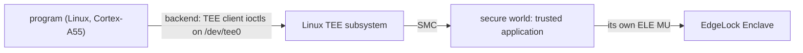
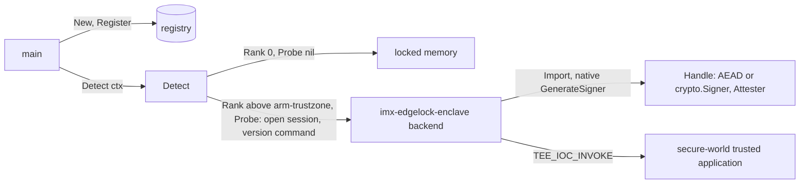

# i.MX EdgeLock Enclave backend — architecture (proposal)

> **Status: REFERENCE** · Scope: go-enclave · Last verified: 2026-11-13
> Proposal — not implemented. A design for the future backend in [SPEC](../SPEC.md#features) row `imx-edgelock-enclave`. No code exists, and every identifier here is a proposal, not an API you can call. The [open questions](#open-questions) mark a recommended answer; none is decided.

## Problem

A program on an NXP i.MX 95, such as a dedicated key-management appliance,
can keep its keys in the memory enclave or in
[linux-secretmem](../linux-secretmem/architecture.md). Both keep the material
in Linux's own memory: a kernel exploit, a DMA-capable peripheral or a
cold-boot attack on the board's DRAM reaches it.

The i.MX 95 carries the EdgeLock Enclave (ELE), a security subsystem with its
own core, memory, key store and true random number generator, which the
application cores reach only through a messaging unit (MU). Keys generated in
or imported into it are used in it and never return to Linux.

The backend proposed here connects a Linux process to a secure-world trusted
application (TA) that drives the ELE. The secure world, the TA and the code
that talks to the ELE are built outside go-enclave, to the interface listed in
[What the secure world must provide](#what-the-secure-world-must-provide).
go-enclave implements only the Linux-side client. With the backend
registered, `Detect` on the board selects it over the memory enclave, and a
sealer's wrapping key never exists in Linux memory after import.

## Threat model: what the backend adds

| Path to the material | Memory enclave | linux-secretmem | imx-edgelock-enclave |
|---|---|---|---|
| Swap, core dump, `fork` child | closed | closed | closed: the material is not in the process |
| `/proc/<pid>/mem`, `ptrace` peek, `process_vm_readv` | readable | refused | nothing to read: the process holds a key reference |
| Kernel direct map, kernel arbitrary read | mapped | removed while allocated | the key is in the ELE's memory, outside the kernel's reach |
| A DMA-capable peripheral, cold boot on DRAM | reachable | reachable | the key is not in DRAM in the clear |
| Code inside the process (an injected library) | reads the material | reads the material | can use the key while it runs, cannot extract it |
| Attestation | through the host's platform | through the host's platform | its own: platform evidence from the secure world, rooted in the ELE |

It does not stop an attacker who controls the program from using a key while
they control it, and it does not protect material the program holds outside
a handle. Imported material passes through the process once, at `Import`; a
key the secure world generates never does.

## Hardware mechanism

Sources: [Linux TEE subsystem userspace API](https://www.kernel.org/doc/html/v6.12/userspace-api/tee.html)
and [`include/uapi/linux/tee.h`](https://git.kernel.org/pub/scm/linux/kernel/git/torvalds/linux.git/tree/include/uapi/linux/tee.h?h=v6.12)
(Linux v6.12); the [GlobalPlatform TEE Client API Specification v1.0](https://globalplatform.org/specs-library/tee-client-api-specification/)
(GPD_SPE_007); the [OP-TEE documentation](https://optee.readthedocs.io/en/latest/);
NXP's *i.MX 95 Applications Processor Reference Manual* (IMX95RM) and
*i.MX 95 Security Reference Manual* (IMX95SRM); NXP's Linux side of the ELE
MU, [`drivers/firmware/imx/se_ctrl.c`](https://github.com/nxp-imx/linux-imx/tree/lf-6.12.y/drivers/firmware/imx)
on `lf-6.12.y`, and its userspace library [imx-secure-enclave](https://github.com/nxp-imx/imx-secure-enclave).
NXP distributes IMX95SRM, which holds the ELE's command ABI, under NDA. The
secure world implements that ABI; go-enclave neither cites its contents nor
copies it.

### The path from the program to the ELE

The recommended transport ([Q1](#q1-the-transport-to-the-secure-world)) is
the Linux TEE subsystem. The backend opens a session to the TA and invokes its
commands, and only the secure world addresses the ELE's messaging unit. The
non-secure ELE MU that NXP's `se_ctrl` driver exposes to Linux is then not
used by go-enclave at all.

### What the board must run

- **Linux on arm64**, built with `CONFIG_TEE` and the TEE driver for the
  secure world (`CONFIG_OPTEE` for OP-TEE), exposing the client device
  `/dev/tee0`.
- **The secure world and TA** at a pinned release, with whatever normal-world
  helper the secure world needs (OP-TEE's `tee-supplicant` for its secure
  storage, an ELE key-store storage daemon). The board image provides them;
  go-enclave does not.
- **Access for the program's user** to `/dev/tee0` (a `tee` group or a udev
  rule in the board image), and no seccomp or LSM rule that refuses `ioctl`
  on it.
- **A closed device lifecycle** for production: AHAB secure boot enforced, so
  the secure world that answers is the signed one. The backend does not
  enforce it ([Q7](#q7-device-lifecycle-at-the-probe)); the evidence reports
  it.

### The kernel interface the backend uses

Everything below is the generic TEE subsystem ABI of `tee.h`; none of it is
specific to the i.MX 95. The backend speaks it in pure Go through
`golang.org/x/sys/unix`, without cgo or `libteec`, as the shipped
[arm-trustzone backend](arm-trustzone-design.md#pure-go-over-the-tee-ioctls)
does.

- `open("/dev/tee0", O_RDWR|O_CLOEXEC)`, then `TEE_IOC_VERSION` to check the
  implementation ID and that the driver is a GlobalPlatform client.
- `TEE_IOC_OPEN_SESSION` to the TA's UUID with `TEE_IOCTL_LOGIN_USER`, so the
  kernel computes the client identity from the calling uid
  (`tee_session_calc_client_uuid`) and the secure world can bind keys to the
  program's user.
- `TEE_IOC_INVOKE` for each command, with memory references in shared memory
  from `TEE_IOC_SHM_ALLOC`, wiped before release.
- `TEE_IOC_CLOSE_SESSION`, and `close`.

### What the secure world must provide

go-enclave needs this interface from the TA. Each item is the secure world's
to design and implement; go-enclave implements only the Linux-side client.

1. **A published, versioned command ABI** at each release: the TA's UUID,
   every command ID, its parameter layout and its result codes. A version
   command (no key access) returns the ABI version, the ELE's firmware
   version and the lifecycle state.
2. **Session-scoped transient keys.** Every key go-enclave makes lives until
   it is destroyed or its session closes, and is never persisted. A release of
   all of a session's keys serves `Sweep`. Persistent provisioning is outside
   the backend.
3. **Key generation in the device**: AES-256 for `AEAD`, and ECDSA P-256 and
   P-384 for `crypto.Signer`, each returning an opaque key identifier.
4. **Import of a wrapping key or data key** (AES-256) under a usage policy the
   secure world enforces (wrap only, or encrypt data only), for
   `PurposeWrappingKey` and `PurposeDataKey`.
5. **AES-256-GCM seal and open in the device** with associated data, the open
   failing with a distinct result code on a tag mismatch; **ECDSA signing** of
   a digest; **key destruction**.
6. **Platform attestation** over a caller nonce of 1 to 64 bytes, binding
   every byte, in a named, documented evidence format with a published
   verification procedure and root ([attestation flow](#attestation-flow)).
   Key attestation where the ELE firmware supports it.
7. **The board image**: a Linux image with the TEE driver, the secure world,
   the TA, its helpers and the device permissions above, at the same release.
8. **Concurrency limits**: how many sessions and keys a client may hold, and
   the result code when a limit is reached.

## Attestation flow

The backend attests its own environment and implements `Attester`
([attestation](architecture.md#attestation)).

- **Platform evidence** (`Attester` on the backend): the secure world produces
  evidence over the caller's nonce that names the device (the ELE's device
  identity, certified by NXP), its lifecycle state, the ELE firmware version
  and the measurement of the secure world and TA, signed by a key the ELE
  holds. `Evidence.Format` names the secure world's format; `Data` is its
  bytes unchanged ([Q6](#q6-the-evidence-format)).
- **Key evidence** (`Attester` on a handle), where the ELE firmware can attest
  a key: evidence that the key was generated in, or imported into, the ELE with
  its usage policy.
- **Who verifies.** go-enclave never parses or appraises evidence
  ([SPEC boundaries](../SPEC.md#boundaries)). The relying party verifies it
  against the NXP device-certificate root and the secure world's published
  reference values.
- **Nonce.** 1 to 64 bytes, as the seam fixes. If the secure world's format
  binds fewer bytes, the backend refuses a longer nonce with
  `ErrInvalidNonce`, never truncating.

## API mapping onto the backend seam

- **Its own Go module** (Q2), registered by `main` like any other; nothing
  registers it at import. It depends on go-enclave, never the reverse, and its
  only dependencies are go-enclave and `golang.org/x/sys`.
- It reaches the secure world over the Linux TEE subsystem (Q1), with a
  pure-Go GlobalPlatform TEE client like the one `backends/armtrustzone`
  carries for OP-TEE. That client is unexported today; sharing it is Q2's
  question.
- **The backend** implements `Backend`, `Importer`, `Sweeper`, `Attester` and
  `Prober`; not `Confiner`, since the program runs outside the secure world.
  Its constructor opens `/dev/tee0` and one session, and checks the ABI
  version.
- **Handles** are references to keys in the ELE: a key identifier, the session
  that owns it, and the key's public part where it has one. They implement the
  secure-element column of [what each backend class provides](architecture.md#what-each-backend-class-provides):
  never `ByteAccess` or `Freezer`; `AEAD` for an AES-256-GCM key;
  `crypto.Signer` for an ECDSA key; `Attester` where key attestation is
  available. `Destroy` destroys the key in the device and wipes the handle's
  state; every later method returns `ErrEnclaveDestroyed`, and `Public()`
  keeps answering.
- **Import** (Q5) takes `PurposeWrappingKey` and `PurposeDataKey` with
  `AlgorithmAES256GCM` and returns an `AEAD` handle. `PurposeMaterial` is
  refused with a `*CapabilityError{Capability: CapabilityImport}`, since the
  material would need byte access. So `NewSealer(…, WithBackend(b))` holds the
  wrapping key and each KEK in the ELE, and `OpenIn` into this backend is
  refused before any device work ([a missing capability](architecture.md#a-missing-capability)).
- **Native interface**, reached through `enclave.As`: `GenerateSigner(curve)`,
  `GenerateAEAD()`, `Random(ctx, n)` from the ELE's TRNG, the version
  command's result, and `Connect(endpoint)` for the conformance harness.
- **Device calls** are bounded by the backend's configured timeout, since the
  seam's opaque shapes take no `context.Context`
  ([opaque operations](architecture.md#opaque-operations)).
- Rank above arm-trustzone's (Q3); the probe runs only from `Detect` (Q4).
- It passes `backendtest` on target hardware ([test strategy](#test-strategy)).
- Off Linux arm64 a stub compiles whose constructor and probe return the typed
  unavailable error, so a `main` that registers it builds everywhere.

## Failure modes

Every failure is a typed error. The names are proposals for the backend's own
module, named for the mechanism (the TEE client session and its commands), not
the contents. go-enclave's existing errors are reused where their meaning
holds. If Q1 chooses another transport, the first three rows are renamed for
that mechanism.

| Failure | Where | Proposed error |
|---|---|---|
| `/dev/tee0` absent, refused or not a GlobalPlatform client (`ENOENT`, `EACCES`, `ENODEV`, wrong `TEE_IOC_VERSION`) | probe, construction | `*TEEDeviceError{Path, Cause}` matching `ErrTEEDeviceUnavailable`; `Cause` is the `*os.SyscallError` |
| Session refused: TA absent, login refused, out of sessions | probe, construction | `*TEESessionError{UUID, Code, Origin}` matching `ErrTEESessionUnavailable`; `Code` and `Origin` are the TEE Client API's result and return origin |
| The TA's ABI version is not one the backend speaks | probe, construction | `*ABIVersionError{Got, Want}` matching `ErrABIVersionUnsupported` |
| A command fails in the secure world (key store full, policy refusal, ELE error) | any device call | `*TEECommandError{Command, Code, Origin}` matching `ErrTEECommandFailed` |
| A command outlives the backend's timeout | any device call | the same, its `Cause` `context.DeadlineExceeded` |
| Off Linux arm64 | probe, construction | `ErrTEEDeviceUnavailable` with no cause |
| A purpose or algorithm the backend does not hold, `PurposeMaterial` included | `Import`, `OpenIn` | the existing `*CapabilityError` |
| Material of a length the algorithm does not take | `Import` | the existing `ErrInvalidImport` |
| GCM tag mismatch on open | `AEAD.Open` | the existing `ErrAEADAuthentication` |
| A nonce outside 1 to 64 bytes, or longer than the format binds | `Attest` | the existing `ErrInvalidNonce` |
| A handle used after `Destroy` | every handle method but `Public` | the existing `ErrEnclaveDestroyed` |
| A key not destroyed, or a session not closed, in `Sweep` | `Sweep` | the existing `*CleanupError` |

A probe failure reaches `main` wrapped in `Detect`'s `*ProbeError`, and the
next-ranked backend is selected. Construction never falls back to another
backend: a backend that probed usable and then fails returns its error
([a missing capability](architecture.md#a-missing-capability)).

## Test strategy

The backend is proven on target hardware: an i.MX 95 board running the
pinned secure world and TA. No simulator, emulator or fake TA stands in for
it in conformance, because only the real ELE holds keys outside Linux and
signs evidence that verifies to NXP's root.

- **The runner.** The board runs the tests. The test binary is
  cross-compiled (`GOOS=linux GOARCH=arm64`, `CGO_ENABLED=0`,
  `-tags=integration`, `go test -c`) and run on the board with the TEE device
  path passed in. The run refuses while the secure-world release pin is empty.
- **The harness** follows the
  [arm-trustzone harness](../backend-conformance/engineering.md#the-arm-trustzone-harness):
  the backend module registers the backend under `imx-edgelock-enclave` and
  supplies `VerifyEvidence` from the relying party's verifier. A fresh backend
  is connected per check, and `backendtest.TestBackend` runs with
  `CapabilityImport`, `CapabilitySweep`, `CapabilityAttest` and
  `CapabilityProbe`, and handle cases `wrapping-key` (imported,
  `PurposeWrappingKey`, `AlgorithmAES256GCM`, `CapabilityAEAD`) and
  `signing-key` (`GenerateSigner` P-256, `CapabilitySign`, plus
  `CapabilityAttest` where key attestation exists).
- **The environment is attested.** Every run first takes the board's platform
  evidence over a fresh nonce and verifies it before any other check, and logs
  the secure-world release, the ABI and ELE firmware versions and the
  lifecycle state from the version command. A run whose evidence does not
  verify fails.
- **Beyond `backendtest`**, on the same board: `Detect` selects
  `imx-edgelock-enclave` over locked memory; a sealer built `WithBackend`
  seals and opens, and a ciphertext tampered on the board fails
  `ErrAEADAuthentication`; after `Import` the imported bytes are absent from
  the process's memory (the residue sweep); `Sweep` leaves no key in the
  session. The probe's typed errors are each produced on the board itself:
  `ErrTEEDeviceUnavailable` as a user without access to `/dev/tee0`,
  `ErrTEESessionUnavailable` with the TA removed from the image,
  `ErrABIVersionUnsupported` against a release whose ABI the backend does not
  speak.
- **Fails, never skips.** An empty endpoint, a missing registration or a
  missing backend fail, as the arm-trustzone harness's do. A skipped
  conformance run would read as a pass.
- **Unit tests** cover what needs no device: the ioctl structs and the
  command parameter layouts, the error types, and the stub's typed error.

## Open questions

### Q1: the transport to the secure world

- **The Linux TEE subsystem, GlobalPlatform TEE Client API** (recommended):
  the secure world publishes a TA and its command ABI, and the backend speaks
  GPD_SPE_007's session and invoke model over `/dev/tee0`. The kernel
  interface is generic and documented, the client matches arm-trustzone's,
  only the secure world addresses the ELE, and keys can be bound to the
  calling uid.
- **The Linux side of the ELE MU** through NXP's `se_ctrl` character device,
  with ELE messages framed by the backend: no secure-world hop, but the
  backend would encode the ELE's NDA command ABI, which is device-specific
  code in go-enclave, and the non-secure MU would carry key commands from
  Linux.
- **NXP's userspace library** (`imx-secure-enclave`, its HSM API) through cgo:
  device-specific, adds cgo and a C dependency, and bypasses the secure
  world's key handling.
- **A secure-world daemon** on a Unix socket: a second normal-world process
  every request trusts, and one more component to attest.

Proposed answer (for owner sign-off): the Linux TEE subsystem with the
GlobalPlatform TEE Client API, because arm-trustzone's ruled design already
speaks it in pure Go over `/dev/tee0`, so the client is shared and no
device-specific ABI or cgo enters go-enclave.

### Q2: where the module lives

- **A nested module in this repository, beside `backends/armtrustzone`**
  (recommended): the two TEE clients can share code and change with the seam
  in one pull request, and the root module still carries no hardware code
  ([SPEC boundaries](../SPEC.md#boundaries)). It costs one more module in the
  release tooling.
- **A repository of its own**, as the
  [out-of-tree sketch](architecture.md#an-out-of-tree-backend) shows: the
  cleanest separation, but the shared TEE client splits across repositories.
- **The root package**: the root module carries no hardware code, and every
  consumer would link a device client.

Proposed answer (for owner sign-off): its own Go module in this repository,
beside arm-trustzone's backend, because the arm-trustzone ruling placed that
backend in the nested module `backends/armtrustzone` on the same terms, and
both keep the root module free of hardware code.

### Q3: rank

- **Above arm-trustzone** (recommended): on the i.MX 95 both may be registered
  and both probe usable. The ELE is a separate subsystem whose keys stay out
  of the application cores' memory, secure world included, so it ranks
  higher than arm-trustzone's 2. The value is agreed across the hardware
  proposals, as detection leaves to each backend
  ([scope fence](../backend-detection/architecture.md#scope-fence)).
- **Equal to arm-trustzone**: the tie goes to the name that sorts first,
  `arm-trustzone`, which selects the weaker backend.
- **Below arm-trustzone**: only if the secure world kept the keys in its own
  memory rather than the ELE, which item 3 of the interface list excludes.

Proposed answer (for owner sign-off): left to the owner, because the hardware
rows' order among themselves is to be ruled once across the sibling proposals
(amd-sev's Q3, in the amd-sev proposal); this proposal's recommendation, above
arm-trustzone, stands as input to that ruling.

### Q4: the detection probe

- **Recommended:** `Probe(ctx)` checks `ctx`, opens `/dev/tee0`, checks
  `TEE_IOC_VERSION`, opens a session to the TA, runs the version command,
  checks the ABI version, and closes the session and the device, leaving
  nothing behind. No key is made, and nothing touches the ELE's key store.
  Each refusal is the typed error above, so the `ProbeResult` says why the
  backend was passed over.
- **Device open only**: cheaper, but passes a board whose secure world lacks
  the TA or speaks another ABI version.
- **A full key round trip** (generate, sign, destroy): proves more but writes
  to the key store on every `Detect`; `backendtest` covers it instead.

Proposed answer (for owner sign-off): the recommended probe (session open and
version command, no key made), because it passes only a board that can serve
requests, as amd-sev's recommended probe does with one report, while leaving
the ELE's key store untouched.

### Q5: what `Import` holds

- **Wrapping and data keys only, as `AEAD` handles** (recommended):
  `PurposeWrappingKey` and `PurposeDataKey` with `AlgorithmAES256GCM`;
  `PurposeMaterial` refused. The imported bytes pass through the process once
  and are wiped; a caller that wants no exposure at all uses the native
  `GenerateAEAD`.
- **No `Importer`**: keys only from native generation. No exposure, but
  `NewSealer(…, WithBackend(b))` could not use the backend, which is its main
  use.
- **`PurposeMaterial` too**, holding arbitrary material in the secure world and
  returning it on request: that is byte access across the boundary, which the
  secure-element class does not give.

Proposed answer (for owner sign-off): wrapping and data keys only, as `AEAD`
handles, because it keeps `NewSealer(…, WithBackend(b))` usable for the
program while no key material ever crosses back out of the secure world.

### Q6: the evidence format

- **An Entity Attestation Token** ([RFC 9711](https://www.rfc-editor.org/rfc/rfc9711))
  within the [RATS architecture](https://www.rfc-editor.org/rfc/rfc9334)
  (RFC 9334), signed by an ELE-held key and carrying the ELE's own
  attestation, with `Evidence.Format` naming its profile (recommended): a
  standard the relying party's verifier already parses.
- **The ELE's native attestation blob passed through**: no work in the secure
  world, but every verifier parses an NDA format and it cannot carry the
  secure world's measurement.
- Either way go-enclave passes the bytes through unparsed. The choice is the
  secure world's; it is recorded here because verifiers depend on it.

Proposed answer (for owner sign-off): an Entity Attestation Token (RFC 9711)
emitted by trusted-imx95, because it is a published standard the verifier
already parses, and like amd-sev's recommended evidence it passes through
go-enclave unparsed in a format the seam names.

### Q7: device lifecycle at the probe

- **The probe does not refuse an open lifecycle** (recommended): `Detect`
  selects by rank and never attests ([scope fence](../backend-detection/architecture.md#scope-fence)).
  The evidence reports the lifecycle, and the relying party refuses an open
  part.
- **The probe refuses unless the lifecycle is closed**: safer by default, but
  a development board would fall back to locked memory with no way to test the
  backend, and it puts an appraisal decision in go-enclave.

Proposed answer (for owner sign-off): the probe does not refuse an open
lifecycle, because detection selects by rank and never attests, so appraisal
stays with the relying party, as amd-sev leaves VMPL policy to its verifier.

## Rejected alternatives

- **A simulator, emulator or fake TA as the conformance fixture** (a QEMU
  i.MX 95, a fake trusted application): only the real ELE holds keys outside
  Linux and signs evidence that verifies to NXP's root.
- **ELE command code in go-enclave**: the ELE's command ABI is NDA material
  and belongs in the secure world, which owns the device. go-enclave stays
  device-neutral above the TEE client interface.
- **A PKCS#11 module for the ELE as the seam**: it adds a C library and cgo
  to the path, where the pure-Go TEE client needs neither.
- **Copying IMX95SRM into `docs/reference/`**: it is NDA material. The
  GlobalPlatform TEE Client API Specification, which the backend implements,
  is referenced by title and URL, as for arm-trustzone.

## What it does not do

No device-specific code, ELE firmware, secure-world or TA code, persistent key
provisioning, evidence parsing or appraisal, byte access to keys,
protection against an attacker who controls the program while they control
it, platform other than Linux on arm64, simulated fixture, or change to the
backend seam.
