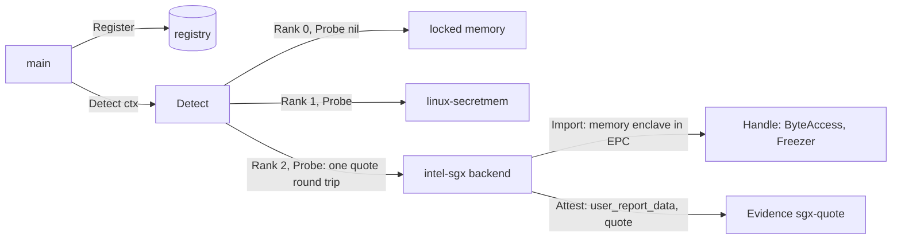

# Intel SGX backend — architecture (proposal)

> **Status: NORMATIVE** · Scope: go-enclave · Last verified: 2026-11-12
> Conflicts with this document are defects. A planned feature ([SPEC](../SPEC.md#features), row `intel-sgx`): no code exists, and no code is written until the owner decides the [open questions](#open-questions); each answer then replaces its options here. The backend's own docs move to its module with its code.

## Problem

The memory enclave keeps material in `mlock`'d, guarded pages
([platform contract](../memory-enclave/engineering.md#platform-contract)), and
[linux-secretmem](../linux-secretmem/architecture.md) takes those pages out of
the kernel's direct map. Both trust the kernel of the machine the program runs
on, and neither defends against what sits below or beside the process:

- the kernel and root on the same machine, which can map any page of the
  process, read it, write it, or hand it to a debugger;
- a hypervisor and its host, when the machine is a virtual machine;
- devices that DMA into RAM;
- anyone with physical access to the DIMMs or the memory bus (cold boot,
  interposers), who reads plaintext.

Intel SGX (Software Guard Extensions) closes those paths in the CPU: an
enclave's pages live in the Enclave Page Cache (EPC), encrypted in DRAM with a
key the CPU never exports, and the CPU refuses every access to them from
outside the enclave, the kernel's and the hypervisor's included. Unlike
SEV-SNP and TDX, which protect a whole virtual machine and trust its kernel,
SGX protects a part of one process and trusts no kernel at all. The enclave
can ask the CPU for a report over its own measurement, which Intel's Quoting
Enclave turns into a quote signed by a key certified to Intel's root, so the
environment attests itself rather than through the host's platform.

An SGX enclave runs in user mode with no system calls: the `SYSCALL`
instruction faults inside it. A Go program, whose runtime makes system calls
directly, cannot run as an enclave unmodified. The backend proposed here is
for a Go program that runs whole inside an enclave under a library OS
([Q2](#q2-execution-model)), which answers the runtime's system calls inside
the enclave and forwards to the host kernel only what must leave it (files,
sockets, time, threads).

**Linux path.** SGX has a complete Linux path: the in-kernel SGX driver
(Linux 5.11 and later), Intel's Data Center Attestation Primitives (DCAP) for
Linux, and library OSes that run only on Linux. The backend, its tests and its
runner are Linux on amd64, inside the [Linux-only runtime ruling](../SPEC.md#boundaries);
SGX on Windows is not considered.

## What intel-sgx adds over the memory enclave and linux-secretmem

The program runs on the same machine in every column; in the intel-sgx column
it runs inside an enclave under a library OS, with the enclave's DEBUG
attribute clear.

| Path to the material | Memory enclave | linux-secretmem | intel-sgx |
|---|---|---|---|
| Kernel or root on the same machine reads the process (`/proc/<pid>/mem`, `ptrace`, a kernel mapping) | readable | GUP paths refused, direct map removed; the kernel can still map the pages | refused by the CPU: reads from outside the enclave return the abort page (all ones), writes are dropped |
| Hypervisor or host kernel reads guest RAM (in a VM) | plaintext | plaintext | ciphertext: EPC is encrypted with a key only the CPU holds |
| Device DMA into the pages | possible | possible | refused: the processor reserved memory range (PRM) is closed to DMA |
| DIMM or bus read, cold boot | plaintext | plaintext | ciphertext; a physical replay of DRAM contents is not detected on the parts without an integrity tree ([hardware](#hardware-and-firmware)) |
| Swap and core dumps | locked, `MADV_DONTDUMP` | locked, `VM_DONTDUMP` | EPC pages the kernel evicts are encrypted and versioned by the CPU (`EWB`, `ELDU`), so swap holds ciphertext the kernel cannot replay; a core dump reads abort pages |
| Code inside the process (the same enclave) | readable | readable | readable: SGX does not isolate inside the enclave ([Q7](#q7-handle-memory-and-freezer)) |
| Attestation of the environment | through the host's platform ([SPEC boundaries](../SPEC.md#boundaries)) | the same | its own: a DCAP ECDSA quote over the enclave's measurement and a caller's nonce |

It does not stop code inside the enclave, side channels the platform's TCB
does not mitigate (SGX has a long record of them, each closed by a microcode
and TCB recovery that the verifier's TCB policy must require), or material the
program sends out: the library OS forwards file and network I/O to the host
kernel, so anything the caller writes to a socket or an unencrypted file
leaves the enclave in whatever form the caller wrote it.

## Hardware, firmware and OS requirements

Sources, each cited by title at the revision current when this proposal was
written. They were recorded offline: the implementing slice confirms the
latest revision, pins it, and copies each into `docs/reference/` with the code
([standards first](../reference/README.md)).

- Intel, *Intel 64 and IA-32 Architectures Software Developer's Manual*,
  Volume 3D, the Intel SGX chapters: the EPC and EPCM, `EREPORT`, `EGETKEY`,
  the `SECS`, `REPORT` and `TARGETINFO` structures, the enclave attributes
  (DEBUG, KSS) and SGX2 dynamic memory management (EDMM).
- Intel, *Intel Software Guard Extensions (Intel SGX) Data Center Attestation
  Primitives: ECDSA Quote Library API*: the quote version 3 format (header,
  ISV enclave report body, ECDSA signature data with the QE report and the
  certification data).
- Intel, *Intel SGX PCK Certificate and Certificate Revocation List Profile
  Specification*: the PCK certificate chain to the Intel SGX Root CA and the
  SGX extensions it carries (FMSPC, TCB components, PCE SVN).
- Intel, *Intel SGX and Intel TDX Provisioning Certification Service for ECDSA
  Attestation* (the PCS API): PCK certificates, CRLs, TCB info and QE identity
  collateral a verifier fetches, directly or through a caching service.
- Intel, *Supporting Intel SGX on Multi-socket Platforms*: platform
  registration for multi-package platforms.
- Linux: *Software Guard eXtensions (SGX)* (`Documentation/arch/x86/sgx.rst`),
  the in-kernel driver, `/dev/sgx_enclave`, `/dev/sgx_provision` and EPC
  reclaim; KVM's SGX virtualization (`/dev/sgx_vepc`). Kernel docs are cited
  at the tree; the implementing slice pins a tag.
- Gramine (the recommended library OS, [Q2](#q2-execution-model)): *Gramine
  manifest syntax* and *Attestation and Secret Provisioning* (the
  `/dev/attestation` pseudo-files). Cited at its latest release; the
  implementing slice pins it.

### Hardware and firmware

- **An Intel Xeon with SGX and Flexible Launch Control (FLC):** Xeon Scalable
  3rd generation (Ice Lake-SP) or later for a production EPC (up to hundreds
  of GiB per socket), or Xeon E parts with a small EPC. FLC is required: the
  Linux driver and DCAP both need it. Client Core processors from the 11th
  generation on no longer carry SGX, and the backend does not target them.
- **SGX2 (EDMM)** is present on Ice Lake-SP and later; whether the backend
  requires it is [Q7](#q7-handle-memory-and-freezer).
- **Memory protection.** On Ice Lake-SP and later, EPC is encrypted by the
  memory controller's total memory encryption engine without the integrity
  tree of the earlier memory encryption engine: confidentiality and
  logical integrity hold, a physical DRAM replay is not detected. The
  verifier and the user doc state this; it does not change the shape.
- **BIOS:** SGX enabled (not "software controlled"), the PRMRR sized for the
  EPC wanted, total memory encryption enabled where the part requires it for
  SGX, and FLC unlocked so the kernel owns the launch key hash.
- **Microcode** at the latest TCB recovery: its SVN is part of the TCB the
  quote carries (`CPUSVN`), and a verifier sets the minimum.
- **Platform registration:** a multi-socket platform registers with Intel's
  registration service before its PCK certificates can be fetched.

### The OS and service side

The host kernel and services are untrusted by design; they are listed because
the enclave cannot run or quote without them.

- **Linux 5.11 or later** with `CONFIG_X86_SGX`: `/dev/sgx_enclave` to build
  enclaves, `/dev/sgx_provision` for the provisioning key the Quoting Enclave
  needs (its access is restricted to a group; the quoting service holds it).
  In a VM, the host's KVM exposes EPC through `/dev/sgx_vepc` (Linux 5.13).
- **DCAP quote generation:** Intel's architectural enclave service (AESM) with
  the ECDSA quote plugin, or the DCAP quote generation library, which loads
  the Quoting Enclave (QE3) and the Provisioning Certification Enclave, plus a
  quote provider library pointing at Intel's PCS or a PCK caching service.
- **The library OS** (Gramine recommended, [Q2](#q2-execution-model)): its SGX
  loader, a manifest that lists the Go binary as a trusted file by SHA-256,
  fixes the arguments and environment, sets the enclave size and thread count,
  and enables DCAP remote attestation; the manifest is signed with the
  project's enclave signing key (`MRSIGNER`).

### The enclave side: the interface the backend uses

- **`/dev/attestation`** (Gramine's pseudo-filesystem, inside the enclave
  only). `attestation_type` reads `dcap` when the enclave can quote and `none`
  otherwise; the caller writes 64 bytes to `user_report_data` and reads the
  quote from `quote`; `report` and `target_info` give local reports. These
  files are per process: two writers in one process race, so the backend
  serialises its own requests and checks that the quote carries what it
  wrote ([failure modes](#failure-modes)).
- **Keeping material in the EPC.** Under the library OS all of the process's
  memory, heap and stacks, is enclave memory; nothing in the backend selects
  it. Pages the library OS maps for the host (its untrusted I/O buffers) are
  outside the enclave and never hold a handle's material.

## Attestation

The backend implements `Attester` on the backend, placing platform evidence
there as the [seam requires](architecture.md#attestation):

- **Evidence.** `Attest(ctx, nonce)` takes the backend's lock, writes `nonce`
  (1 to 64 bytes) zero-padded to 64 bytes to `user_report_data`, reads
  `quote`, checks that the quote's `REPORT_DATA` is the 64 bytes it wrote, and
  releases the lock. It returns `Evidence{Format: "sgx-quote", Data: quote}`,
  where `quote` is the version 3 ECDSA quote of the DCAP Quote Library API,
  byte for byte ([Q6](#q6-evidence-shape)).
- **What it binds.** The quote's ISV enclave report body carries `MRENCLAVE`
  (the enclave's build measurement), `MRSIGNER` (the hash of the signing key),
  `ISVPRODID`, `ISVSVN`, `ATTRIBUTES` (DEBUG, 64-bit, KSS), `CPUSVN`, the
  `CONFIGID` and `CONFIGSVN` when KSS is used, and `REPORT_DATA`. The Quoting
  Enclave signs the header and body with its ECDSA P-256 attestation key; its
  own report, signed by the PCK, binds that key; the PCK certificate chains to
  the Intel SGX Root CA.
- **Who verifies.** The relying party, through the `sgx-quote` format's
  verifier, outside this module: go-enclave never parses or appraises evidence
  ([SPEC boundaries](../SPEC.md#boundaries)); platform attestation belongs to
  go-xkms and go-trusted-platform. The verifier checks the chain and CRLs,
  the QE report and identity, the TCB info for the platform's FMSPC and the
  TCB status it accepts, `REPORT_DATA` against the nonce it issued, DEBUG
  clear, and its policy on `MRENCLAVE` or `MRSIGNER`, `ISVPRODID` and minimum
  `ISVSVN`.
- **What the measurement covers.** `MRENCLAVE` covers the library OS, its
  loader and the manifest; the manifest names each trusted file by hash, so
  the Go binary and its libraries are covered. Files the manifest only allows,
  arguments and environment variables not fixed in the manifest, and anything
  read from the host at run time are not; the user doc will say so, and the
  test manifest fixes them all.

## Shape proposed

Recommended answers to the open questions are marked; none is decided.

- **Out of tree** (Q1), a module of its own (`go-enclave-intel-sgx`), in the
  shape of the [TDX sketch](architecture.md#an-out-of-tree-backend); it depends
  on go-enclave and `golang.org/x/sys`, never the reverse, and has no cgo.
  `main` registers it explicitly; nothing registers it at import.
- **Name** `intel-sgx`.
- **Runs whole inside an enclave under Gramine** (Q2); the backend reaches
  SGX only through the library OS's `/dev/attestation` (Q3).
- **Capabilities**, as the [TEE-memory class](architecture.md#what-each-backend-class-provides)
  provides: `Importer`, `Attester` (backend), `Confiner`, `Sweeper` and
  `Prober` on the backend; `ByteAccess` and `Freezer` on its handles; no
  `AEAD`, `Deriver`, `crypto.Signer` or `crypto.Decrypter` (Q8).
- **Handles** wrap a memory enclave made with `enclave.NewMemory` inside the
  enclave (Q7), so the memory enclave's guard pages, canary, wipe, freeze and
  release rules hold as the library OS implements `mmap` and `mprotect`;
  `Import` resolves the `ImportSpec` and accepts every purpose, since
  `ByteAccess` meets each purpose's contract.
- **`ConfinesProcess` is true**: construction succeeded only inside a
  non-debug enclave that can quote, which holds the whole process. A debug
  enclave is refused: its memory is readable from outside through `EDBGRD`.
- **`Sweep`** destroys every handle the backend made and returns the count it
  could not; `WipeAll`'s first phase reaches the same memory enclaves.
- **Rank 2** (Q4); the probe runs only from `Detect` (Q5), and the constructor
  checks the same interface, so a backend that cannot attest is never built.
- It passes `backendtest` with `VerifyEvidence` set (Q9).
- **Linux on amd64 only.** On any other GOOS or GOARCH a stub compiles whose
  constructor and probe return the typed unavailable error, so a
  cross-platform `main` that registers it builds everywhere.

## Failure modes

Every failure is a typed error. The names are proposals, named for the
mechanism (the enclave and its quote), not the contents, and live in the
backend's module; go-enclave's existing errors are reused where their meaning
holds.

| Failure | Where | Proposed error |
|---|---|---|
| Not in an SGX enclave: no `/dev/attestation` (not under a library OS), `attestation_type` not `dcap` (Gramine without SGX, or attestation not enabled in the manifest) | probe, construction | `*SGXEnclaveError{Op, Cause}` matching `ErrSGXUnavailable`; `Op` names the step (`attestation_type`, `report`, `user_report_data`, `quote`), `Cause` the `*os.PathError` or the value read |
| A debug enclave (`ATTRIBUTES.DEBUG` set in its own report) | probe, construction | the same, `Op` `debug` |
| Non-Linux or non-amd64 build | probe, construction | `ErrSGXUnavailable` with no cause |
| The quote cannot be produced (the quoting service down or unreachable through the host, the PCK not provisioned, the platform not registered, the host's delay outlasting `ctx`) | `Attest` | `*SGXQuoteError{Op, Cause}` matching `ErrSGXQuote` |
| The quote's `REPORT_DATA` is not what the backend wrote (another writer in the process raced it) | `Attest` | the same, `Op` `report_data`; never a quote of unknown provenance |
| The quote is not a version 3 ECDSA quote, or shorter than its header and report body | `Attest` | the same, `Op` `quote` |
| A nonce empty or over 64 bytes | `Attest` | go-enclave's existing `ErrInvalidNonce`, before any request |
| `ctx` ended | every call | `ctx.Err()`, as the seam requires |
| Budget refused, an `ImportSpec` refused | `Import` | the existing `*BudgetError`, `ErrInvalidImport`, `*CapabilityError` |
| The enclave's memory exhausted (the manifest's enclave size) | `Import` | the memory enclave's existing `ErrLockedMemoryUnavailable` |
| `mprotect`, `munmap` refused; canary mismatch | `Freeze`, `Destroy` | the memory enclave's existing `ErrLockedMemoryUnavailable`, `ErrReleasedWithoutWipe`, `ErrEnclaveCorrupted` |

`ErrSGXUnavailable` means "not here"; `ErrSGXQuote` means "here, and this
request failed". A probe failure reaches `main` wrapped in `Detect`'s
`*ProbeError`, and a lower-ranked backend stays selected. A backend that
probed usable and then fails returns its error; it never falls back to locked
memory ([a missing capability](architecture.md#a-missing-capability)).

## Test plan on the real hardware

The backend is proven on the real part only: no simulator, emulator or mock
device (owner, 2026-10-17). No SGX-capable machine is recorded for this
project yet ([Q10](#q10-the-test-hardware)); the plan below runs on the
machine the owner provides, Linux on amd64.

1. **Record the host.** Before the first run, record the server model, the CPU
   family, model and stepping, SGX1, SGX2 and FLC from `CPUID` leaf 0x12 and
   leaf 7, the EPC sections the kernel reports at boot, the BIOS settings
   above, the microcode revision, the kernel, Gramine and DCAP versions, and
   the platform's registration state. A part without FLC cannot run the plan,
   and it stops there for the owner.
2. **The runner.** A self-hosted runner on that host builds the test binary,
   signs a pinned Gramine manifest for it (DEBUG off, arguments and
   environment fixed, the binary a trusted file), computes the expected
   `MRENCLAVE` and `MRSIGNER` from the signing step, and runs the backend
   module's tests under `gramine-sgx`, handing the expected values to the test.
3. **Conformance inside the enclave.** `backendtest.TestBackend` with
   `VerifyEvidence` set to a verifier that checks the PCK chain to the Intel
   SGX Root CA, the QE report and identity, the quote signature, the TCB
   status, `REPORT_DATA` against the suite's nonce, the expected `MRENCLAVE`
   and DEBUG clear. The residue sweep runs if the library OS's `/proc`
   emulation gives `internal/memscan` its view of the process; if it does
   not, the implementing slice says so in the conformance harness and skips
   that subtest by name.
4. **Detection inside the enclave.** With locked memory and intel-sgx
   registered (and linux-secretmem, which ships), `Detect` selects intel-sgx,
   and every `ProbeResult` is nil.
5. **The host cannot read the material.** The test imports a random needle
   into a handle and holds it; on the host, as root, a scan of the Gramine
   process's whole address space (`/proc/<pid>/maps` and `/proc/<pid>/mem`)
   must not find it. The control: the same binary under `gramine-direct` (the
   library OS without SGX) on the same host, where the same scan must find it,
   proving the scan reaches the process's memory when it is readable.
6. **Refusals on the same machine.** The test binary on the host itself, under
   `gramine-direct`, and in a debug enclave: the probe returns
   `ErrSGXUnavailable` naming the step, and `Detect` keeps the next backend.
   With the quoting service stopped: `Attest` returns `ErrSGXQuote`.
   Concurrent `Attest` calls from many goroutines each return a quote that
   verifies against its own nonce.

## Open questions

### Q1: in-tree or out-of-tree

- **Out of tree** (recommended): its own module, as the SPEC row and the
  boundary "no hardware backend or hardware-specific code in this module"
  ([SPEC](../SPEC.md#boundaries)) say. It needs nothing unexported: the TDX
  sketch shows a TEE-memory backend built from `enclave.NewMemory` and the
  seam alone.
- **In tree:** it would need no new dependency (pseudo-files through `os`),
  but it is hardware-specific code, which the boundary excludes.

### Q2: execution model

- **The whole program inside an enclave under Gramine** (recommended): the
  unmodified Go binary, built with the upstream toolchain at its latest
  release, runs as a trusted file of a measured manifest; the enclave
  boundary holds the whole process, so the backend is a TEE-memory backend
  like amd-sev and TDX, and the backend itself has no SGX code beyond reading
  pseudo-files. Gramine is maintained under the Confidential Computing
  Consortium and runs on Linux only.
- **EGo** (a Go toolchain and runtime built for SGX): no manifest to write,
  but the program must be built with that toolchain, which follows upstream
  Go at its own pace; that ties every consumer's Go version to it, against
  the project's latest-toolchain rule.
- **A helper enclave** (written with the Intel SGX SDK, called through cgo):
  the Go process stays outside; material is imported into the enclave and
  used through opaque `crypto.Signer` and `AEAD` handles, as a secure element
  is. It needs cgo and C enclave code in the backend module, moves plaintext
  through the untrusted process on import, and leaves the rest of the
  program, its Go heap included, unprotected.

### Q3: the quote interface

- **Gramine's `/dev/attestation`** (recommended, with Q2's recommendation):
  plain file I/O inside the enclave; the library OS talks to the Quoting
  Enclave on the host.
- **The DCAP quote generation library or the AESM socket directly:** needed
  only with a helper enclave (Q2), from the untrusted side, through cgo or
  AESM's protocol; it ties the backend to Intel's C libraries.

### Q4: rank

- **Rank 2** (recommended): above locked memory (0) and linux-secretmem (1),
  equal to amd-sev's proposed rank; the hardware rows' order among
  themselves is for the owner to rule once across the sibling proposals. Two
  TEE-memory backends do not meet in one process (an SGX enclave inside an
  SNP or TDX guest is possible but rare), so an equal rank decides nothing in
  practice.
- **A wide band** (for example 100 for TEE memory, 200 for secure elements):
  room between classes, at the cost of numbers with no meaning but their
  order ([detection scope fence](../backend-detection/architecture.md#scope-fence)).

### Q5: the detection probe

- **Recommended:** `Probe(ctx)` checks `ctx`, reads `attestation_type` (must
  be `dcap`), reads its own `report` and refuses a set DEBUG attribute, then
  requests one quote over a fresh random nonce and checks that it is a
  version 3 ECDSA quote with that nonce at `REPORT_DATA`'s offset; it
  verifies nothing else. It costs one quote, a round trip to the host's
  Quoting Enclave, per `Detect`, and it passes only an enclave that can
  attest, which every environment must ([SPEC boundaries](../SPEC.md#boundaries)).
- **Presence only** (`attestation_type` and the DEBUG check): no quote round
  trip, but it passes an enclave whose platform is not provisioned or whose
  quoting service is down, which then fails at the first `Attest`.

### Q6: evidence shape

- **The quote alone** (recommended): `Data` is the version 3 ECDSA quote as
  the DCAP Quote Library API defines it, its certification data carrying the
  PCK certificate chain as the quoting service returns it; the format name is
  `sgx-quote`, alongside the seam's `tdx-quote` and `sev-snp-report`. The
  verifier fetches TCB info, QE identity and CRLs from Intel's PCS or a cache.
  The nonce is zero-padded to 64 bytes; the verifier compares against the
  nonce it issued and its length.
- **Quote and collateral in one wrapper**, such as the IETF RATS Conceptual
  Message Wrapper (draft-ietf-rats-msg-wrap): one value carries everything,
  but it adopts a draft, to be pinned and watched, and collateral is the
  verifier's to fetch and cache.

### Q7: handle memory and Freezer

- **A memory enclave, as the library OS implements it** (recommended):
  `enclave.NewMemory` inside the enclave, through go-enclave's exported API
  only. `mprotect` and guard pages hold through the page tables, which the
  untrusted kernel owns: they keep the program's own bugs off the material,
  not the host, which cannot read EPC in any case. SGX2 is not required.
- **Require SGX2 (EDMM)** so that Gramine also restricts the EPCM permissions
  a frozen page carries: `Freeze` then holds against a kernel that rewrites
  the page tables. It refuses SGX1 parts and depends on the library OS's EDMM
  support, for a protection against an attacker who can only write through a
  page-table change the enclave's code makes.

### Q8: sealing keys

- **Not in this row** (recommended): the backend attests and confines; it
  holds no device key. `EGETKEY` derives seal keys bound to `MRENCLAVE` or
  `MRSIGNER` and the CPU's SVNs (Gramine exposes them under
  `/dev/attestation/keys`), which would seal material to this enclave on this
  CPU; that is a sealing provider (`RootUnsealer`), with its own questions
  (material sealed on one CPU does not open on another, nor after a TCB
  recovery under the `MRENCLAVE` policy), for a row of its own.
- **A `Deriver` handle in this row:** wider at first ship, and it decides the
  sealing questions inside a memory-backend row.

### Q9: the verifier the tests use

- **The `sgx-quote` verifier of go-trusted-platform** (recommended), the
  project that owns platform attestation, so the test proves the evidence the
  portfolio's relying party accepts. If it has no SGX quote verifier when
  this row is moved, that is its row to add first.
- **A third-party verifier** (Intel's DCAP quote verification library through
  cgo) as a test-only dependency of the backend module: available now, but it
  brings cgo into the tests and proves a verifier the portfolio does not run.

### Q10: the test hardware

- **A server the owner provides** (recommended): a Xeon Scalable 3rd
  generation or later with FLC and SGX2, bare metal, ruled a CI runner for
  this row. It runs every step of the test plan, the host-side scan
  included.
- **A cloud virtual machine with SGX passed through** (KVM's virtual EPC): a
  real CPU, available at once, but the host-side scan of step 5 cannot run
  (the test does not own the host), and the platform's TCB and registration
  are the provider's.

## Rejected alternatives

- **A simulator, emulator or mock for tests:** the SGX SDK's simulation mode,
  `gramine-direct` standing in for SGX, a fake `/dev/attestation`. Ruled out by
  the owner: a hardware backend is proven on the real part, and only a real
  platform's Quoting Enclave produces a quote that verifies to Intel's root.
  `gramine-direct` appears in the test plan only as a control and a refusal.
- **EPID attestation.** Intel has retired EPID remote attestation in favour
  of DCAP; the probe requires `dcap`.
- **Client Core processors.** SGX is deprecated there, with a small EPC; the
  backend targets Xeon.
- **Occlum or another library OS that needs its own toolchain.** It rebuilds
  the program against its own libc, the cost of EGo (Q2) without its Go
  support.
- **Moving material into an enclave for a process outside it** (beyond Q2's
  helper option): a transport across the enclave boundary for a caller that
  stays unprotected, which go-enclave never carries
  ([SPEC boundaries](../SPEC.md#boundaries)).
- **Parsing or appraising the quote in go-enclave.** Ruled out by the SPEC;
  the probe's version and `REPORT_DATA` checks are the backend module's
  sanity check of its own request, not an appraisal.

## What it does not do

No code in this module, no protection inside the enclave beyond the memory
enclave's, no evidence verification, no collateral fetching, no seal keys or
sealing, no SGX on Windows or on client processors, no simulation mode, and
nothing off Linux on amd64.
