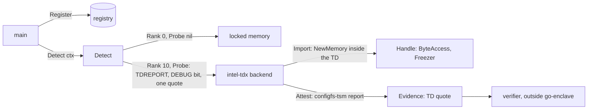

# Intel TDX backend — architecture (proposal)

> **Status: NORMATIVE** · Scope: go-enclave · Last verified: 2026-10-27
> Conflicts with this document are defects. A planned feature ([SPEC](../SPEC.md#features), row `intel-tdx`, status future): no code exists, and no code is written until the owner decides the [open questions](#open-questions) and an Intel TDX host is on the network; each answer then replaces its options here. The backend is out of tree, so its code, tests and user docs live in its own module; this file moves there when the module gains sources.

## Problem

The memory enclave keeps material in `mlock`'d, guarded pages
([platform contract](../memory-enclave/engineering.md#platform-contract)), and
[linux-secretmem](../linux-secretmem/architecture.md) proposes removing them from the kernel's
direct map. Both still trust everything below the process: the host kernel,
and on a virtual machine the hypervisor, the host's administrators and any
device that can DMA into guest memory. On a shared or rented host those are
the parties the owner of the material trusts least, and neither backend can
prove to a remote peer what code holds the material.

Intel Trust Domain Extensions (TDX) run a whole virtual machine, a trust
domain (TD), in memory the host cannot read: the CPU encrypts it with a key
per TD, and the TDX module, running in the CPU's SEAM mode, keeps the
hypervisor out of the TD's private pages and registers. The TDX module also
signs what the TD was launched with, so the TD can prove it to a peer. The
backend proposed here is the go-enclave backend for a process running inside a
TD: it holds material in the TD's private memory, reports that the whole
process is confined, and attests the platform with a TD quote. It is the
`go-enclave-tdx` module the [out-of-tree backend](architecture.md#an-out-of-tree-backend)
sketch already describes.

## What intel-tdx adds over the memory enclave and linux-secretmem

| Path to the material | Memory enclave | linux-secretmem | intel-tdx (inside a TD) |
|---|---|---|---|
| Swap, core dump, `fork` child | locked, `MADV_DONTDUMP`, `MADV_DONTFORK` | the same, set by the kernel | the same: its handles are memory enclaves (Q6) |
| Another process, `ptrace`, `/proc/<pid>/mem` | readable under the ptrace check | refused | readable under the ptrace check, from inside the TD only (Q6) |
| The host kernel, hypervisor and host root | readable | readable | refused: TD private memory is encrypted with the TD's key and the TDX module refuses the host access |
| A device's DMA | possible | possible | refused into private memory; the TD shares only pages it converts to shared |
| Physical memory (DIMM read, cold boot) | plaintext | plaintext | ciphertext under the TD's key |
| The guest kernel inside the TD | readable | removed from the direct map | readable: the guest kernel is inside the TD's trust boundary |
| Code inside the process | readable | readable | readable |
| Proof to a remote peer | the host's platform attests the environment ([SPEC boundaries](../SPEC.md#boundaries)) | the same | its own: a TD quote over the caller's nonce ([attestation](#attestation)) |

The boundary is the whole TD, not the handle: every page of the process,
its heap copies and key schedules included
([key-schedule exposure](architecture.md#key-schedule-exposure)), is private
to the TD. That is why the backend is a `Confiner`. What runs inside the TD,
the guest kernel and firmware included, is inside the trusted base; the
quote is what lets a verifier judge it.

## Hardware, firmware and kernel requirements

Sources, each pinned to a kernel tag or document revision when the code is
written and copied into the module's `docs/reference/` then (see
[standards](#standards-and-specifications)):

- [TDX guest API](https://docs.kernel.org/virt/coco/tdx-guest.html) and
  [include/uapi/linux/tdx-guest.h](https://git.kernel.org/pub/scm/linux/kernel/git/torvalds/linux.git/tree/include/uapi/linux/tdx-guest.h),
  Linux 6.2;
- [configfs-tsm-report](https://git.kernel.org/pub/scm/linux/kernel/git/torvalds/linux.git/tree/Documentation/ABI/testing/configfs-tsm-report),
  Linux 6.7;
- [sysfs-devices-virtual-misc-tdx_guest](https://git.kernel.org/pub/scm/linux/kernel/git/torvalds/linux.git/tree/Documentation/ABI/testing/sysfs-devices-virtual-misc-tdx_guest)
  and [measurement registers](https://docs.kernel.org/driver-api/coco/measurement-registers.html),
  Linux 6.16;
- [Intel TDX guest support](https://docs.kernel.org/arch/x86/tdx.html) in the
  kernel's x86 documentation.

**Hardware and firmware (the host).**

- An Intel Xeon with TDX (5th Gen Xeon Scalable or Xeon 6), with TME-MK and
  TDX enabled in the BIOS and the TDX module loaded by its SEAM loader.
- SGX enabled with Intel's DCAP stack: the TD Quoting Enclave, the Quote
  Generation Service (QGS) and a provisioning certificate cache (PCCS) that
  holds the platform's PCK certificates. Without them the TD gets reports but
  no quotes.
- A host kernel with KVM TDX support (Linux 6.16) and a VMM that launches
  TDs and forwards the TD's GetQuote requests to QGS (QEMU 10.1 with
  `quote-generation-socket`). The VMM runs the TD on the real CPU; it is not
  an emulator.

**Kernel interfaces (the guest).**

- **`/dev/tdx_guest`** (`CONFIG_TDX_GUEST_DRIVER`, Linux 6.2). Its one
  ioctl, `TDX_CMD_GET_REPORT0`, takes 64 bytes of REPORTDATA and returns the
  1024-byte TDREPORT from `TDG.MR.REPORT`. A TDREPORT is MAC'd for the local
  platform only: a remote peer cannot check it, so it is never `Evidence`.
  (The kernel's guest API text names the node `/dev/tdx-guest`; the misc
  device is `tdx_guest`, as its sysfs path shows.)
- **configfs-tsm reports** (`CONFIG_TSM_REPORTS`, Linux 6.7), at
  `/sys/kernel/config/tsm/report/`. A caller creates a report directory,
  writes up to 64 bytes to `inblob`, and reads the quote from `outblob`;
  `provider` reads `tdx_guest`, and `generation` counts writes so a caller
  can detect a concurrent writer. The kernel turns the request into the
  GetQuote hypercall, which the VMM forwards to QGS. A quote too large for
  the kernel's buffer fails the read with `EFBIG`; a quote larger than 8 KB
  is the CBOR Web Token form of DICE-based platforms.
- **Measurement registers** (Linux 6.16), at
  `/sys/devices/virtual/misc/tdx_guest/measurements/`: `mrtd:sha384`,
  `mrconfigid`, `mrowner`, `mrownerconfig` read only, and `rtmr0:sha384` to
  `rtmr3:sha384`, where a 48-byte write at offset 0 extends that RTMR
  (`TDG.MR.RTMR.EXTEND`) and any other write is `EINVAL`.
- **Privileges.** The device node and the configfs tree are root's as the
  kernel creates them. A non-root service needs access granted by the
  deployment; the user doc will say how.
- **Linux on x86-64 only.** A TD is an x86-64 virtual machine, and the owner
  ruled Linux the only runtime target.

## Attestation

Roles follow the RATS architecture, [RFC 9334](https://www.rfc-editor.org/rfc/rfc9334)
(January 2023), as written:

- **Attester:** the TD. The backend's `Attest(ctx, nonce)` (the backend
  placement of [`Attester`](architecture.md#attestation)) produces the
  evidence: a TD quote whose REPORTDATA carries the caller's nonce (Q4).
- **Evidence:** `Evidence{Format, Data}`, `Data` the quote exactly as
  `outblob` returned it, in the format of Intel's
  [TDX DCAP Quoting Library API](https://download.01.org/intel-sgx/latest/dcap-latest/linux/docs/Intel_TDX_DCAP_Quoting_Library_API.pdf),
  revision 0.8, appendices 4 and 5, the revision the kernel cites; `Format`
  is Q5's. The quote carries the TD's measurements (MRTD, RTMR0 to RTMR3,
  MRCONFIGID, MROWNER, MROWNERCONFIG), its attributes (the DEBUG bit among
  them), the TDX module's identity and TCB level, and REPORTDATA, signed by
  the Quoting Enclave's attestation key under the platform's PCK certificate
  chain to Intel's root.
- **Verifier:** outside go-enclave and outside this backend. The SPEC puts
  platform attestation with go-xkms and go-trusted-platform
  ([boundaries](../SPEC.md#boundaries)); a deployment may use Intel's
  Quote Verification Library or a service that wraps it. It checks the
  signature chain against Intel's collateral (PCK CRLs, TCB info, QE
  identity), REPORTDATA against the nonce, the DEBUG bit, the TCB status and
  the measurements against the relying party's policy.
- **Relying party:** the peer that chose the nonce and acts on the verdict.

The backend never parses, appraises or caches a quote, as the seam requires
([what it does not do](architecture.md#what-it-does-not-do)). The one field
it reads is its own TDREPORT's DEBUG attribute in the probe (Q3), to refuse a
TD whose memory the host can read.

## Shape proposed

Recommended answers to the open questions are marked; none is decided.

- **Out of tree** ([SPEC](../SPEC.md#boundaries): no hardware code in this
  module): module `github.com/jeremyhahn/go-enclave-tdx` (Q1), depending on
  go-enclave and `golang.org/x/sys` only; the ioctl and the configfs and
  sysfs files need nothing more. go-enclave never depends on it.
- **Name** `intel-tdx`, the SPEC row's name (the
  [sketch](architecture.md#an-out-of-tree-backend)'s `tdx` changes with the
  code). `main` registers it; nothing registers it at import.
- **Capabilities.** The backend implements `Backend`, `Importer`, `Confiner`
  (`ConfinesProcess` is true: the constructor succeeds only inside a TD),
  `Attester` and `Prober`; not `Sweeper` (Q7). Its handles wrap a memory
  enclave from `enclave.NewMemory` and implement `ByteAccess` and `Freezer`,
  as the sketch shows (Q6). No `Deriver`, `AEAD` or opaque handle: the TDX
  module gives a TD no sealing or key-derivation service, and in-TD byte
  access meets every purpose's contract
  ([class table](architecture.md#what-each-backend-class-provides)).
- **Native interface**, reached through `enclave.As`: `Report(reportData
  [64]byte)` returns the raw TDREPORT, `Measurements()` reads the registers,
  and `ExtendRTMR(index int, digest [48]byte)` extends one (Q8). The seam
  models none of them.
- **Attest** creates a fresh report directory per call (so concurrent calls
  never share `inblob`), writes the 64-byte REPORTDATA (Q4), reads `outblob`,
  checks `provider` is `tdx_guest` and `generation` counts exactly its own
  write, and removes the directory on every path.
- **Rank 10** (Q2); the probe runs only from `Detect` (Q3).
- **Builds everywhere, works in a TD.** The code is `linux && amd64`; every
  other target builds a stub whose constructor and probe return the typed
  unavailable error, so a cross-platform `main` that registers it builds and
  selects another backend.
- **Kernel floor 6.7**, for reports and quotes; the measurement methods
  return the typed unavailable error below 6.16.
- It passes `backendtest` on the real hardware ([test plan](#test-plan)).

## Failure modes

Every failure is a typed error. The names are proposals for the module's own
`errors.go`, named for the mechanism (the device, the report interface, the
register), not the contents; go-enclave's errors are reused where their
meaning holds.

| Failure | Where | Proposed error |
|---|---|---|
| `/dev/tdx_guest` absent (`ENOENT`: not a TD, or no driver), refused (`EACCES`), or `TDX_CMD_GET_REPORT0` failed (`EIO`: the TDCALL failed; `EINVAL`) | constructor, probe, `Report` | `*GuestDeviceError{Op, Cause}` matching `ErrGuestDeviceUnavailable`; `Cause` the `*os.SyscallError` or `*fs.PathError` |
| The TD runs with ATTRIBUTES.DEBUG set | constructor, probe | `ErrDebugTD` |
| `/sys/kernel/config/tsm/report` absent (kernel before 6.7, no `CONFIG_TSM_REPORTS`, configfs not mounted), `provider` not `tdx_guest`, `mkdir`, `inblob` or `outblob` refused (`EIO`: no quote from the host; `EFBIG`; `EACCES`) | probe, `Attest` | `*TSMReportError{Op, Cause}` matching `ErrTSMReportUnavailable` |
| `generation` moved past this call's own write | `Attest` | `*TSMReportError` whose `Cause` is `ErrTSMReportConflict` |
| A nonce empty or over 64 bytes | `Attest` | go-enclave's `ErrInvalidNonce`, its documented meaning widened from `AEAD` to `Attest` with the code; the conformance suite refuses either nonce |
| An ended `ctx` | `Attest`, `Import`, probe | the context's own error, as the conformance suite requires |
| A measurement register absent (before 6.16) or a write refused | `Measurements`, `ExtendRTMR` | `*MeasurementRegisterError{Register, Cause}` matching `ErrMeasurementRegisterUnavailable` |
| Not Linux on x86-64 | constructor, probe | `ErrGuestDeviceUnavailable` with no cause |
| `mlock`, `mprotect`, `munmap` refused; canary mismatch | `Import`, `Freeze`, `Destroy` | the memory enclave's existing `ErrLockedMemoryUnavailable`, `ErrReleasedWithoutWipe`, `ErrEnclaveCorrupted` |

A probe failure reaches `main` wrapped in `Detect`'s `*ProbeError`, and a
lower-ranked backend stays selected. After a successful probe the backend
never falls back: a failing `Attest` or `Import` returns its error
([a missing capability](architecture.md#a-missing-capability)).

## Test plan

The owner ruled (2026-10-17) that a hardware backend is proven on the real
part only: no simulator, emulator or mock device, here or in CI. The plan is
written for one Intel TDX host, on the owner's shopping list and not on the
network today; until it is, no test of the device paths runs anywhere.

**The fixture.** The host above (TDX and SGX enabled, DCAP's QGS and PCCS
running, KVM and QEMU with TDX), launching one TD from a pinned guest image:
Linux 6.16 or later with the TDX guest driver, configfs-tsm and the
measurement registers, Go at the module's toolchain pin. A self-hosted CI
runner inside that TD runs the module's integration target
(`make integration-test-intel-tdx`, `-tags=integration`, `-race`). A second
TD launched with DEBUG set is the negative fixture for `ErrDebugTD`.

**Inside the TD:**

1. `backendtest.TestBackend` with `BackendCapabilities` `Import`, `Confine`,
   `Attest` and `Probe`, and one handle case, `material`
   (`PurposeMaterial`, 32 bytes, `Bytes` and `Freeze`), plus one per key
   purpose. `VerifyEvidence` verifies the quote with the reference verifier
   (Q9) against Intel's collateral, then compares REPORTDATA with the nonce:
   the suite's check that evidence for one nonce fails against another is
   the binding test. The residue sweep runs (Linux).
2. `Detect` with the backend registered selects `intel-tdx` and reports
   locked memory's result beside it.
3. Two hundred concurrent `Attest` calls return valid quotes, each binding its
   own nonce, and leave no report directory behind.
4. `ExtendRTMR(3, d)` changes `rtmr3:sha384` to SHA-384(old ‖ d), and the next
   quote carries the new value.
5. The probe and `Attest` fail with `*TSMReportError` while the host's QGS is
   stopped, and succeed once it is restarted: a real outage of the real
   service, not a stand-in.

**On the host, outside any TD:** the constructor and probe return
`*GuestDeviceError` (`ENOENT`), and `Detect` keeps locked memory.

**In the DEBUG TD:** the probe returns `ErrDebugTD`.

**Everywhere else** (go-enclave's CI, a developer's machine): the module's
unit tests cover what needs no device (REPORTDATA layout, error texts and
unwrapping, the stub's typed error), and its device tests are built only
under the integration tag. go-enclave's own CI gains nothing.

## Open questions

### Q1: one module per row, or one confidential-VM module

- **One module per row** (recommended): `go-enclave-tdx` for this row, as the
  sketch names it; amd-sev gets its own. Each is tested on its own hardware
  and released on its own, and a TDX defect never blocks a SEV release.
- **One `go-enclave-coco` module** for TDX and SEV-SNP, which both reach
  quotes through configfs-tsm: one copy of the report client, but one module
  whose release waits on two kinds of hardware.

Either way the configfs-tsm client is vendor-neutral. If the amd-sev proposal
also uses it, the two settle where the one copy lives before either is coded.

### Q2: rank

- **Rank 10** (recommended), the value every confidential-VM backend
  (intel-tdx, amd-sev) reports: above locked memory (0) and linux-secretmem's
  proposed 1, with room for further software backends between. TDX and SEV
  never run on one host, so the equal rank never ties in practice; the value
  is agreed across the hardware proposals and the owner decides it once, as
  the [detection scope fence](../backend-detection/architecture.md#scope-fence)
  leaves to out-of-tree backends.
- **Rank 2**, the next value above secretmem: simpler, but every later
  software backend would have to sit above a hardware one or renumber it.

### Q3: the detection probe

- **TDREPORT, DEBUG bit and one quote** (recommended): `Probe(ctx)` checks
  `ctx`, gets a TDREPORT through `/dev/tdx_guest`, refuses a DEBUG TD, then
  produces one quote over a probe nonce through configfs-tsm and discards it.
  It proves the whole path `Attest` depends on, so a TD whose host has no QGS
  is passed over with a `*TSMReportError` that says so: every environment the
  backend is selected in is attestable. It costs one round trip to the host's
  QGS per `Detect`. How `ctx` bounds a blocking `outblob` read is settled in
  the implementing slice.
- **TDREPORT and DEBUG bit only:** no host round trip, but it selects a TD
  that cannot attest, and the first `Attest` fails instead.
- **CPUID or `/proc/cpuinfo`'s `tdx_guest` flag only:** cheapest, proves
  neither the driver nor the quote path.

### Q4: how the nonce reaches REPORTDATA

- **The nonce, zero-padded to 64 bytes** (recommended): what the kernel's
  `inblob` takes and what Intel's verifiers compare, so a relying party
  checks REPORTDATA with no construction of ours. The backend writes all 64
  bytes itself, never relying on the kernel's buffer. A shorter nonce and the
  same nonce with trailing zeros give one REPORTDATA; a relying party that
  cares sends 64 bytes, and the user doc will say so.
- **SHA-512 of the nonce:** binds its length, but every verifier must know a
  construction go-enclave designed, which standards first rules out where the
  interface already takes the raw bytes.

The amd-sev proposal faces the same 64-byte field. Recommended: one rule for
every attesting backend, stated once in [Attestation](architecture.md#attestation)
with the first backend's code.

### Q5: the evidence format name

- **The kernel's `provider` value, `tdx_guest`** (recommended): the kernel
  defines it as the name of `outblob`'s format, so the backend copies it and
  invents nothing, and a verifier that reads configfs-tsm already knows it.
- **A name of ours**, such as `intel-tdx-quote`: matches the row's name, but
  is a second name for a format that has one.

### Q6: where handles live inside the TD

- **Memory enclaves from `enclave.NewMemory`** (recommended), as the sketch
  does: the exported API, every memory-enclave guarantee inside the TD, no
  widening of go-enclave's surface.
- **linux-secretmem pages**, if that row lands: the guest kernel's direct map
  would lose them too. Its proposed constructor is unexported, so this waits
  on that row; the backend can then import through it with no seam change.

### Q7: `Sweeper`

- **No `Sweeper`** (recommended): the handles wrap memory enclaves, which
  `WipeAll`'s first phase already sweeps; a second sweep of the same pages
  would only count them twice. The class table's "yes" for TEE memory gains a
  note with the code.
- **A `Sweeper`** that destroys every live handle it made: matches the table
  as written, at the cost of a second registry of the same handles.

### Q8: RTMR extension

- **Native only** (recommended): `ExtendRTMR` is a method `main` calls
  through `As`. An extension cannot be undone for the TD's life, so it is a
  process-wide decision for `main`, never a library's
  ([SPEC boundaries](../SPEC.md#boundaries)).
- **The backend extends RTMR3** with an event at construction (for example,
  that go-enclave selected it): a verifier would see it, but importing and
  constructing would change measured state no caller asked to change.

### Q9: the verifier the tests use

- **Intel's Quote Verification Library** (recommended), the reference
  implementation of the quote specification, run from the test binary as a
  test-only dependency (cgo or an external process), never linked into the
  backend.
- **A third-party pure-Go verifier:** no cgo, but the test would certify
  against an implementation that is not the specification's owner's.
- **A remote verification service:** needs an account and the network in
  every run.

## Rejected alternatives

- **A TDX simulator, emulator or mock `/dev/tdx_guest` for CI.** Ruled out by
  the owner: a hardware backend is proven on the real part only.
- **In this module.** The SPEC keeps hardware code out of go-enclave.
- **Intel's `libtdx_attest` through cgo, or a vsock link to QGS.** The kernel's
  configfs-tsm interface is the upstream path, needs no network setup in the
  TD, and keeps the module free of cgo.
- **Wrapping the quote in an Entity Attestation Token or another envelope.**
  It designs a format where Intel's exists; `Evidence` carries the quote as
  produced.
- **Appraising the quote in the backend** (refusing to start below a TCB
  level). That is the verifier's role, with the relying party's policy.
- **A TDREPORT as `Evidence`.** Only the local platform can check its MAC.

## Standards and specifications

Each is followed as written. Each is copied into the module's
`docs/reference/` with its revision and implementing symbol when the code is
written, not now.

| Document | Revision | Used for |
|---|---|---|
| [RFC 9334](https://www.rfc-editor.org/rfc/rfc9334), RATS Architecture | January 2023 | Attester, Evidence, Verifier and Relying Party roles |
| [Intel TDX Module ABI Specification](https://www.intel.com/content/www/us/en/developer/tools/trust-domain-extensions/documentation.html) | the release for the host's TDX module, pinned with the code (the kernel driver follows v1.0) | TDREPORT layout, `TDG.MR.REPORT`, `TDG.MR.RTMR.EXTEND`, ATTRIBUTES.DEBUG |
| [Intel TDX Guest-Hypervisor Communication Interface](https://www.intel.com/content/www/us/en/developer/tools/trust-domain-extensions/documentation.html) | pinned with the code (the kernel driver follows v1.0) | GetQuote, which the kernel issues |
| [Intel TDX DCAP Quoting Library API](https://download.01.org/intel-sgx/latest/dcap-latest/linux/docs/Intel_TDX_DCAP_Quoting_Library_API.pdf) | 0.8, appendices 4 and 5 | the quote format in `Evidence.Data` |
| Linux kernel ABI: `tdx-guest.h`, configfs-tsm-report, sysfs-devices-virtual-misc-tdx_guest | the kernel tag pinned with the code (introduced in 6.2, 6.7, 6.16) | the interfaces above; cited by URL, as a kernel interface is not a standard |

## What it does not do

No code in go-enclave and no change to its seam (a widened meaning of
`ErrInvalidNonce` aside, Q4's rule once decided), no host-side TDX (the
backend runs inside a TD, never in the VMM), no SGX (row `intel-sgx`), no
parsing or appraisal of quotes, no sealing or key derivation (a TD has no
TDX sealing key), no TD migration support, no protection against the guest
kernel or code inside the process, and no simulator.
