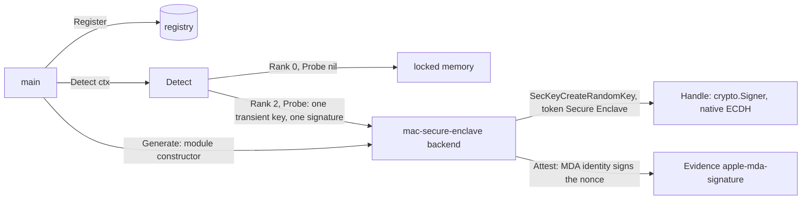

# Mac Secure Enclave backend — architecture (proposal)

> **Status: NORMATIVE** · Scope: go-enclave · Last verified: 2026-11-12
> Conflicts with this document are defects. A future feature ([SPEC](../SPEC.md#features), row `mac-secure-enclave`), proposed for `planned` with this design. A stub-only first slice exists at `backends/macse` ([what the first slice ships](#what-the-first-slice-ships)): its typed errors, its probe, and `New`, `Name` and `Rank` 2, with no Security framework binding, so on every platform `New` and the probe refuse with `ErrSecureEnclaveUnavailable`. That slice adopts the module location (Q1) and the rank (Q8); the other [open questions](#open-questions) wait for the owner, and no binding, handle or attestation code is written until they are decided; each answer then replaces its options here. The backend's own docs move to its module with its code.

## Problem

The memory enclave keeps material in `mlock`'d, guarded pages
([platform contract](../memory-enclave/engineering.md#platform-contract)). On
macOS that is the whole defence: darwin has `mlock` and `RLIMIT_CORE`, and no
dump or fork exclusion the platform contract can use. Anything that reads the
process's memory reads the material:

- the kernel, and any root process or debugger that obtains the task port;
- code inside the process, and a crash or diagnostic report that captures its
  pages;
- the application processor's caches and side channels, which material in
  user memory shares with every other process.

Apple's Secure Enclave is a coprocessor on the same system on chip (or, on an
Intel Mac, on the T2 chip) with its own boot chain, its own OS (sepOS) and
memory that the application processor cannot read. Third-party software can
ask it to generate a NIST P-256 private key that never leaves it, and then to
sign, agree a key, or decrypt with that key. The application processor holds
only a reference and a wrapped form of the key that only that Secure Enclave
can unwrap. The backend proposed here gives a Go program such keys as
go-enclave handles: a secure element in the
[backend classes](architecture.md#what-each-backend-class-provides), not TEE
memory. It holds no bytes for the caller; it holds keys.

## What mac-secure-enclave adds over the memory enclave

The program runs on macOS in both columns.

| Path to the material | Memory enclave | mac-secure-enclave |
|---|---|---|
| Kernel, root, a debugger with the task port reads process memory | plaintext | the private key is not in process memory; only its wrapped form and a reference are |
| Code inside the process | readable through `WithBytes` | can use the key while it holds the handle, cannot read it |
| Crash or diagnostic report, swap | locked pages; no dump exclusion on darwin | the wrapped form only, useless off this Secure Enclave |
| DIMM or bus read, cold boot | plaintext | the Secure Enclave's memory is encrypted and authenticated by its Memory Protection Engine |
| The key copied to another machine | possible once read | impossible: the wrapping key is derived from the Secure Enclave's UID, which no software reads |
| Attestation of the environment | through the host's platform ([SPEC boundaries](../SPEC.md#boundaries)) | its own, where the Mac is enrolled for Managed Device Attestation ([Q4](#q4-attestation)) |

It does not stop code that holds a handle (or, on the same Mac, a process
that obtains the wrapped form and passes the key's access control) from using
the key, and it gives nothing for material that is not a P-256 key: an AES
key, a seed or a password cannot live in the Secure Enclave through any
interface Apple offers third-party software.

## Hardware, firmware and OS requirements

Sources, each cited by title at the edition current when this proposal was
written. They were recorded offline: the implementing slice confirms the
latest edition, pins it, and copies each into `docs/reference/` with the code
([standards first](../reference/README.md)).

- Apple, *Apple Platform Security* (the platform security guide), the
  chapters "Secure Enclave" (the Secure Enclave Processor, the Memory
  Protection Engine, the Secure Enclave Boot ROM, the AES engine and the
  public-key accelerator) and "Keychain data protection".
- Apple Developer Documentation, *Protecting keys with the Secure Enclave*:
  which keys third-party code may create there (P-256 only, generated in the
  enclave, never imported) and the attributes that request it
  (`kSecAttrTokenIDSecureEnclave`).
- Apple Developer Documentation, Security framework reference:
  *SecKeyCreateRandomKey*, *SecKeyCreateSignature*,
  *SecKeyCopyKeyExchangeResult*, *SecKeyCreateDecryptedData*,
  *SecKeyCopyPublicKey*, *SecAccessControlCreateWithFlags* and *SecKeyAlgorithm*.
- Apple, *Apple Platform Deployment*, "Managed Device Attestation for Apple
  devices", and Apple Developer Documentation, Device Management, the *ACME
  Certificate* payload (`HardwareBound`, `Attest`): hardware-bound identity
  keys and their attestation certificates.
- Apple Developer Documentation, *Establishing your app's integrity* and
  *DCAppAttestService* (App Attest), considered in [Q4](#q4-attestation).
- The Go project, *cgo* command documentation, for the binding
  ([Q2](#q2-the-binding)).

### Hardware

- **A Mac with a Secure Enclave:** every Mac with Apple silicon (M1 and
  later), and Intel Macs with the Apple T2 Security Chip. Intel Macs without a
  T2 have none, and the probe refuses them.
- **Not a virtual machine.** A macOS guest under Virtualization.framework is
  not given the host's Secure Enclave for third-party keys; this proposal
  assumes the probe fails there, and the [test plan](#test-plan-on-the-real-hardware)
  proves it. Hosted macOS CI runners are such guests.
- **Attestation needs Apple silicon:** Managed Device Attestation on a Mac is
  documented for Apple silicon on macOS 14 or later; a T2 Mac can hold keys
  but cannot attest ([Q4](#q4-attestation)).

### The OS side: the interfaces the backend uses

- **The Security framework**, a C API in a system framework. A key is created
  with `SecKeyCreateRandomKey` and the attributes `kSecAttrKeyType` =
  `kSecAttrKeyTypeECSECPrimeRandom`, `kSecAttrKeySizeInBits` = 256,
  `kSecAttrTokenID` = `kSecAttrTokenIDSecureEnclave`, and an access-control
  object (`SecAccessControlCreateWithFlags`) carrying `privateKeyUsage` and an
  accessibility class (`kSecAttrAccessibleWhenUnlockedThisDeviceOnly` is
  proposed). Operations go through `SecKeyCreateSignature` (ECDSA with
  SHA-256), `SecKeyCopyKeyExchangeResult` (ECDH) and `SecKeyCreateDecryptedData`
  (ECIES, the X9.63 SHA-256 AES-GCM variants).
- **Transient and persistent keys.** A key created without
  `kSecAttrIsPermanent` lives as long as its `SecKeyRef`; a permanent key is
  stored, wrapped, in the data protection keychain, which requires the binary
  to be code-signed with a `keychain-access-groups` entitlement. Every key the
  seam's operations make is transient ([importing](architecture.md#importing-with-a-purpose)),
  so the backend needs no entitlement; persistent provisioning is the module's
  own API ([Q6](#q6-persistent-keys)).
- **User presence.** Access-control flags can require Touch ID or the login
  password for each use. The backend sets none by default: a prompt cannot be
  answered in a server process, and the seam's opaque operations take no
  context to cancel one. A caller that wants one asks the module's own
  constructor for it.
- **No Linux path.** The Secure Enclave's key services are reached only
  through sepOS's mailbox, which only Apple's kernels drive; no Linux
  interface to them exists that this proposal could cite, Asahi Linux on
  Apple silicon included. The backend therefore runs on darwin only, and the
  [Linux-only runtime ruling](#q7-the-test-hardware) cannot cover it: it is
  proven on a physical Mac or not at all.

## Attestation

The SPEC requires every environment to be attestable
([boundaries](../SPEC.md#boundaries)). The Secure Enclave gives third-party
code no report it signs over a caller's nonce. What macOS offers is Managed
Device Attestation: on a Mac enrolled in device management, an ACME payload
with `HardwareBound` and `Attest` makes the OS generate an identity key in the
Secure Enclave and obtain, from Apple, an attestation certificate chaining to
Apple's Enterprise Attestation Root CA. The certificate binds that key to
properties Apple's servers read from the device: serial number and UDID (when
the payload asks), OS and sepOS versions, and the boot security state.

The proposal ([Q4](#q4-attestation)) uses that identity as the backend's
`Attester`:

- **Evidence.** `Attest(ctx, nonce)` takes 1 to 64 bytes, signs them with the
  attested identity key in the Secure Enclave (ECDSA P-256, SHA-256), and
  returns `Evidence{Format: "apple-mda-signature", Data: …}`, where `Data` is
  the DER attestation certificate chain from the keychain identity followed by
  the DER signature over the nonce, in a length-prefixed layout the module
  documents ([Q5](#q5-evidence-shape)).
- **What it binds.** The nonce, signed by a key Apple certified to live in
  this Mac's Secure Enclave, with the device properties the certificate
  carries. It binds no measurement of the program: macOS has no
  per-process launch measurement third-party code can obtain.
- **Who verifies.** The relying party, through the format's verifier,
  outside this module: go-enclave never parses or appraises evidence
  ([SPEC boundaries](../SPEC.md#boundaries)); platform attestation belongs to
  go-xkms and go-trusted-platform. The verifier checks the chain to Apple's
  root, the certificate's freshness and device properties against its policy,
  and the signature over the nonce it issued.
- **What it does not prove.** That a handle's key lives in the Secure
  Enclave: the identity is the OS's key, not the handle's, and Apple
  attests no key the backend makes. The evidence proves the environment, which
  is what the SPEC asks; a relying party that needs per-key proof needs
  [Q4](#q4-attestation)'s App Attest option.

## What the first slice ships

`backends/macse` is a nested module with its own `go.mod`, requiring the root
module, and is built with the other backend modules. It provides:

- the typed errors [Failure modes](#failure-modes) proposes,
  `ErrSecureEnclaveUnavailable`, `ErrSecureEnclaveOperation`,
  `ErrInvalidSignInput` and `*SecurityError` naming the failing step and its
  `OSStatus`, and also `*PlatformError`;
- the probe: create one transient key, make one signature, verify it in Go;
- `New(ctx)`, which runs the same probe and builds the backend only if it
  passes; `Name` (`mac-secure-enclave`); `Rank` 2; `Probe`.

It refuses everything else. It has no Security framework binding yet, so on
every platform, darwin included, `New` and `Probe` return
`ErrSecureEnclaveUnavailable` and `Detect` keeps a lower-ranked backend. It has
no `Generate`, no handles, no `Attester` and no `Sweeper`. Registering it is
safe on any platform and changes nothing for a caller.

Choices this slice adopted: the module location (Q1, a nested module, at
`backends/macse`) and the rank (Q8, rank 2). Open for the owner: the binding
(Q2), what a handle offers (Q3), attestation (Q4), the evidence shape (Q5),
persistent keys (Q6) and the test hardware (Q7). The darwin binding follows
those rulings.

## Shape proposed

Recommended answers to the open questions are marked; Q1 and Q8 are adopted by
[the first slice](#what-the-first-slice-ships), the rest are not decided.

- **A nested module** (Q1, adopted), `backends/macse` in this repository, in
  the shape of `backends/armtrustzone`: its own `go.mod`, requiring the root
  module, never the reverse; `main` registers it explicitly; nothing registers
  it at import.
- **Name** `mac-secure-enclave`.
- **Binding through cgo** (Q2) to the Security and CoreFoundation frameworks;
  no third-party dependency.
- **Capabilities**, as the [secure-element class](architecture.md#what-each-backend-class-provides)
  provides: `Attester`, `Sweeper` and `Prober` on the backend; `crypto.Signer`
  on its handles, with ECDH and ECIES decryption reached through `As` as the
  module's native interface (Q3). No `Importer`: the Secure Enclave imports
  nothing, so `Sealed.OpenIn` into it fails with `*CapabilityError` before any
  work ([a missing capability](architecture.md#a-missing-capability)). No
  `ByteAccess`, `Freezer`, `AEAD`, `Deriver` or `Confiner`.
- **Handles** come from the module's constructor,
  `Generate(ctx) (enclave.Handle, error)`, which creates a transient P-256 key;
  `Public()` returns its `*ecdsa.PublicKey`; `Destroy` releases the
  `SecKeyRef` and wipes the module's copy of the wrapped form, after which
  every fallible method returns `ErrEnclaveDestroyed`
  ([opaque operations](architecture.md#opaque-operations)). Device calls are
  bounded by the backend's configured timeout.
- **`Sweep`** destroys every handle the backend made and returns the count it
  could not; transient keys leave nothing in the keychain.
- **Rank 2** (Q8, adopted), the probe runs only from `Detect`, and the constructor
  checks the same conditions, so a backend that cannot attest is never built.
- It passes `backendtest` with `VerifyEvidence` set, on a physical Mac (Q7).
- **darwin on arm64 and amd64 only.** On any other GOOS, or with cgo off, a
  stub compiles whose constructor and probe return the typed unavailable
  error, so a cross-platform `main` that registers it builds everywhere and
  Linux CI builds the stub.

## Failure modes

Every failure is a typed error. The names are proposals, named for the
mechanism (the Security framework call), not the contents, and live in the
backend's module; go-enclave's existing errors are reused where their meaning
holds.

| Failure | Where | Proposed error |
|---|---|---|
| No Secure Enclave: an Intel Mac without T2, a virtual machine, `errSecUnimplemented` or `errSecParam` from `SecKeyCreateRandomKey` with the Secure Enclave token | probe, construction | `*SecurityError{Op, Status}` matching `ErrSecureEnclaveUnavailable`; `Op` names the call (`create`, `sign`, `identity`), `Status` the `OSStatus` |
| No attestable identity: no MDA identity in the keychain, its certificate not hardware-bound, or access to it refused | probe, construction | the same, `Op` `identity` |
| A non-darwin build, or cgo off | probe, construction | `ErrSecureEnclaveUnavailable` with no cause |
| The key's access control refuses the use (device locked under `WhenUnlocked`, user presence not given) | `Sign`, native calls, `Attest` | `*SecurityError` matching `ErrSecureEnclaveOperation`, `Status` the `OSStatus` (`errSecInteractionNotAllowed`, `errSecAuthFailed`) |
| The Secure Enclave refuses or fails an operation | `Sign`, native calls, `Attest` | the same |
| The device call outlasts the backend's timeout | `Sign`, native calls | the same, `Op` naming the call, wrapping `context.DeadlineExceeded` |
| A digest not 32 bytes, or `opts` not SHA-256 | `Sign` | `ErrInvalidSignInput` (proposed in the module) before any device call |
| A nonce empty or over 64 bytes | `Attest` | go-enclave's existing `ErrInvalidNonce`, before any request |
| `ctx` ended | every call taking one | `ctx.Err()`, as the seam requires |
| `Import`, `OpenIn` into the backend | caller | the existing `*CapabilityError{Capability: CapabilityImport}` |
| A handle used after `Destroy` | every fallible method | the existing `ErrEnclaveDestroyed` |

`ErrSecureEnclaveUnavailable` means "not here"; `ErrSecureEnclaveOperation`
means "here, and this operation failed". A probe failure reaches `main`
wrapped in `Detect`'s `*ProbeError`, and a lower-ranked backend stays
selected. A backend that probed usable and then fails returns its error; it
never falls back to a software key
([a missing capability](architecture.md#a-missing-capability)).

## Test plan on the real hardware

The backend is proven on the real part only: no simulator, emulator or mock
device (owner, 2026-10-17). There is no Linux path to the Secure Enclave, so
this plan needs a physical Mac as a self-hosted runner, which the Linux-only
runtime ruling does not provide ([Q7](#q7-the-test-hardware)). Nothing below
runs until the owner rules on it.

1. **Record the machine.** Before the first run, record the Mac model, the
   chip (`sysctl machdep.cpu.brand_string`), the macOS and sepOS versions, the
   boot security policy, and the device-management enrolment and ACME payload
   that issued the identity.
2. **The runner.** A self-hosted runner on that Mac, logged in, with the
   identity's keychain unlocked, runs the backend module's tests in a fresh
   build per job with the pinned Go toolchain and the Xcode command-line tools.
3. **Conformance.** `backendtest.TestBackend` with `VerifyEvidence` set to a
   verifier that checks the attestation chain to Apple's Enterprise
   Attestation Root CA, the device properties against the recorded machine,
   and the signature over the suite's nonce. The residue sweep does not run:
   `memscan` is Linux-only, and the backend holds no plaintext to sweep.
4. **The key never leaves.** Sign with a handle, verify with `Public()`;
   assert that no Security framework call the module makes can export the
   private key (`SecKeyCopyExternalRepresentation` on the private key fails),
   and that the wrapped form, moved to a second Mac, does not sign.
5. **Detection.** With locked memory and mac-secure-enclave registered,
   `Detect` selects mac-secure-enclave and every `ProbeResult` is nil.
6. **Refusals.** In a macOS virtual machine on the same Mac (and on a T2 or
   pre-T2 Intel Mac, if one is available): the probe returns
   `ErrSecureEnclaveUnavailable` naming the step, and `Detect` keeps locked
   memory. On the runner with the identity removed: the same error, `Op`
   `identity`. With the screen locked: `Sign` returns
   `ErrSecureEnclaveOperation`. Concurrent `Sign` and `Attest` calls from many
   goroutines each verify.
7. **The stub.** Linux CI builds the module with the stub and runs its unit
   tests: the constructor and probe return `ErrSecureEnclaveUnavailable`.

## Open questions

### Q1: where the module lives

- **A nested module in this repository** (recommended; adopted by the first
  slice), `backends/macse`, as `backends/armtrustzone` is: the SPEC's
  boundary keeps hardware code out of the root module, not out of the
  repository, and the precedent shares the root's release and CI.
- **A repository of its own:** independent releases, but a second CI and
  release pipeline for a module whose tests need a Mac either way.

### Q2: the binding

- **cgo** (recommended): Apple's supported way to call the Security
  framework, and no third-party dependency. The darwin code builds only on a
  Mac with the command-line tools; Linux CI builds the stub.
- **A dlopen binding without cgo** (for example `github.com/ebitengine/purego`):
  Linux CI could cross-compile the darwin code, but it adds a third-party
  dependency to the module and calls a C ABI by hand.

### Q3: what a handle offers

- **`crypto.Signer`, with ECDH and ECIES decryption through `As`**
  (recommended): the signer plugs into `tls.Certificate` and
  `x509.CreateCertificate`; key agreement has no standard shape and goes
  native, as the seam's [opaque operations](architecture.md#opaque-operations)
  say; ECIES in Apple's X9.63 form is not what `crypto.Decrypter` callers
  expect.
- **Also `crypto.Decrypter` for ECIES:** one more standard shape, at the cost
  of a ciphertext format only this backend produces behind a generic
  interface.

### Q4: attestation

- **Managed Device Attestation** (recommended): the backend's `Attester`
  signs the nonce with the MDA identity, as [Attestation](#attestation)
  describes; the backend is constructed only where that identity exists.
  Apple-signed, and needs no entitlement or app bundle, but only on Apple
  silicon Macs enrolled in device management.
- **App Attest** (`DCAppAttestService`): attests each key the service makes to
  Apple's App Attestation Root, but only for a code-signed app bundle with an
  App ID, and its keys sign only App Attest assertions, not arbitrary data.
- **No `Attester`**, with the environment attested through the host's
  platform as the memory enclave is: works on every Mac with a Secure
  Enclave, but it is an exception to the SPEC's "every environment must be
  attestable" for a hardware backend, which only the owner can grant.

### Q5: evidence shape

- **A documented length-prefixed layout** (recommended): the certificate chain
  in DER, then the signature in DER, each preceded by a 4-byte big-endian
  length; format name `apple-mda-signature`.
- **An IETF RATS Conceptual Message Wrapper** (draft-ietf-rats-msg-wrap): one
  standard wrapper, but a draft to pin and watch, as [amd-sev's Q6](amd-sev.md#q6-evidence-shape)
  also weighs.

### Q6: persistent keys

- **Transient only in this row** (recommended): no entitlement, nothing left
  in the keychain, and the seam's rule that every import is transient holds
  for generated keys too.
- **A persistent provisioning API** (keychain items by label): what a service
  that restarts needs, but it requires a signed binary with a
  `keychain-access-groups` entitlement and decides key lifecycle questions
  for a later row.

### Q7: the test hardware

- **A physical Apple silicon Mac as a self-hosted runner, enrolled in device
  management** (recommended): the only machine that proves the backend; the
  owner names it, as a server was named for amd-sev. The Linux-only runtime
  ruling covers BSD and Windows; this row asks for macOS as a ruled
  exception for one module's job.
- **Keep the row planned** until such a Mac exists: the design stands, and
  the module stays the refusing stub of the first slice.

### Q8: rank

- **Rank 2** (recommended; adopted by the first slice), as `arm-trustzone` reports: above locked memory
  (0); linux-secretmem (1) never shares a host with it.
  The hardware rows' order among themselves is for the owner to rule once
  across the sibling proposals.
- **Rank 0, never selected over locked memory by `Detect`**: since the
  backend imports nothing, a `main` that opens sealed material into the
  detected backend would fail; this keeps detection for material and leaves
  the Secure Enclave to explicit use.

## Rejected alternatives

- **A simulator or mock Secure Enclave for tests.** Ruled out by the owner: a
  hardware backend is proven on the real part.
- **CryptoKit (`SecureEnclave.P256`).** A Swift-only API; calling it from Go
  needs a Swift shim, and it reaches the same keys the Security framework
  does.
- **A helper process (an app or XPC service) holding the keys.** It would
  move operations across a process boundary, a transport go-enclave never
  carries ([SPEC boundaries](../SPEC.md#boundaries)).
- **Keeping the backend's material in the Secure Enclave by wrapping it with
  an ECIES key.** That is a `KeyProtector`: a secure-element provider for the
  keyprotector-providers row (#264), not this backend's handles.
- **Parsing or appraising the evidence in go-enclave.** Ruled out by the SPEC.

## What it does not do

No code in this module, no bytes held for the caller, no import, no
symmetric keys, no persistent keys (unless [Q6](#q6-persistent-keys) is
taken), no evidence verification, no user-presence prompts by default, and
nothing off darwin.
