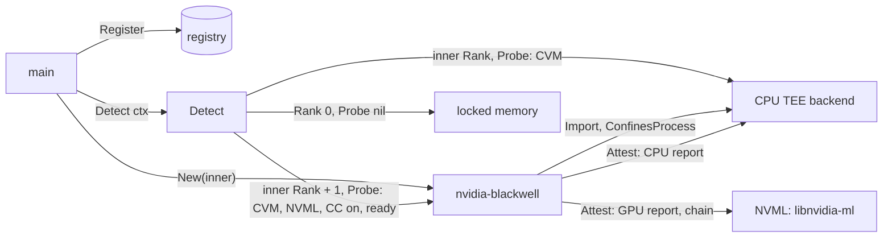

# NVIDIA Blackwell backend — architecture (proposal)

> **Status: NORMATIVE** · Scope: go-enclave · Last verified: 2026-10-27
> Conflicts with this document are defects. A future feature ([SPEC](../SPEC.md#features)): no code exists, and no code is written until the owner decides the [open questions](#open-questions); each answer then replaces its options here. The row moves from future, and gains a milestone and a lane, only when the owner moves it and the [test hardware](#test-plan) is on the network.

## Problem

The owner keeps Blackwell on the table "if it makes sense", and requires every
environment to be attestable ([SPEC boundaries](../SPEC.md#boundaries)). An
NVIDIA Blackwell GPU in confidential-computing (CC) mode is not a place to keep
a process's keys: it has no key store the CPU can call, and it runs CC only
when assigned to a confidential VM (CVM) on Intel TDX or AMD SEV-SNP. What it
changes is the CVM's trusted computing base. With TEE-I/O (PCIe IDE and TDISP),
the CVM accepts the GPU into its TCB and the GPU reads and writes the CVM's
private memory directly; without it, the GPU still runs the CVM's code on its
data. In both cases a quote from the CPU alone no longer describes everything
that can reach the material: the GPU's own evidence is part of the
environment's.

The backend proposed here answers "if it makes sense" with a narrow yes
([Q1](#q1-does-a-blackwell-backend-make-sense)): a backend that holds material
where the CPU TEE backend holds it, and adds the GPU's evidence and a readiness
gate, so a CVM with a Blackwell GPU attests as one environment.

## What nvidia-blackwell adds over the memory enclave and linux-secretmem

| Path to the material | Memory enclave | [linux-secretmem](../linux-secretmem/architecture.md) | CPU TEE backend (intel-tdx, amd-sev) | nvidia-blackwell |
|---|---|---|---|---|
| Host kernel, hypervisor, host root | readable | readable: secretmem guards one kernel's own paths, not a hypervisor's | refused: CVM private memory | refused: material is held where the CPU TEE backend holds it |
| `/proc/<pid>/mem`, `ptrace`, GUP inside the same kernel | readable | refused | readable to the CVM's own root | as the CPU TEE backend |
| A GPU accepted into the CVM's TCB (TEE-I/O) | not applicable | not applicable | reaches private memory; its evidence is not in this backend's `Attest` | reaches private memory; its evidence is in `Attest` |
| Evidence from `Attester` | none: the host's platform attests | none: the host's platform attests | the CPU's report | the CPU's report and one GPU report per GPU, bound to one nonce |
| Selected by `Detect` when | always (rank 0) | the kernel allows `memfd_secret` | the process runs in that CVM | the process runs in that CVM and every GPU is in CC mode and set ready |

It adds no protection to the material itself beyond the CPU TEE's: the bytes
sit in the same private memory. What it adds is evidence that covers the GPU
and a probe that refuses a GPU not yet admitted.

## Hardware, firmware and kernel requirements

Sources: NVIDIA's [confidential computing documentation](https://docs.nvidia.com/confidential-computing/)
and [attestation documentation](https://docs.nvidia.com/attestation/index.html)
(NVIDIA Attestation SDK, NVAT: the `nvattest` CLI, C API and Rust bindings;
the NVIDIA Remote Attestation Service, NRAS), the NVML header carried by
[go-nvml](https://github.com/NVIDIA/go-nvml) (NVML API version 13), the kernel's
[configfs-tsm report ABI](https://git.kernel.org/pub/scm/linux/kernel/git/torvalds/linux.git/tree/Documentation/ABI/testing/configfs-tsm-report)
(Linux 6.7) and its [PCI TSM](https://www.kernel.org/doc/html/latest/driver-api/pci/tsm.html)
(`drivers/pci/tsm.c`, Linux 6.19). Each vendor document is pinned at the
revision current when the code is written.

- **The GPU.** A Blackwell part (`nvmlDeviceGetArchitecture` returns
  `NVML_DEVICE_ARCH_BLACKWELL`) whose firmware supports CC, with CC mode set to
  on by the host administrator before the GPU is passed to the CVM, using
  NVIDIA's host tooling. DevTools mode (`NVML_CC_SYSTEM_DEVTOOLS_MODE_ON`) is a
  debugging mode and does not count as on.
- **The CPU TEE.** GPU CC runs only inside a CVM: an Intel TDX trust domain or
  an AMD SEV-SNP guest, which the [intel-tdx](../SPEC.md) and
  [amd-sev](../SPEC.md) rows' backends already cover. KVM with VFIO passes the
  GPU through.
- **Two data paths.** Without TEE-I/O, the driver encrypts every transfer
  between the CVM and the GPU through bounce buffers in shared memory, and
  the GPU never reaches private memory. With TEE-I/O, PCIe IDE encrypts the
  link and TDISP admits the device into the CVM's TCB; it needs CPU support
  (Intel TDX Connect, AMD SEV-TIO), the host kernel's PCI TSM (6.19), and
  guest-side device acceptance, which is still landing upstream and is
  watched until a kernel release carries it.
- **Multi-GPU modes.** NVML reports none, protected PCIe and NVLink
  encryption (`NVML_CC_SYSTEM_MULTIGPU_NONE`, `_PROTECTED_PCIE`, `_NVLE`)
  ([Q6](#q6-which-parts-and-modes)).
- **The guest.** A Linux kernel with TDX or SEV-SNP guest support and
  configfs-tsm (6.7) for the CPU report; NVIDIA's open GPU kernel modules on a
  driver branch whose release notes list Blackwell CC, at its latest release;
  `libnvidia-ml.so.1` from the same driver; the services NVIDIA's deployment
  guide lists for CC mode.
- **The ready state.** In CC mode the GPUs refuse work until something in the
  CVM, having verified their evidence, sets the ready state
  (`nvmlSystemSetConfComputeGpusReadyState`). That is the platform's
  attestation agent, not this backend
  ([rejected alternatives](#rejected-alternatives)).

### GPU attestation

- **Evidence.** NVML's `nvmlDeviceGetConfComputeGpuAttestationReport` returns
  the GPU's SPDM measurement response (at most `NVML_CC_GPU_ATTESTATION_REPORT_SIZE`,
  8 KiB) over a caller nonce of exactly 32 bytes (`NVML_CC_GPU_CEC_NONCE_SIZE`),
  signed by the GPU's device identity key;
  `nvmlDeviceGetConfComputeGpuCertificate` returns the certificate chain to
  NVIDIA's device identity root. The measurement exchange is DMTF
  [DSP0274 (SPDM)](https://www.dmtf.org/standards/spdm); the version the part
  negotiates is recorded from the real part and pinned then.
- **Verification** is the relying party's: NVAT verifies locally against
  NVIDIA's reference integrity manifests (RIM service) and certificate
  revocation (OCSP), or remotely through NRAS. This module never parses or
  appraises evidence ([SPEC](../SPEC.md#boundaries)).

## Attestation

`Attest(ctx, nonce)` on the backend returns platform evidence covering the CVM
and every GPU it can see, under one nonce ([Q4](#q4-nonce-and-evidence-format)):

1. checks `ctx` and the nonce (1 to 64 bytes, else `enclave.ErrInvalidNonce`);
2. asks the CPU TEE backend's `Attest` for the CPU report over the nonce as given;
3. asks each GPU for its report over `SHA-256(nonce)`, the 32 bytes the GPU
   binds, and for its certificate chain;
4. returns one `Evidence` whose `Format` names the composite and whose `Data`
   is a CMW collection ([RFC 9999](https://www.rfc-editor.org/rfc/rfc9999.html),
   July 2026) of the CPU's evidence and each GPU's report and chain.

The relying party verifies each member with its own verifier (the CPU TEE
backend's, and NVAT or NRAS for the GPUs), recomputes `SHA-256(nonce)`, and
checks that the set of GPUs is the one it expects. This backend's handles do not
attest: no per-key evidence exists on a GPU.

## Shape proposed

Recommended answers to the open questions are marked; none is decided.

- **Out of tree**, its own module, as every hardware row is: the SPEC's
  boundary "no hardware code in this module" decides it, and it adds a
  dependency (Q5) the core module cannot take.
- **A composing backend** (Q1, Q2): its constructor takes the CPU TEE backend
  `main` built (`inner`) and refuses one that is not an `Importer`, `Attester`
  and `Prober` whose `ConfinesProcess` is true, with `*enclave.CapabilityError`.
- It implements `Backend` (name `nvidia-blackwell`), `Importer`, `Confiner`,
  `Attester` and `Prober`. `Import` delegates to `inner` and wraps the handle so
  `Backend()` returns this backend; the wrapped handle is `ByteAccess` and
  `Freezer`, `As` reaches `inner`'s handle, and a handle `inner` makes without
  both is destroyed and refused with `*enclave.CapabilityError`. It is no
  `Sweeper`: the handles are `inner`'s, swept as `inner`'s are.
- **Rank** is `inner.Rank() + 1` (Q3), fixed at construction.
- **Probe**, run only from `Detect`: checks `ctx`, runs `inner.Probe(ctx)`, then
  loads NVML and requires at least one GPU, every GPU Blackwell, CC on, DevTools
  off, a multi-GPU mode the test hardware proved (Q6), and the ready state set.
  It fetches no evidence.
- It passes `backendtest` on the real part ([test plan](#test-plan)).
- Linux only (owner, 2026-10-15): the module builds for Linux; nothing is
  proposed for any other GOOS.

## Failure modes

Every failure is a typed error. The names are proposals for the backend
module's `errors.go`, named for the mechanism (NVML, CC mode, the GPU's
architecture, its attestation), not the contents; go-enclave's errors are
reused where their meaning holds.

| Failure | Where | Proposed error |
|---|---|---|
| `libnvidia-ml.so.1` absent or fails to load; `nvmlInit` or a query returns an error | probe, `Attest` | `*NVMLError{Call, Return}` matching `ErrNVMLUnavailable` |
| No GPU visible; CC off; DevTools on; a multi-GPU mode not proven; ready state not set | probe | `*ConfComputeError{Device, Setting, Value}` matching `ErrConfComputeUnavailable` |
| A GPU that is not Blackwell | probe | `*GPUArchitectureError{Device, Architecture}` matching `ErrUnsupportedGPU` |
| A GPU's report or certificate chain cannot be fetched | `Attest` | `*GPUAttestationError{Device, Cause}` matching `ErrGPUAttestation` |
| `inner` lacks `Importer`, `Attester` or `Prober`, or does not confine; `inner`'s handle lacks `ByteAccess` or `Freezer` | construction, `Import` | `*enclave.CapabilityError` |
| An empty or 65-byte nonce | `Attest` | `enclave.ErrInvalidNonce` |
| `inner`'s own failures (no CVM, its report refused) | probe, `Import`, `Attest` | `inner`'s typed error, unwrapped by `errors.Is` and `errors.As` |
| `ctx` ended | every call taking one | the context's error |

A probe failure reaches `main` wrapped in `Detect`'s `*ProbeError`, and
`Detect` keeps the next-ranked backend, normally `inner`. Nothing falls back
after construction ([a missing capability](architecture.md#a-missing-capability)).

## Test plan

On the real part only (owner ruling, 2026-10-17): no simulator, emulator or
mock GPU, and no DevTools mode standing in for CC. None of this hardware is on
the network today, so nothing below runs until it is.

- **Hardware.** One NVIDIA Blackwell data-center GPU whose NVIDIA product
  documentation lists CC support (an HGX B200 board's GPU, for example), with
  CC mode on, in a host whose CPU runs Intel TDX or AMD SEV-SNP, the GPU passed
  through to a CVM with KVM and VFIO. The CVM is the deployment itself, not a
  stand-in for the GPU. TEE-I/O is tested when the CPU and kernel carry it.
- **Order.** The inner backend (intel-tdx or amd-sev) passes its own
  `backendtest` on that host first; this row depends on one of them.
- **Conformance.** `backendtest.TestBackend` inside the CVM, under `-race`:
  `BackendCapabilities` `CapabilityImport`, `CapabilityConfine`,
  `CapabilityAttest`, `CapabilityProbe`; handle cases `material` (purpose
  material) and `wrapping-key` (AES-256-GCM), each `CapabilityBytes` and
  `CapabilityFreeze`; the residue sweep runs. `VerifyEvidence` splits the CMW
  collection, verifies the CPU member with `inner`'s verifier and each GPU
  member with NVAT in local mode, and checks both nonces.
- **Probe on the same part.** CC on and ready: nil. Ready state not yet set:
  `ErrConfComputeUnavailable`. CC switched off by the host and the GPU passed
  through again: the same. DevTools mode: the same. Driver unloaded: `ErrNVMLUnavailable`.
  `Detect` selects this backend in the first case and `inner` in the others.
- **Attestation.** Evidence verifies with NVAT locally and through NRAS; it
  fails for another nonce, for an altered report, and with a GPU's member
  removed from the collection.
- **No device stand-in.** Unit tests cover only code that touches no device:
  the CMW encoding and the nonce derivation.
- **Where it runs** (Q7): a self-hosted runner inside the CVM. None exists; the
  CI job and its pins wait for the hardware, as the arm-trustzone harness's do.

## Open questions

### Q1: does a Blackwell backend make sense

- **A composing backend** (recommended): material where the CPU TEE backend
  holds it, plus the GPUs' evidence and the readiness gate. It makes sense
  because the GPU is in the CVM's TCB: with TEE-I/O it reaches private memory,
  and an environment whose evidence leaves it out is not fully attested.
- **A key-holding backend in GPU memory** (CUDA allocations in the protected
  region): the material must come back to the CPU for `ByteAccess`, the GPU's
  memory is managed by the CVM's own driver, so it is no harder to reach than
  CVM memory, and it needs the CUDA runtime. Recommended against.
- **No backend:** close the row as not making sense, and leave GPU evidence to
  the platform's attestation layer (go-trusted-platform). Coherent, but a
  process that selects intel-tdx on a GPU host then attests an environment
  that omits a device inside its TCB.

### Q2: how it reaches the CPU TEE backend

- **A constructor argument** (recommended): `main` builds the intel-tdx or
  amd-sev backend and passes it in; the dependency is explicit, no lookup runs
  at import, and either CPU backend works.
- **`enclave.Lookup` by name** inside the constructor: hides the dependency in
  configuration and fails when `main` registers in another order.
- **Its own CPU attestation:** duplicates the intel-tdx and amd-sev rows.

### Q3: rank

- **`inner.Rank() + 1`** (recommended): above the CVM alone, so `Detect`
  prefers the attestation that covers the GPU when the GPU is ready, and falls
  back to `inner` by rank when it is not. Rank stays the backend's own property.
- **A fixed number:** needs the hardware rows to agree a scale, which
  [detection](../backend-detection/architecture.md#scope-fence) leaves to them,
  and can drift from `inner`'s.

### Q4: nonce and evidence format

- **CMW collection, GPU nonce `SHA-256(nonce)`** (recommended): CMW
  ([RFC 9999](https://www.rfc-editor.org/rfc/rfc9999.html)) is the IETF RATS
  standard for carrying several evidence items together; the hash binds every
  byte of a 1- to 64-byte nonce into the GPU's 32, as the seam requires
  ([attestation](architecture.md#attestation)); the CPU report binds the nonce
  as given. The format is copied into `docs/reference/` with the code.
- **NRAS's request body:** NVIDIA's own envelope, which carries no CPU
  evidence and ties the format to one verifier.
- **Refuse any nonce but 32 bytes:** breaks the seam's 1-to-64 contract and
  fails `backendtest`.

### Q5: how it reaches the GPU

- **go-nvml** (recommended): NVIDIA's Go binding of NVML, which loads
  `libnvidia-ml.so.1` at run time (cgo with `dlopen`), at its latest release.
  NVML's CC calls are NVIDIA's documented interface.
- **The driver's ioctls on `/dev/nvidiactl`:** no cgo, but a private ABI that
  changes between driver branches.
- **Running `nvattest` or `nvidia-smi conf-compute`:** a process per call and
  parsed text output.

### Q6: which parts and modes

- **Recommended:** Blackwell only, CC on, DevTools off, and only the multi-GPU
  modes proven on the test hardware (single GPU first); every GPU the CVM sees
  must pass, and each one's report is in the evidence. Hopper, which also has
  CC, and NVSwitch evidence for NVLink fabrics wait until a part is tested.
- **Every CC-capable architecture and mode NVML reports:** wider, but claims
  parts nobody has proven.

### Q7: where the conformance harness lives

- **In go-enclave's `test/integration`** behind its own build tag, as the
  [arm-trustzone harness](../backend-conformance/engineering.md#the-arm-trustzone-harness)
  is (recommended): one place proves every hardware row against the seam.
- **Only in the backend's module:** simpler, but go-enclave would not see the
  run that proves the row.

## Rejected alternatives

- **A simulated GPU, an emulator, or DevTools mode in CI.** Ruled out by the
  owner (2026-10-17); a hardware backend is proven on the real part only.
- **Setting the GPUs' ready state from the probe or the backend.** It admits
  the GPUs to work for the whole CVM, after someone has verified their
  evidence; that is a process-wide decision and an appraisal, both outside
  go-enclave ([SPEC](../SPEC.md#boundaries)).
- **Checking the nonce echoed in the GPU's report.** That is parsing
  evidence, which this module never does; the relying party checks it.
- **Copying the vendor specifications into `docs/reference/` now.** Copies
  land with the code, at the revision it implements. DSP0274 and RFC 9999 are
  public; the PCIe IDE and TDISP specifications are PCI-SIG members' documents
  and are cited by name.

## What it does not do

No key material in GPU memory, no CUDA, no setting of CC mode or the ready
state, no verification of evidence, no Hopper and no NVSwitch evidence until
tested, no code in this module, nothing off Linux, and no protection for the
material beyond the CPU TEE's.
