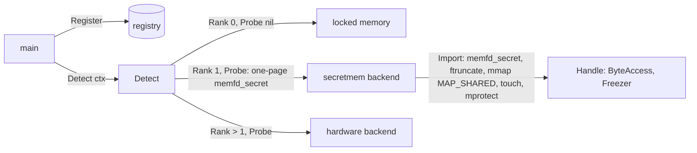

# Linux secretmem backend — architecture

> **Status: NORMATIVE** · Scope: go-enclave · Last verified: 2026-10-27
> Conflicts with this document are defects. For shipped behavior the code is canonical: fix this document to match it.

## Problem

The memory enclave keeps material in `mlock`'d pages between guard pages, with
`MADV_DONTDUMP` and `MADV_DONTFORK` ([platform contract](../memory-enclave/engineering.md#platform-contract)).
Those pages stay in the kernel's direct map, the kernel's own mapping of all
physical memory, and stay reachable through the kernel's paths into another
process's memory:

- `/proc/<pid>/mem` and `ptrace(PTRACE_PEEKDATA)`, for a same-user process or
  root that passes the ptrace access check;
- `process_vm_readv(2)`, under the same check;
- any kernel path that pins user pages (GUP: `get_user_pages`, `pin_user_pages`),
  such as `O_DIRECT` I/O or a driver;
- a kernel exploit with an arbitrary read, which finds the pages through the
  direct map without walking the process's page tables.

`memfd_secret(2)` (Linux 5.14) creates memory that closes these paths, with no
special hardware. The secretmem backend holds material in it, so a Linux host
that allows it gets a stronger software floor than the memory enclave, while
every hardware backend still ranks above it.

## What secretmem adds over the memory enclave

| Path to the material | Memory enclave | secretmem |
|---|---|---|
| Swap | locked (`mlock`) | locked: the mapping is `VM_LOCKED` |
| Core dump | `MADV_DONTDUMP` | `VM_DONTDUMP`, set by the kernel |
| `fork` child | `MADV_DONTFORK` | a `MAP_SHARED` mapping a child would share: needs `MADV_DONTFORK` too |
| `/proc/<pid>/mem`, `ptrace` peek, `process_vm_readv` | readable | refused: the pages refuse GUP |
| Kernel GUP paths (`O_DIRECT`, drivers) | reachable | refused |
| Kernel direct map | mapped | removed while allocated, restored and zeroed on free |
| Hibernation image | written to it | hibernation is refused while any secretmem mapping exists |

It does not stop code running inside the process (an injected library, a
`ptrace` attacher that rewrites the process's code), a kernel exploit that
walks the process's own page tables, or heap copies the program makes outside
the enclave ([key-schedule exposure](../backends/architecture.md#key-schedule-exposure)).
It is a narrower kernel attack surface, not an isolation boundary, and its
environment is attested through the host's platform as the memory enclave's is
([SPEC boundaries](../SPEC.md#boundaries)).

## Kernel requirements

Sources: [memfd_secret(2)](https://man7.org/linux/man-pages/man2/memfd_secret.2.html),
the kernel's [mm/secretmem.c](https://git.kernel.org/pub/scm/linux/kernel/git/torvalds/linux.git/tree/mm/secretmem.c)
and its [kernel-parameters](https://www.kernel.org/doc/html/latest/admin-guide/kernel-parameters.html)
(`secretmem.enable`).

- **Linux 5.14 or later**, built with `CONFIG_SECRETMEM`, on an architecture
  that can remove pages from the direct map (x86-64, arm64, riscv64, s390x among
  them). `golang.org/x/sys/unix` carries the syscall number
  (`SYS_MEMFD_SECRET`) but no wrapper, so the call is a raw syscall. x/sys has
  the number on 386, amd64, arm64, loong64, riscv64 and s390x only; every other
  Linux architecture builds the stub.
- **Enabled.** From 5.14 to 6.4 it is off unless the kernel boots with
  `secretmem.enable=1`; from 6.5 it is on unless booted with
  `secretmem.enable=0`. Disabled, the syscall fails `ENOSYS`.
- **Not filtered.** A seccomp profile or LSM that does not allow
  `memfd_secret` refuses it (`EPERM` or `ENOSYS`, as the filter chooses).
  Docker's default seccomp profile allows it on the toolchain image's host
  (Linux 7.0); other runtimes' profiles may not.
- **Counted against `RLIMIT_MEMLOCK`.** `mmap` of a secretmem file is refused
  (`EAGAIN`) past the limit, as `mlock` is, unless the process has
  `CAP_IPC_LOCK`.
- **Locked by the kernel, never by `mlock`.** The mapping is `VM_LOCKED` from
  `mmap`, and `mlock` on it fails `ENOMEM`: its populate step is the GUP path
  secretmem refuses. The backend therefore does not `mlock` or `munlock` the
  material pages; `munmap` drops the lock.
- **Shared mapping only.** The file is sized with `ftruncate` and mapped
  `MAP_SHARED`; a private mapping is `EINVAL`.
- **Allocation at first touch.** A page is allocated and removed from the
  direct map when first faulted. A failure there (no memory, or the direct map
  cannot be split) is a `SIGBUS`, not an error return, so the backend touches
  every page while Go's `debug.SetPanicOnFault` turns the fault into a
  recoverable panic, as `Seal` already does for a read-only source
  ([sealing](../backends/architecture.md#sealer-and-sealed)).
- **Hibernation blocked.** While any secretmem mapping exists the kernel
  refuses to hibernate. A laptop or VM host that hibernates must not select it.
- **Direct-map fragmentation.** Removing single pages splits the direct map's
  huge pages, which costs TLB reach for the whole kernel. Many small,
  short-lived enclaves cost more than a few long-lived ones.

## Design

- A separate backend ([D2](#d2-a-separate-backend)) in the root package
  ([D1](#d1-in-tree)), registered by `main` like any other; nothing registers
  it at import.
- It implements `Backend`, `Importer` and `Prober`, and its handles implement
  `ByteAccess` and `Freezer`, as locked memory's do
  ([what each backend class provides](../backends/architecture.md#what-each-backend-class-provides)).
- Each handle is one secretmem mapping between anonymous guard pages, with the
  memory enclave's canary, wipe, freeze and release rules: the mapping layer
  reserves the guarded region, the backend maps the secretmem file over its
  inner pages with `MAP_FIXED`, and the layer then applies `MADV_DONTDUMP`,
  `MADV_DONTFORK`, the canary and the guards as it does for locked memory. The
  fd is opened `O_CLOEXEC` and closed once mapped. [`WipeAll`](../shutdown-sweep/user.md)
  sweeps each handle.
- Each handle is admitted through an `Allocator`, so one budget covers this
  backend and locked memory, and the charge matches `RLIMIT_MEMLOCK`'s.
- Rank 1 ([D3](#d3-rank-1)); the probe runs only from `Detect` ([D4](#d4-the-detection-probe)).
- It passes `backendtest`.
- It builds on every GOOS of the platform contract: off Linux, and on a Linux
  architecture without `SYS_MEMFD_SECRET`, a stub compiles whose constructor
  returns `ErrMemfdSecretUnavailable`, so a cross-platform `main` that
  registers it builds everywhere and selects the memory enclave.

## Failure modes

Every failure is a typed error, named for the mechanism (the syscall), not the
contents; the root package's existing errors are reused where their meaning
holds.

| Failure | Where | Error |
|---|---|---|
| `memfd_secret` unimplemented or disabled (`ENOSYS`), filtered (`EPERM`), out of descriptors (`EMFILE`, `ENFILE`) or memory (`ENOMEM`) | probe, construction | `*MemfdSecretError{Cause}` matching `ErrMemfdSecretUnavailable`; `Cause` is the `*os.SyscallError` |
| `ftruncate`, `mmap`, `close` or the probe's `munmap` refused, `RLIMIT_MEMLOCK` included (`EAGAIN`) | probe, construction | the same, `Cause` naming the call |
| A page fault at first touch (`SIGBUS` caught as a panic) | probe, construction | the same, its `Cause` the recovered fault as an error |
| Non-Linux build, or a Linux architecture without the syscall | `NewSecretMemory` | `ErrMemfdSecretUnavailable` with no cause |
| Budget refused by an `Allocator` | construction | the existing `*BudgetError` |
| `mprotect`, `munmap` refused; canary mismatch | `Freeze`, `Destroy` | the memory enclave's existing `ErrLockedMemoryUnavailable`, `ErrReleasedWithoutWipe`, `ErrEnclaveCorrupted` |

A probe failure reaches `main` wrapped in `Detect`'s `*ProbeError`, and the
memory enclave stays selected. Construction never falls back to the memory
enclave: a backend that probed usable and then fails returns its error
([a missing capability](../backends/architecture.md#a-missing-capability)),
and the budget it charged is refunded.

## Decisions

### D1: in tree

A `secretmem_linux.go` backend in the root package with a
`secretmem_unsupported.go` stub, one implementation per GOOS as the
[platform contract](../memory-enclave/engineering.md#platform-contract)
requires. It is software on a stock kernel, needs nothing but
`golang.org/x/sys`, and shares the memory enclave's mapping, canary, wipe and
ledger code, which is unexported. The boundary "no hardware code in this
module" ([SPEC](../SPEC.md#boundaries)) does not reach it. Out of tree, it would
have to re-implement the mapping layer from exported API only, or the root
package would have to export it.

### D2: a separate backend

Detection selects it by rank and reports why it was passed over, `main`
chooses it, and the memory enclave stays the always-usable floor at rank 0. A
failure is its own typed error, never a silent downgrade. A mode of the memory
enclave was rejected: the choice would be invisible to `Detect`, the same call
would give different protection on different hosts, and a mid-run secretmem
failure would either fail allocations the floor must always serve or fall back
silently, which the [backend seam](../backends/architecture.md#a-missing-capability)
forbids. Because the pages count against `RLIMIT_MEMLOCK`, the backend admits
through an `Allocator`, so one budget covers both.

### D3: rank 1

Above locked memory (0) and below every hardware backend, each of which then
reports a rank above 1. Rank stays each backend's own property, as detection
requires; "0 is locked memory" gains "1 is secretmem", so hardware rows know
the value to beat. A wider gap was rejected: a number with no meaning but its
order.

### D4: the detection probe

`Probe(ctx)` checks `ctx`, then calls `memfd_secret(O_CLOEXEC)`, `ftruncate`
to one page, `mmap` it `MAP_SHARED`, closes the fd, touches the page under
`debug.SetPanicOnFault`, and unmaps it, leaving nothing behind. It runs only
from `Detect`. Any refusal returns `*MemfdSecretError` naming the failed call
and its errno, so the `ProbeResult` says why the memory enclave was kept
(`ENOSYS`: disabled or too old; `EPERM`: filtered; `EAGAIN`, `ENOMEM`: no
memory or no lock headroom). It costs one locked page and one split of the
direct map once per `Detect`. A syscall-only probe was rejected: it passes a
host whose `mmap` or first fault would fail, such as one at its
`RLIMIT_MEMLOCK`. The probe cannot see whether the host hibernates; a
deployment that does must not register the backend ([user guide](user.md#prerequisites)).

### D5: no consumer row

No seam changes: the backend implements the existing `Backend`, `Importer` and
`Prober`, so a consumer that takes the enclave interface and calls `Detect`
gains it when its `main` registers it, with no code change. No consumer's SPEC
gains a row. A consumer that still holds a concrete memory enclave
([ROADMAP dependencies](../../ROADMAP.md#dependencies)) gains nothing until it
moves to the interface, which its existing enclave-interface work already
covers.

`OpenIn` into a non-locked-memory backend decrypts into a locked-memory
scratch enclave and imports from it
([`Sealer` and `Sealed`](../backends/architecture.md#sealer-and-sealed)), so
opened plaintext passes briefly through direct-mapped pages. This backend is
the exception: its handles are locked regions
over its own pages, so `OpenIn` admits one against its budget and decrypts
straight into it. No scratch enclave, import or heap buffer holds the
plaintext, and a refused `memfd_secret` fails the open rather than falling
back to the scratch path.

## Rejected alternatives

- **Replacing the memory enclave with secretmem on Linux.** The floor must be
  usable on every host; secretmem is off by default before 6.5 and filtered in
  many containers.
- **A copy of memfd_secret(2) in `docs/reference/`.** A man page documents a
  kernel interface; it is not a standard under the standards-first rule, so it
  is cited by URL.

## What it does not do

No new dependency, no hardware code, no attestation, no protection against
code inside the process or a kernel that walks its page tables, and no change
to the memory enclave's behavior.
