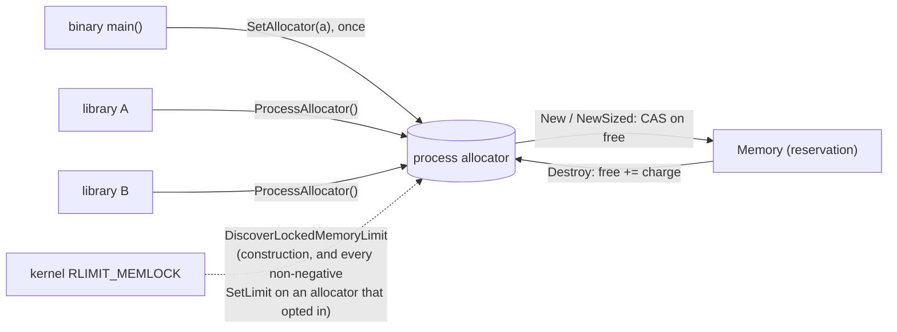
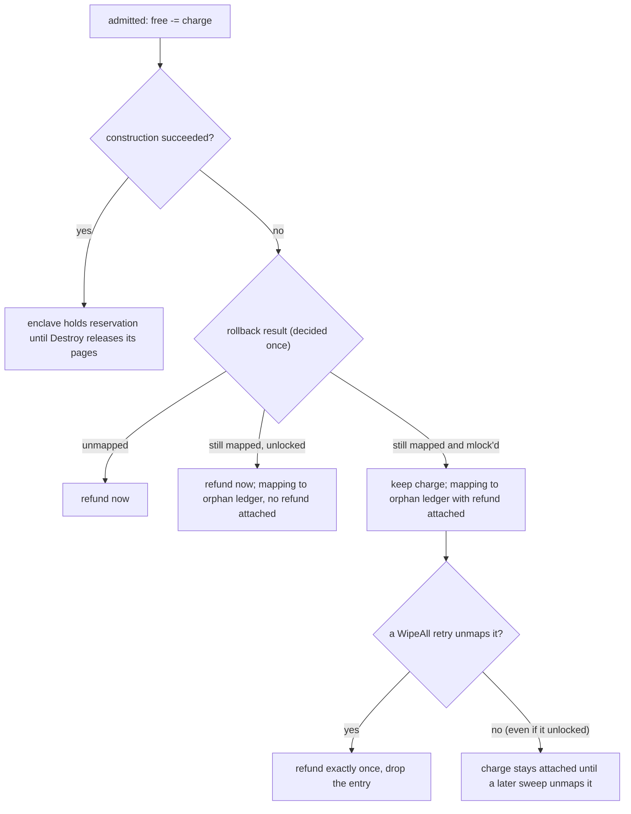
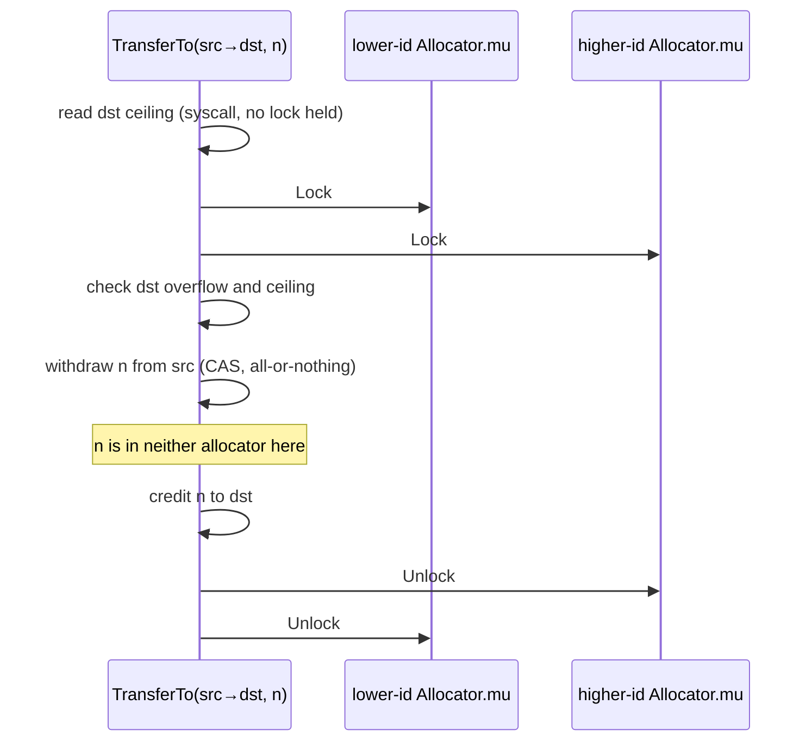

# Locked-memory budget and admission — architecture

> **Status: NORMATIVE** · Scope: go-enclave · Last verified: 2026-10-12
> Conflicts with this document are defects. For shipped behavior the code is canonical: fix this document to match it.

## Problem

`RLIMIT_MEMLOCK` is one ceiling for the whole process. A path that allocates
locked memory without a bound does not only fail itself when it reaches the
ceiling — every other path's allocation fails too. The motivating case is a
network responder that buffers key material before authenticating the peer: a
flood of half-open connections drains locked memory and the sessions that did
authenticate can no longer allocate. Separately, N libraries each holding their
own budget stay inside N budgets while together locking past the one ceiling.

## Shape chosen



- **`Allocator`** holds the *remaining* budget in one atomic word, `free`.
  Admission, release, raise and lower are all signed adjustments of that word,
  so a lowering and an in-flight admission are decided by the same
  compare-and-swap and cannot both take the last page. Admission is a
  compare-and-swap loop and a refund is one atomic add; neither takes a
  lock. Retunes (`SetLimit`, `ForceLimit`, `TransferTo`) serialize on a
  per-allocator mutex, so the allocator as a whole is not lock-free. A **refusal** reports its figures from an
  unlocked read and falls back to the retune mutex's read lock when that pair is
  inconsistent (`budgetSnapshot`), so a refusal can wait for a retune in
  progress. The retune mutex is written only by budget changes.
- **Charges are in locked bytes** — `LockedSize(n)`, the request rounded up to a
  page — the unit `RLIMIT_MEMLOCK` is expressed in, so a budget and the ceiling
  are directly comparable.
- **The process allocator** splits responsibility the way `WipeAll` does: the
  binary sizes and installs it once; libraries only draw from it.
- **Ceiling discovery** reads `RLIMIT_MEMLOCK` (and, on Linux, whether
  `CAP_IPC_LOCK` held in the initial user namespace makes it unenforced) at construction, when the lazy default
  process allocator is installed, on every `SetLimit` of an opted-in allocator
  (acted on only for a raise) and when `TransferTo` credits one — never on the
  admission path.

### Failed-construction refund



The refund decision is made once, at rollback: pages that were no longer locked
then are refunded at once, while an attached charge stays until the pages are
**unmapped**. `Destroy` applies the unmapped rule from the start: an enclave
keeps its reservation until its pages are unmapped, because the enclave itself
is the handle a retry goes through.

### TransferTo lock order



## Data flow

```mermaid
sequenceDiagram
  participant C as caller
  participant A as Allocator
  participant K as kernel
  participant R as registry (ledgers)
  C->>A: New(data) / NewSized(n) / OpenIn
  A->>A: charge = LockedSize(n); CAS free -= charge
  alt charge > free
    A-->>C: *BudgetError (ErrBudgetExhausted), no syscall
  else admitted
    A->>K: mmap, mlock, guard pages
    alt kernel refuses
      A->>A: rollback; refund decided once
      A-->>C: ErrLockedMemoryUnavailable
    else constructed
      A->>R: register enclave (last step)
      A-->>C: *Memory holding the reservation
    end
  end
  C->>A: Destroy (on the Memory)
  A->>K: unmap
  A->>A: free += charge, once
```

Control flows the other way for budgets. `SetLimit` and `ForceLimit` read the
ceiling (opted-in allocators only), take the allocator's retune mutex and adjust
`free` and `limit`; `TransferTo` takes both mutexes in id order and moves the
bytes. Only the retune path reads `RLIMIT_MEMLOCK`; admission never does.
Contracts and error mapping: [engineering.md](engineering.md).

## Rejected alternatives

| Alternative | Why rejected |
|---|---|
| Separate `limit` and `used` words | Admission would read the limit then commit usage; a lowering between the two is invisible — check-then-act over-commit. |
| Read the ceiling on every admission | A syscall on a path that is one CAS, buying nothing: the kernel's refusal already arrives as `ErrLockedMemoryUnavailable`. |
| Cache the ceiling at construction for later raises | The ceiling moves (any thread's `setrlimit`, a resized container). Raises re-read it fresh. |
| Warn instead of failing a budget above the ceiling | A warning is reported where nobody correlates it with the later failure. It is a constructor error; the application decides. |
| Return an error where the platform has no ceiling | Makes the checked constructor unusable there, so callers switch to the unchecked one everywhere. The source is reported as `LimitUnsupported` instead. |
| Derive a ceiling from cgroup `memory.max` | It caps total memory, not locked memory; deriving a locked ceiling from it would invent a number. |
| Order `TransferTo`'s locks by pointer address | Needs `uintptr` ordering the language does not promise; a per-allocator counter is stable and unique. |
| `TransferTo` as two calls | Leaves a window where the bytes are in both allocators (over-commit) or neither. |
| Refund every failed construction at once | Offers memory the process still holds locked, so the allocator admits what the kernel can only refuse. |
| A replaceable process allocator | Live reservations would stay charged to the old one while the new one admits against a fresh budget. Installation is one-shot. |

## Component boundaries

| Concern | File |
|---|---|
| `Allocator` (a handle on shared `allocatorState`), its constructors (`NewAllocatorWithinRLimit` included), admission (`admit`, one refund decision for `New` and `NewSized`), retune, transfer, the process allocator, and its role as the locked-memory `Backend` and `Importer` | [allocator.go](../../allocator.go) |
| The install-once, lazily defaulted process slot the process allocator lives in | [singleton.go](../../singleton.go) |
| Ceiling discovery (`DiscoverLockedMemoryLimit` is the platform function itself) | [memlock.go](../../memlock.go), [memlock_linux.go](../../memlock_linux.go), [memlock_unix.go](../../memlock_unix.go), [memlock_bsd.go](../../memlock_bsd.go), [memlock_unsupported.go](../../memlock_unsupported.go) |
| Orphan ledger the refund rides on | [registry.go](../../registry.go) |

No other project hand-rolls an admission budget: the bounded `Allocator` is part
of go-enclave's [ownership of locked memory](../locked-memory/architecture.md#component-boundaries).

## Trust boundaries

An `Allocator` is a **policy**, not a kernel guarantee. It bounds the enclaves
it creates; it cannot bound locked memory taken elsewhere — the unbudgeted
constructors, `Sealed.Open`, sealing's key pages, another library's
`mlock`. Admitted is not allocated: callers must handle
`ErrLockedMemoryUnavailable` as well as `ErrBudgetExhausted`.

## Scope fence

- No monitoring of the ceiling between raises.
- No cgroup awareness.
- No forced reclamation: an allocator never destroys a live enclave to make a
  budget fit (`ForceLimit` over-subscribes instead).
- The seal path is not budgeted (there is no `SealWith`); opens are, through
  `OpenIn` ([sealing](../sealing/engineering.md)).
