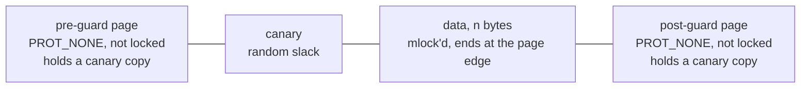
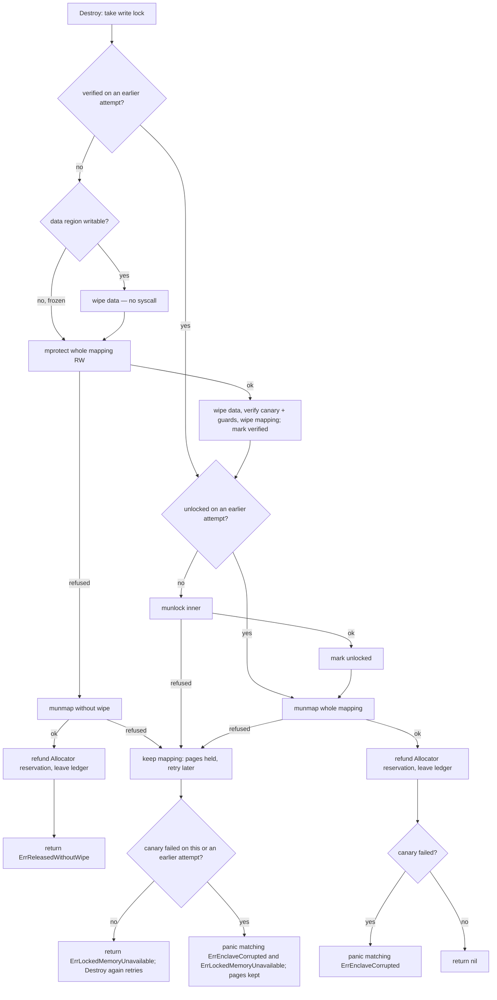

# Locked-memory enclaves — architecture

> **Status: NORMATIVE** · Scope: go-enclave · Last verified: 2026-10-01
> Conflicts with this document are defects. For shipped behavior the code is canonical: fix this document to match it.

## Problem

A Go process holding key material needs memory that never reaches swap, is
kept out of core dumps, faults on an overflow, detects an underflow, and is
wiped before it goes back to the kernel. It also needs a **failure policy**: an
allocation that fails at the `RLIMIT_MEMLOCK` ceiling must fail *that
allocation*, never another caller's live key.

## Shape chosen

One `MemoryEnclave` owns one guarded mapping, built by this package over
`golang.org/x/sys` with one system call per primitive. There is no global
coordinator on the access path: an enclave's own `sync.RWMutex` is the whole of
its concurrency story, and a shutdown ledger (see
[shutdown-sweep](../shutdown-sweep/architecture.md)) is touched only on
construction, destruction and `WipeAll`.

- The inner region is `LockedSize(n)` bytes — `n` rounded up to a page — and is
  the only part that is `mlock`'d and charged against `RLIMIT_MEMLOCK`.
- The data sits at the **end** of the inner region, so the first byte past it is
  the post-guard: an overflow faults immediately.
- The slack ahead of the data holds a random canary; an underflow into it is
  detected when the enclave is released. When `n` is an exact page multiple
  there is no slack and therefore no canary — a known gap
  ([mapping.go](../../mapping.go), `newMapping`).
- Both guard pages carry a copy of the canary before they are made
  inaccessible, so release can also tell that the guards were not remapped.

### Release sequence

Release is an explicit sequence in [mapping.go](../../mapping.go) (`release`);
no primitive wipes or re-protects on its own ([osmem.go](../../osmem.go)).

A retry resumes rather than repeats: the wipe and canary check run once per
mapping (`verified`), and a successful `munlock` is never repeated
(`unlocked`) — there is **at most one successful unlock**, while a refused one
is retried. A failed canary detected on an attempt whose unlock or unmap is
then refused is kept (sticky) and reported again by the retry that finally
releases the pages. (A mapping abandoned by a failed constructor carries on to
the `munmap` when its `munlock` is refused, since unmapping drops the lock.)

## Rejected alternatives

| Alternative | Why rejected |
|---|---|
| memguard `LockedBuffer` (used through v0.2.0-alpha) | On any mapping failure it purges — unmaps — every live buffer in the process, then panics. Guarding against that needed a process-wide lock that made allocating inside a live borrow deadlock. It also put NaCl secretbox, a non-FIPS algorithm, in every consumer's build graph. |
| memcall primitives (used through v0.6.2-alpha) | Its `Free` re-protected and re-wiped the region itself and its `Lock` discarded an `madvise` result, so the release path could not tell which refusal it was recovering from and needed a second, "direct" unmap. It also reported success for core-dump hardening on Windows, where none exists. |
| Return an error, not panic, on canary corruption | `defer e.Destroy()` drops the error, so the evidence of a memory-safety event would vanish on the most common path; and the state a caller would consult to recover is the state that is wrong. See [engineering.md](engineering.md#the-one-panic). |
| `WerRegisterExcludedMemoryBlock` on Windows | Covers WER reports only, and draws on a per-process pool of 512 entries shared with every WER user: failing closed would cap live enclaves and starve other libraries; best effort would be silently partial ([dontdump_windows.go](../../dontdump_windows.go)). |
| Refuse to build enclaves where no per-mapping dump exclusion exists | Would also remove `mlock`, guard pages and canary — strictly worse than losing one control. |
| A reversible `Freeze` | Re-mutable pages reopen exactly the window `Freeze` closes; the fill is the only reason pages are ever writable. |
| A finalizer that destroys forgotten enclaves | Not implemented: nothing destroys an enclave except its owner's `Destroy` or an explicit `WipeAll`. An undestroyed enclave holds its pages until one of those or process exit. |

## Component boundaries

| Concern | File(s) |
|---|---|
| `MemoryEnclave`, constructors, borrow, `Freeze`, `Destroy` | [enclave.go](../../enclave.go) |
| Mapping layout, canary, release sequence, `LockedSize`, `CoreDumpsDisabled` | [mapping.go](../../mapping.go) |
| OS primitives, one syscall each | [osmem.go](../../osmem.go), [osmem_unix.go](../../osmem_unix.go), [osmem_windows.go](../../osmem_windows.go), [osmem_unsupported.go](../../osmem_unsupported.go) |
| Per-mapping core-dump exclusion | [dontdump_linux.go](../../dontdump_linux.go), [dontdump_nocore.go](../../dontdump_nocore.go), [dontdump_openbsd.go](../../dontdump_openbsd.go), [dontdump_other.go](../../dontdump_other.go), [dontdump_windows.go](../../dontdump_windows.go) |
| Shutdown ledger | [registry.go](../../registry.go) — see [shutdown-sweep](../shutdown-sweep/architecture.md) |

go-enclave is a bottom-layer module: its only dependency is `golang.org/x/sys`,
and consumers reach it only through the exported Go API of package `enclave`.

## Trust boundaries

**Protects against:** the material reaching swap (`mlock` for the enclave's
life); reaching a core dump (per-mapping exclusion where the kernel offers one,
plus `RLIMIT_CORE` lowered to zero at import); a linear overflow (post-guard
fault); an underflow into the slack (canary, reported at release); a stray
write through a retained slice once frozen (fault); a failed allocation
elsewhere in the process touching this enclave (no failure path reaches another
enclave's mapping). Underflow detection needs slack: an enclave whose size is
an exact page multiple has no canary, though an underflow past its first byte
still faults on the pre-guard page.

**Does not protect against:** anything that can read this process's live
memory — `ptrace` or `/proc/<pid>/mem` at the same uid, a debugger, a cold-boot
capture. While an enclave exists its plaintext is readable by such an adversary.
`mlock` keeps pages out of swap, not out of a hibernation (suspend-to-disk)
image or a virtual-machine snapshot, which capture locked memory too.
Nor does it cover copies the caller makes: the `[]byte` handed to
`NewMemoryEnclaveCopy`, the string from `OpenString`, or bytes generated on the
heap before being moved in. For narrowing the live-memory window, see
[sealing](../sealing/architecture.md).

## Scope fence

- No cryptography. The only primitive near a `MemoryEnclave` is `crypto/rand`
  filling the canary.
- No persistence and no cross-process sharing.
- No automatic destruction (no finalizer, no fault handler).
- No per-call budget: admission control is a separate capability,
  [locked-memory-budget](../locked-memory-budget/architecture.md).
- Unsupported GOOS values (js, wasip1, plan9, any future GOOS until checked)
  fail to **compile** with `undefined: go_enclave_does_not_support_this_GOOS`
  rather than building something that cannot lock memory.
