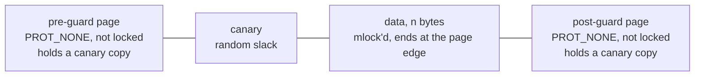
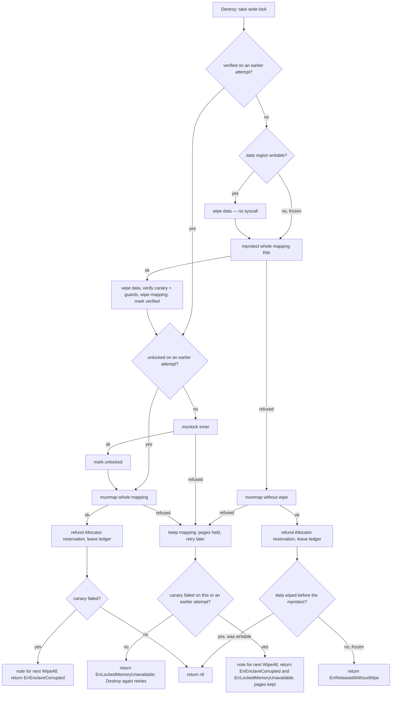
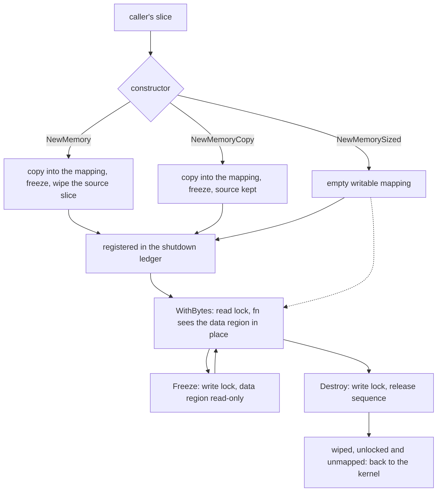

# Locked-memory enclaves — architecture

> **Status: NORMATIVE** · Scope: go-enclave · Last verified: 2026-10-12
> Conflicts with this document are defects. For shipped behavior the code is canonical: fix this document to match it.

## Problem

A Go process holding key material needs memory that never reaches swap, is
kept out of core dumps, faults on an overflow, detects an underflow, and is
wiped before it goes back to the kernel. It also needs a **failure policy**: an
allocation that fails at the `RLIMIT_MEMLOCK` ceiling must fail *that
allocation*, never another caller's live key.

## Shape chosen

One memory enclave owns one guarded mapping, built by this package over
`golang.org/x/sys` with one system call per primitive. There is no global
coordinator on the access path: an enclave's own `sync.RWMutex` is the whole of
its concurrency story, and a shutdown ledger (see
[shutdown-sweep](../shutdown-sweep/architecture.md)) is touched only on
construction, destruction and `WipeAll`.

- The inner region is `LockedSize(n)` bytes — `n` rounded up to a page — and is
  the only part that is `mlock`'d and charged against `RLIMIT_MEMLOCK`.
- The data sits at the **end** of the inner region, so the first byte past it is
  the post-guard: an overflow faults immediately.
- The slack ahead of the data holds a random canary; an underflow into it is
  detected when the enclave is released. When `n` is an exact page multiple
  there is no slack and therefore no canary — a known gap
  ([mapping.go](../../mapping.go), `newMapping`).
- Both guard pages carry a copy of the canary before they are made
  inaccessible, so release can also tell that the guards were not remapped.

### Release sequence

Release is an explicit sequence in [mapping.go](../../mapping.go) (`release`);
no primitive wipes or re-protects on its own ([osmem.go](../../osmem.go)).

A retry resumes rather than repeats: the wipe and canary check run once per
mapping (`verified`), and a successful `munlock` is never repeated
(`unlocked`) — there is **at most one successful unlock**, while a refused one
is retried. A failed canary detected on an attempt whose unlock or unmap is
then refused is kept (sticky) and reported again by the retry that finally
releases the pages. (A mapping abandoned by a failed constructor carries on to
the `munmap` when its `munlock` is refused, since unmapping drops the lock.)

### Process hardening

Some protections are per-process, not per-mapping, and they are not the
library's to impose. `HardenProcess` ([harden.go](../../harden.go)) is the one
place they live, and it is opt-in: nothing in this package calls it, importing
the package changes no process state, and a `main` package calls it, normally
first.

- **Steps.** Each is attempted and read back. Where `RLIMIT_CORE` exists (every
  supported GOOS but Windows) it lowers the limit to zero, soft and hard. On
  Linux it also sets `prctl(PR_SET_DUMPABLE, 0)`. The `RLIMIT_CORE` step is
  implemented with the `osmem` primitives and the non-dumpable step in
  [harden_linux.go](../../harden_linux.go), so `harden.go` only sequences them
  and builds the report.
- **Report.** A `ProcessHardening` names each step that took, so a partial
  result is visible. The error is for the first step that failed; Windows, with
  neither step, returns `ErrProcessHardeningUnsupported` and an empty report.
- **Status.** `CoreDumpsDisabled` returns what the last `HardenProcess` did to
  `RLIMIT_CORE`, kept in a mutex-guarded record, and
  `ErrCoreDumpLimitNotApplied` before one has run. Constructors never consult it.
- **Scope.** It is specific to locked memory, not a backend capability: only
  that backend's protection is relative to the process, so dumps and same-uid
  readers are its threat. See [backends](../backends/architecture.md).

The per-process cost of each step, and what it does not bind, is in
[engineering.md](engineering.md#configuration).

## Rejected alternatives

| Alternative | Why rejected |
|---|---|
| Lowering `RLIMIT_CORE` when the package is imported | A process-wide decision that belongs to the binary, not to a library: the limit is inherited across `fork` and `execve`, so every child the binary starts, go-enclave user or not, would run with it and could not raise it back without privilege. An import has no way to be declined, ordered or tested, and two libraries cannot both own it. |
| Constructors that refuse to build, or lower the limit, while the process is unhardened | Moves the same process-wide choice into every allocation, and makes a library's success depend on a policy the binary never made. The binary reads `CoreDumpsDisabled` and decides. |
| Lowering only the soft `RLIMIT_CORE` | Any code in the process could raise it again unprivileged; the hard limit is lowered too. |
| `RLIMIT_CORE` as the only hardening step | It does not bind a piped Linux `core_pattern`, and does not stop a same-uid `ptrace` or `/proc/<pid>/mem` read. The non-dumpable flag covers both, at a cost the binary must choose ([engineering.md](engineering.md#configuration)). |
| A `Hardener` capability that `HardenProcess` calls on registered backends | Only the locked-memory backend's protection depends on process state; see [backends](../backends/architecture.md). |
| memguard `LockedBuffer` | On any mapping failure it purges — unmaps — every live buffer in the process, then panics. Guarding against that needed a process-wide lock that made allocating inside a live borrow deadlock. It also put NaCl secretbox, a non-FIPS algorithm, in every consumer's build graph. |
| memcall primitives | Its `Free` re-protected and re-wiped the region itself and its `Lock` discarded an `madvise` result, so the release path could not tell which refusal it was recovering from and needed a second, "direct" unmap. It also reported success for core-dump hardening on Windows, where none exists. |
| Panic on canary corruption | Library code returns its failures. The case for a panic is that `defer e.Destroy()` drops the error; the next `WipeAll` reports every corruption `Destroy` detected, so the evidence survives without one. See [engineering.md](engineering.md#canary-corruption). |
| `WerRegisterExcludedMemoryBlock` on Windows | Covers WER reports only, and draws on a per-process pool of 512 entries shared with every WER user: failing closed would cap live enclaves and starve other libraries; best effort would be silently partial ([madvise_unsupported.go](../../madvise_unsupported.go)). |
| Refuse to build enclaves where no per-mapping dump exclusion exists | Would also remove `mlock`, guard pages and canary — strictly worse than losing one control. |
| A reversible `Freeze` | Re-mutable pages reopen exactly the window `Freeze` closes; the fill is the only reason pages are ever writable. |
| A finalizer that destroys forgotten enclaves | Not implemented: nothing destroys an enclave except its owner's `Destroy` or an explicit `WipeAll`. An undestroyed enclave holds its pages until one of those or process exit. |

## Component boundaries

| Concern | File(s) |
|---|---|
| `lockedRegion` (the internal type behind `ByteAccess`, a handle on shared `memoryState`), constructors, borrow, `Freeze`, `Destroy`, `Backend` | [enclave.go](../../enclave.go) |
| Mapping layout, canary, release sequence, `LockedSize` | [mapping.go](../../mapping.go) |
| `HardenProcess`, `CoreDumpsDisabled` | [harden.go](../../harden.go), [harden_linux.go](../../harden_linux.go), [harden_unsupported.go](../../harden_unsupported.go); the `RLIMIT_CORE` call in the `osmem` files |
| `Wipe` and the constant-time copy and compare | [constanttime.go](../../constanttime.go) |
| OS primitives, one syscall each | [osmem.go](../../osmem.go), [osmem_unix.go](../../osmem_unix.go), [osmem_windows.go](../../osmem_windows.go), [osmem_unsupported.go](../../osmem_unsupported.go) |
| Per-mapping core-dump and fork exclusion | [madvise_unix.go](../../madvise_unix.go), [madvise_linux.go](../../madvise_linux.go), [madvise_bsd.go](../../madvise_bsd.go), [madvise_openbsd.go](../../madvise_openbsd.go), [madvise_unsupported.go](../../madvise_unsupported.go) |
| Shutdown ledger, the holder-counting locks the sweep waits on, and `settleRelease`, the one bookkeeping step after every release | [registry.go](../../registry.go) — see [shutdown-sweep](../shutdown-sweep/architecture.md) |

go-enclave is a bottom-layer module: the root module's only dependency is
`golang.org/x/sys` (the nested provider modules under `backends/` have their
own), and consumers reach it only through the exported Go API of package
`enclave`. It is meant to be the one place a program handles locked memory, so
a consumer needs no mlock, guard-page or canary code of its own. Process-wide lifecycle (`HardenProcess`,
`WipeAll`) is the consuming binary's call, never a library's.

## Data flow

How bytes move through one enclave, from the caller's slice to the kernel.

1. **In.** `NewMemory` and `NewMemoryCopy` map an enclave of the slice's length
   and load it frozen; `NewMemory` then wipes the caller's slice (it also wipes
   it when it refuses), `NewMemoryCopy` leaves it. `NewMemorySized` maps a
   writable enclave for the caller to fill in place, so the material is never on
   the heap. An empty slice is `ErrEmptyEnclave`; a size that cannot be mapped is
   `ErrInvalidSize`. A failure is a typed error ([engineering.md](engineering.md#error-semantics)).
2. **Registered.** A built enclave is entered in the shutdown ledger, so a
   concurrent `WipeAll` sees it only once it is complete
   ([shutdown-sweep](../shutdown-sweep/architecture.md)).
3. **Borrowed.** `WithBytes` takes the enclave's read lock and passes the data
   region itself to the function, not a copy: the bytes are readable only inside
   the call, and the lock holds `Destroy` off for its duration. A nil function is
   `ErrNilFunc`; a destroyed enclave is `ErrEnclaveDestroyed`.
4. **Frozen.** `Freeze` takes the write lock, so it cannot land mid-borrow, and
   makes the data region read-only for good.
5. **Out.** `Destroy` takes the write lock and runs the
   [release sequence](#release-sequence): wipe, canary and guard check, `munlock`,
   `munmap`, then the ledger and any `Allocator` reservation are settled. Nothing
   else returns the pages to the kernel.

## Trust boundaries

**Protects against:** the material reaching swap (`mlock` for the enclave's
life); reaching a core dump (per-mapping exclusion where the kernel offers one,
plus `RLIMIT_CORE` lowered to zero by an opted-in `HardenProcess`); a `fork(2)` child inheriting the
pages (Linux `MADV_DONTFORK`); a linear overflow (post-guard
fault); an underflow into the slack (canary, reported at release); a stray
write through a retained slice once frozen (fault); a failed allocation
elsewhere in the process touching this enclave (no failure path reaches another
enclave's mapping). Underflow detection needs slack: an enclave whose size is
an exact page multiple has no canary, though an underflow past its first byte
still faults on the pre-guard page.

**Does not protect against:** anything that can read this process's live
memory — `ptrace` or `/proc/<pid>/mem` at the same uid (unless the binary opts
in to `HardenProcess`), a debugger, a cold-boot capture. While an enclave exists its plaintext is readable by such an adversary.
`mlock` keeps pages out of swap, not out of a hibernation (suspend-to-disk)
image or a virtual-machine snapshot, which capture locked memory too.
Nor does it cover copies the caller makes: the `[]byte` handed to
`NewMemoryCopy`, a string made from bytes borrowed through `WithBytes`, or bytes
generated on the heap before being moved in. For narrowing the live-memory window, see
[sealing](../sealing/architecture.md).

## Scope fence

- No cryptography. The only primitive near a memory enclave is `crypto/rand`
  filling the canary.
- No persistence and no cross-process sharing.
- No automatic destruction (no finalizer, no fault handler).
- No per-call budget: admission control is a separate capability,
  [locked-memory-budget](../locked-memory-budget/architecture.md).
- Unsupported GOOS values (js, wasip1, plan9, any future GOOS until checked)
  fail to **compile** with `undefined: go_enclave_does_not_support_this_GOOS`
  rather than building something that cannot lock memory.
