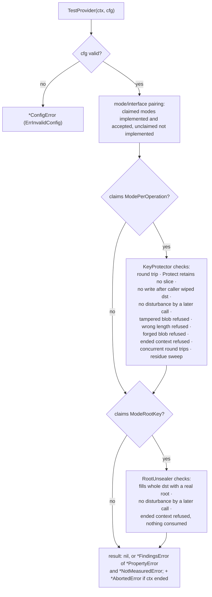
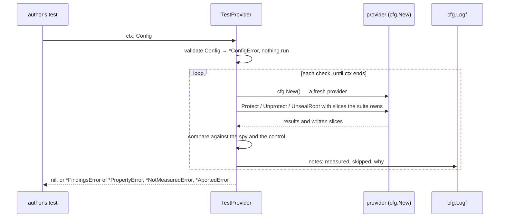

# Provider conformance — architecture

> **Status: NORMATIVE** · Scope: go-enclave · Last verified: 2026-10-12
> Conflicts with this document are defects. For shipped behavior the code is canonical: fix this document to match it.

## Problem

The provider seam's signatures — `Unprotect(ctx, blob, key []byte) error`,
`UnsealRoot(ctx, dst []byte) error` — constrain where plaintext is **written**.
They say nothing about what a provider **keeps**: a provider may write into the
caller's locked slice and hold its own copy forever, and from go-enclave's side
that is indistinguishable from a conforming one. Nor can a signature say that a
provider refuses forgeries, honors its context, or implements only the modes it
really serves. Providers (TPM, HSM, cloud KMS) are written in other
repositories, so the check has to ship to them.

## Shape chosen

A subpackage, `providertest`, in the shape of `testing/fstest.TestFS`: one call,
`TestProvider(ctx, cfg)`, which returns `nil`, a `*ConfigError` for a `Config` it cannot run, or a
`*FindingsError` holding one `*PropertyError` per failed **assertion**, a
`*NotMeasuredError` per property it could not measure and, if `ctx` ended, an
`*AbortedError`. One property can contribute several
(the tampered-blob check records one per blob it wrongly accepted), all
carrying the same `Property` name. It does not import `testing`, takes no
dependency on any provider, and nothing in go-enclave depends on it.

Each check calls `cfg.New` for a fresh provider — the mode-pairing check once
per mode, so twice — so one check leaving a provider in a terminal state cannot
change the meaning of the next. Checks stop
at the next boundary once `ctx` ends.

### Two instruments for retention, in this order

1. **The spy (primary, deterministic).** The suite is the caller, so it owns
   every slice it hands the provider and watches it afterwards: a `Protect`
   that filed the caller's slice instead of copying it, an `Unprotect` that
   writes into a destination the caller already wiped, a later call that
   disturbs an earlier destination. Each spy assertion has a control that fails
   first if its setup did not happen.
2. **The residue sweep (corroboration, Linux only).** The only instrument that
   can see a retained **copy**: it protects a needle that exists only in locked
   pages, recovers it into a second locked mapping, destroys that mapping, and
   searches every readable mapping that can hold a runtime copy — anonymous,
   writable, memfd, `/dev/shm`, `/dev/zero` and unlinked (via `/proc/self/maps`
   and `/proc/self/mem`) — for the whole needle outside its home; unreadable
   mappings and read-only views of on-disk files are skipped and a read error
   ends the scan of that mapping (limits:
   [engineering.md](engineering.md#contract-versus-evidence)). It first proves it *can* find the needle
   while the destination is alive, and wipes its own scan buffer after every
   mapping so it cannot plant what it looks for. A sweep that cannot run
   returns `ErrNotMeasured` unless `SkipResidueSweep` accepted that.

## Data flow

Inputs are the `Config` and the provider the author's `New` builds. The suite
hands the provider only slices it owns, so it can watch them afterwards, and
reads nothing from the provider but its return values and what the provider
wrote into those slices. Findings accumulate in the run's report; the report
and the `Logf` notes are the only output. The suite keeps no state between
runs.

## Rejected alternatives

| Alternative | Why rejected |
|---|---|
| Require that a provider never materializes plaintext | Unsatisfiable: every real backend's decrypt returns a fresh slice (TPM2 `RSADecrypt`, PKCS#11 wrappers, HTTP response bodies from KMS APIs). The requirement is to **wipe** that transient, which the sweep measures. |
| Residue sweep as the primary instrument | A sweep that keeps its scan buffer replants its needle; and a residue claim is unfalsifiable for bytes that transit a stack local (a stack growth strands pre-wipe bytes on the freed old stack). It corroborates; the spy decides. |
| A residue sweep for `RootUnsealer` | A root unsealer legitimately retains the root — that is its job (`SoftwareProvider` keeps it in a locked enclave). It would fail every conforming implementation. |
| Trust `Config.Modes` as a description | An unclaimed mode the type happens to satisfy (a placeholder `UnsealRoot` returning a constant) would be accepted by `NewSealer` and seal everything under a fake root. The suite requires unclaimed modes to be refused. |
| Require cross-instance blob refusal | A device-backed provider hands every instance the same device key; a blob from another instance *is* its own. |
| A boolean "skip residue sweep" | A reason string is required and echoed to `Logf`, so a green run records what it did not measure. |
| Report a provider call aborted by the run's context as a provider failure | It proves only that the run stopped waiting. Reported as `ErrAborted` instead. |
| Let the tamper cases stand for forgery | A bare public-key wrap refuses every malformed blob through its padding or tag and opens a well-formed one built from the public key. Only the author can build that blob, so `Config.Forge` does; a declared `PublicKey` provider without it is `ErrNotMeasured`. |
| Find shared provider state only with `-race` | An author may not run it, and a device library's state is often outside Go. The concurrency check compares each call's output, so a racy provider fails without it. |
| Measure mid-call cancellation | Only the provider can hold a call open; the suite measures the refusal of already-ended contexts. |

## Component boundaries

| Concern | File |
|---|---|
| `Config`, `TestProvider`, the checks | [providertest/providertest.go](../../providertest/providertest.go) |
| `ErrInvalidConfig`/`ConfigError`, `ErrAborted`/`AbortedError`, `ErrNotMeasured`/`NotMeasuredError`, `PropertyError`, `FindingsError` | [providertest/errors.go](../../providertest/errors.go) |
| Residue sweep | [providertest/residue.go](../../providertest/residue.go); the `/proc/self/mem` scan it shares with the root package's tests is [internal/memscan](../../internal/memscan/memscan_linux.go) |

The provider under test is the author's; the suite runs in the author's
repository and test binary. Hardware and cloud providers belong to go-xkms; this
suite is the check go-enclave ships to their authors
([sealing](../sealing/architecture.md#component-boundaries)).

## Trust boundaries

A passing run is evidence about the properties the suite **could measure on
that host**, nothing more. What it could not measure goes to `Config.Logf`.

## Scope fence

Not a performance or load test; no device liveness checks; no mid-call
cancellation measurement; no check of the bulk AES key schedule, which is inside
the standard library's AES implementation, not the provider, and is out of scope.
