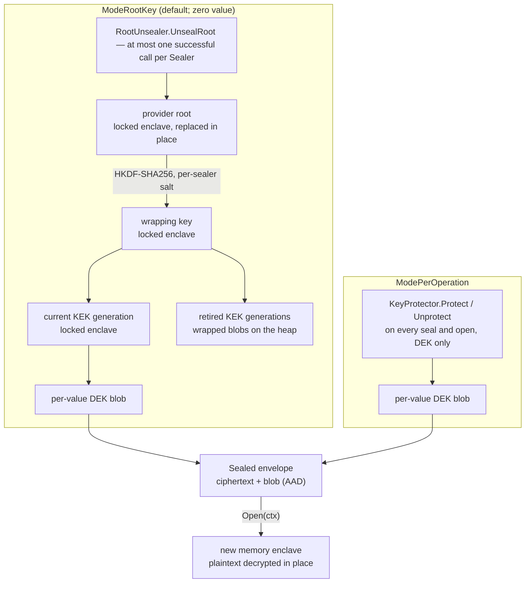
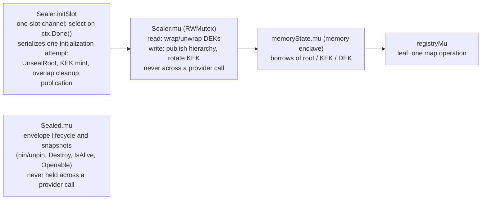
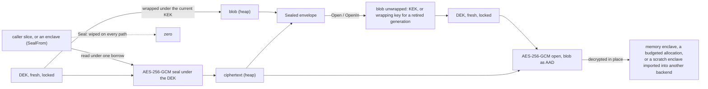

# Sealing and the provider seam — architecture

> **Status: NORMATIVE** · Scope: go-enclave · Last verified: 2026-10-12
> Conflicts with this document are defects. For shipped behavior the code is canonical: fix this document to match it.

## Problem

A memory enclave holds plaintext for its whole life. Material used
intermittently — a credential opened once per request, a root key used a few
times an hour — is then readable by a live-memory adversary for the whole
process lifetime when it only needs to exist for the operation. Separately,
sealing must be rootable in a TPM, HSM or cloud KMS **without** this
bottom-layer package importing any hardware code.

## Shape chosen

A `Sealed` holds an **envelope** on the ordinary heap — both halves are
ciphertext — and decrypts it into a fresh memory enclave only for an `Open`:

- a per-value 32-byte **DEK**, generated into locked memory, seals the material
  with AES-256-GCM (`cipher.NewGCMWithRandomNonce`) and is destroyed before the
  seal returns;
- a **blob**: that DEK protected by the `Sealer`. The blob is the AEAD's
  additional authenticated data, so pairing one value's blob with another
  value's ciphertext fails the tag.

The `Sealer` decides what protects the DEK, by **mode**:



The provider seam is **two interfaces**, `KeyProtector` and `RootUnsealer`,
injected through typed options (`WithKeyProtector`, `WithRootUnsealer`) that
also select the mode, so a provider that cannot serve a mode does not compile.
A `KeyProtector` may also implement `HealthReporter`, found by type assertion,
to report whether a sweep took its in-process key material. go-enclave ships
one provider, `SoftwareProvider`, which implements all three.

### What each mode buys against a live-memory reader

Two separate questions decide what an adversary who can read this process's
memory (live, or through swap or a core dump the hardening did not stop) can
recover between opens:

1. **Where the long-lived wrapping key lives** — the key that unwraps every
   value's DEK.
2. **Residual per-value keys on the heap.** Every AES-GCM operation expands its
   key into a heap-allocated key schedule that Go neither zeroes nor frees
   promptly ([aead.go](../../aead.go), `withAEAD`). Each seal and each open
   leaves its value's DEK schedule behind, and that schedule plus the value's
   heap ciphertext recovers the value until the allocator reuses the memory.
   This holds in **every** mode, hardware included — except in a build with
   `GOEXPERIMENT=runtimesecret` on linux/amd64 or linux/arm64 (not Android), where every
   AES operation runs under `runtime/secret.Do` and its schedule is erased at
   the next garbage collection (`KeyScheduleErasure`); the table below
   describes the default build.

| Configuration | Long-lived wrapping key | Residual heap key schedules |
|---|---|---|
| Default (`SoftwareProvider`, `ModeRootKey`) | Wrapping key (derived from the root) and current KEK in this process's locked memory: recovers every value. | DEK schedules (per seal/open), KEK schedules (per DEK wrap/unwrap), wrapping-key schedules (each KEK mint at first seal and at rotation, each retired-generation open), and the root's HMAC state once per sealer (the derivation). |
| Hardware `RootUnsealer`, `ModeRootKey` | Same as the default after the one unseal. Hardware adds only the **origin and gating** of the root (e.g. a TPM PCR policy at unseal time). | Same as the default. |
| Hardware `KeyProtector`, `ModePerOperation` | Held by the device, if the provider keeps it there; go-enclave never holds it. | DEK schedules of values sealed or opened since their memory was last reused: those values are recoverable; values never touched in that window are not. |
| `SoftwareProvider`, `ModePerOperation` | The provider's root in this process: recovers every value. For tests and shape parity only. | DEK schedules, the Protect key's schedule (derived from the root) on every `Protect`/`Unprotect`, and the root's HMAC state once (the derivation). |

So no configuration makes previously used values unrecoverable from this
process's memory. Per-operation hardware bounds the exposure to values used
recently; it does not reduce it to values open right now. What sealing does
guarantee in every mode is that this package decrypts **plaintext material**
only into locked pages, never onto the heap.

## Concurrency and lock ordering

No mutex of a `Sealer` or `Sealed` is held across a provider call.



Arrows read "may be held while acquiring". The only lock spanning a provider
call is the init slot — and the read borrow of the private, per-call enclave the
provider writes into. A caller queued on the slot leaves when its own context
ends, so a provider stalled in `UnsealRoot` stalls only callers that need the
hierarchy it is producing, each for no longer than its own context allows.
`Sealed` pins its envelope (an in-flight counter) instead of holding its
lock across an open, so `Destroy` — which takes no context — never waits on a
provider.

### First seal in ModeRootKey

```mermaid
sequenceDiagram
  participant C as caller (ctx)
  participant S as Sealer
  participant P as RootUnsealer
  C->>S: Seal(ctx, data)
  S->>S: check ctx; record the value's sweep generation (for Openable)
  S->>S: new DEK (locked)
  S->>S: acquire initSlot (or ctx ends → ErrSealFailed + ctx.Err())
  S->>S: read sweep generation g; allocate root destination (locked)
  S->>P: UnsealRoot(ctx, dst)
  P-->>S: root written (or error → retried by a later seal)
  S->>S: same borrow: replace root with HKDF-SHA256(root, fresh salt) — the wrapping key
  S->>S: sweep since g? → destroy root, ErrSealerWiped (never asks again)
  S->>S: mint KEK gen 1 (failure keeps root for retry of the mint only)
  S->>S: mu.Lock: publish root + KEK; mu.Unlock
  S->>S: release initSlot; re-check ctx
  S->>S: wrap DEK under KEK (mu.RLock); seal data under DEK, blob as AAD
  S-->>C: Sealed (data wiped on every path)
```

## Backends and enclave sources

The sealer is not tied to locked process memory at either end. Three entry
points carry the [backend seam](../backends/architecture.md) into sealing:

- **`WithBackend(b)`** chooses where a `ModeRootKey` sealer keeps its long-lived
  keys. The wrapping key and every KEK are imported into `b`; a handle with an
  `AEAD` wraps inside the device, one with only `ByteAccess` wraps here. Data
  keys (DEKs) never leave this process. Without it, those keys live in locked
  memory. In `ModePerOperation` the sealer holds no such key, so the option only
  feeds the strict-mode check of `WithRequireKeyScheduleErasure`, which refuses
  a configuration where an AES key schedule would stay on the heap.
- **`SealFrom(ctx, src)`** seals material that already sits in an enclave
  (`NewSealedFrom` for the process sealer). It borrows `src`, leaves it
  unwiped and undestroyed, and so also seals a frozen memory enclave that `Seal`
  refuses: `Seal` wipes its input, and writing to a read-only page kills the
  process.
- **`OpenIn(ctx, b)`** opens into any backend that can hold the material
  instead of only a new memory enclave. Locked memory, an `Allocator` and the
  [linux-secretmem](../linux-secretmem/user.md) backend are decrypted into
  directly (the allocator or backend admits the destination against its
  budget), so plaintext opened into secretmem never touches direct-mapped
  pages. Any other `Importer` receives the plaintext from a locked scratch
  enclave that is destroyed once the import returns, so plaintext still never
  lands on the heap.

The TPM and secure-element `KeyProtector` providers, which keep the protect
key in a device and live in nested modules of their own, are designed in
[Hardware KeyProtector providers](hardware-providers.md).

## Data flow

Where each byte goes, in the default `ModeRootKey`:



- **Seal.** The caller's slice (or the source enclave, read under its own
  borrow) is read once. The DEK is generated into locked memory, wrapped, and
  the material is sealed under it with the blob as additional authenticated
  data. The DEK is destroyed before the call returns; `Seal` also wipes the
  caller's slice on every path, `SealFrom` does not touch its source.
- **Provider calls.** `ModeRootKey` calls the `RootUnsealer` once, at the first
  seal, then runs on in-process keys (see the sequence above). `ModePerOperation`
  calls the `KeyProtector` for the DEK on every seal (`Protect`) and open
  (`Unprotect`); the material never reaches the provider, only the 32-byte DEK.
- **Open.** The destination is allocated first, with capacity exactly the
  plaintext length, then the DEK is recovered into locked memory and the
  ciphertext is decrypted in place. A length mismatch is refused before
  decrypting; a failed tag releases no plaintext.
- **What reaches the heap** is ciphertext, blobs and AES key schedules, never
  plaintext material
  ([engineering.md](engineering.md#key-schedule-heap-exposure)).

## Rejected alternatives

| Alternative | Why rejected |
|---|---|
| Send the material itself to the device | Bulk traffic across the device boundary, and the plaintext would come back into an ordinary heap buffer instead of being decrypted into locked pages. The device sees the 32-byte DEK only. |
| One provider interface | A mismatch between provider and mode would surface at the first seal, hours after boot. |
| `sync.Once` for the root unseal | One transient failure (memlock ceiling, device hiccup) would be permanent for the process. |
| A mutex for first-time initialization | A mutex wait cannot be abandoned when a caller's context ends. The init slot is a channel selected against `ctx.Done()`. |
| Holding `Sealer.mu` across `UnsealRoot` | A stalled provider stalled every `Seal`, `Open` and `Openable` on that sealer, with no way to give up. |
| `cipher.NewGCM` with caller-supplied nonces (and with it `GOEXPERIMENT=boringcrypto`) | FIPS 140-only mode refuses GCM with arbitrary IVs. `NewGCMWithRandomNonce` removes caller-managed nonces; random 96-bit nonces can still collide, so collision risk is bounded by per-key usage limits: at most 2^31 DEK wraps per KEK generation before rotation (`kekMessageLimit`, [hierarchy.go](../../hierarchy.go); `WithKEKRotationLimit` can only lower it), at most 2^31 KEK generations per sealer wrapping key (`maxKEKGenerations`; past it a seal fails with `ErrSealerExhausted`) — a key each sealer derives from the provider's root with HKDF-SHA256 under its own random salt, so sealers sharing a root, or restarts unsealing the same one, never share it — and 2^31 `Protect` calls per `SoftwareProvider` Protect key, itself HKDF-SHA256 of the root under its own info so it is never the root `UnsealRoot` exports (`softwareProtectLimit`, [provider_software.go](../../provider_software.go)), half of crypto/cipher's documented 2^32 bound. boringcrypto builds therefore cannot seal; Go's native FIPS 140-3 module is the supported route. |
| XSalsa20-Poly1305 / ChaCha20-Poly1305 (no key schedule) | Not FIPS-approved. |
| A hand-written AES whose schedule lives in locked memory | Unvalidated, unreviewed cryptography; a worse class of defect than the bounded heap exposure it removes. |
| Shipping a `crypto.Decrypter` + signer composition | A generic adapter cannot know a device's guarantees. Each device gets its own provider, in its own module under `backends/` or outside go-enclave, held to the conformance suite. Confidentiality-only providers (bare RSA-OAEP) do not satisfy the seam. |
| Unmarshalling foreign sealed bytes | Would make an internal, unversioned, process-scoped format accidentally permanent. There is no constructor that accepts sealed bytes. |
| Re-keying silently after a shutdown sweep | The next seal would succeed and old values would fail as `ErrSealedAuthentication`, presenting a lifecycle bug as an attack. The sealer fails closed with `ErrSealerWiped`. |
| Sweeping `Sealed` values in `WipeAll` | They hold no locked pages; in `ModePerOperation` they remain legitimately openable. `Openable` reports the state instead. |
| `WithProvider(any)` + `WithMode`, checked at construction | A mode/interface mismatch compiled and surfaced only at boot as an error. Typed options make it a compile error and leave one way to configure a sealer. |
| A `WithProviderHealth(func() error)` callback | Kept health separate from the provider that knows it. `HealthReporter` is narrowed by its contract instead: in-process sealing state only, never device liveness. |
| Charging `OpenIn`'s transient key pages to the budget | Two reservations per open let concurrent callers fragment the budget so every open fails under load. One reservation (the destination) gates the transients. |

## Component boundaries

| Concern | File |
|---|---|
| Seam interfaces, `RootKeyBytes`, provider context contract | [provider.go](../../provider.go) |
| `SoftwareProvider` | [provider_software.go](../../provider_software.go) |
| `Sealer`, modes, options, `NewSealer`, seal and open, `ModePerOperation` provider calls, lifecycle, `SetSealer` | [sealer.go](../../sealer.go) |
| `ModeRootKey` hierarchy: wrapping-key derivation, the one state check (`hierarchyStateLocked`), init slot, KEK rotation, dead-hierarchy cleanup | [hierarchy.go](../../hierarchy.go) |
| Blob framing and the one key wrap (`wrapKey` / `unwrapKey`), shared by the hierarchy and `SoftwareProvider` | [keywrap.go](../../keywrap.go) |
| AEAD primitives, the sealable-length bound, key generation, and the heap audit (`withAEAD`) | [aead.go](../../aead.go) |
| `Sealed`, envelope lifecycle | [sealed.go](../../sealed.go) |
| Error shaping (`contextFailure`, `providerFailure`) and key cleanup (`destroyOnFailure`) | [errors.go](../../errors.go) |
| Conformance suite for providers | [providertest](../../providertest/providertest.go) — see [provider-conformance](../provider-conformance/architecture.md) |

Three providers behind the `KeyProtector` seam ship in go-enclave: memory
(`SoftwareProvider`), TPM ([`backends/tpm`](../../backends/tpm), its own
module) and the TrustZone host side
([`backends/armtrustzone`](../../backends/armtrustzone), whose other half is
the OP-TEE trusted application). The TPM and TrustZone providers are nested
modules, so the root package gains no dependency from them. The
secure-element provider is designed
([hardware providers](hardware-providers.md#secure-element-provider-outline))
and not yet built. HSM and KMS providers come from outside go-enclave and are
injected through `NewSealer(WithKeyProtector(p))`,
`NewSealer(WithRootUnsealer(p))`, or `SetSealer`; the
[keyprotector-providers](../SPEC.md#features) row lists them.

Sealing is built on go-enclave's
[locked memory](../memory-enclave/architecture.md#component-boundaries), so a
provider never handles locked memory itself. The root package ships only
`SoftwareProvider` and takes every other provider through the seam.

## Trust boundaries

- **Provider boundary.** A provider must supply confidentiality **and**
  authenticity, must not retain the key it is handed or the plaintext it
  recovers, and must honor its context.
- **Process memory.** Plaintext material is decrypted only into locked pages;
  keys transit the Go heap inside AES key schedules — per-value DEKs in every
  mode, and in `ModeRootKey` the current KEK on every seal and open (see
  [engineering.md](engineering.md#key-schedule-heap-exposure)) — erased at
  the next GC only in a `runtime/secret` build. Swap and core-dump hardening
  covers the locked pages, not those schedules.
- **Sealing narrows a window; it does not close one.** No protection against a
  reader while an `Open` is in flight, or against anyone who can drive `Open`
  through the caller's own surface.

## Scope fence

No persistence or transport format; no `SealWith` (seals are unbudgeted); no
device liveness probe; no hardware code in the root package (the TPM and
TrustZone providers are nested modules); no boringcrypto support.
