# Shutdown sweep — architecture

> **Status: NORMATIVE** · Scope: go-enclave · Last verified: 2026-10-12
> Conflicts with this document are defects. For shipped behavior the code is canonical: fix this document to match it.

## Problem

At an orderly exit, locked memory still held is material that should not
outlive the process: enclaves whose owners never destroyed them, the sealer's
root and KEKs, and pages a failed construction could not hand back. The program
that owns the process needs one call that reclaims all of it — without ever
unmapping memory a reader is using, without hanging a shutdown behind a stuck
reader, and without turning into a fault handler that destroys live data on an
unrelated error.

## Shape chosen

`WipeAll(ctx)` is a **cooperative, explicitly called** sweep over a shutdown
ledger:

- **Ledger.** `register` adds every constructed enclave (last step of
  construction); `Destroy` removes it once its pages are gone. A second ledger
  holds **orphans**: mappings from failed constructions whose rollback the
  kernel refused, with any `Allocator` refund attached. Both are maps under
  `registryMu`, held for one map operation and never while acquiring another
  lock. Nothing on the borrow path touches the ledger.
- **Admission.** One sweep runs at a time, holding a one-slot channel
  (`sweepSlot`) acquired in a `select` against `ctx.Done()`.
- **Never block on an enclave's lock.** The sweep `TryLock`s each enclave. A
  failed try is classified by the enclave's `holders` counter: non-zero means a
  holder will wake the sweep when it lets go; zero means a spurious failure,
  retried at once.
- **Wake-ups, not sleeps.** A flag (`sweepWaiting`) is armed for the whole
  sweep; the borrow that takes an enclave's `holders` count to zero posts to a
  one-slot channel (`sweepWake`). The decrement-then-read / arm-then-read pair
  is sequentially consistent, so no wake-up is lost.
- **A sweep generation** (`sweepGen`) is bumped before anything is destroyed
  and again on return, so it is odd exactly while a sweep runs. Sealing uses it
  to answer `Openable` and to detect a sweep overlapping its first root unseal.
- **Backends second.** After the locked-memory phase, the sweep snapshots the
  registered non-default `Sweeper`s under the registry's read lock, releases
  it, and calls each in name order with the caller's `ctx`. Their held counts
  join the count and their errors join `SweepError.Backends`
  ([backends](../backends/architecture.md)).

```mermaid
stateDiagram-v2
  [*] --> Admission
  Admission --> NotAdmitted: slot busy and (ctx nil or ctx ends first)
  NotAdmitted --> [*]: return ledger count, ErrSweepInProgress
  Admission --> Admitted: slot free (even under a done ctx) or acquired before ctx ends
  Admitted --> Pass: bump generation (odd), arm wake flag, snapshot owed set on pass 1
  Pass --> Pass: an owed entry was reclaimed (no ctx check — finite)
  Pass --> Pass: an owed enclave's TryLock was contended and ctx is live
  Pass --> Waiting: an owed enclave is held and ctx is live
  Waiting --> Pass: a holder released it (wake-up)
  Waiting --> Done: ctx ended
  Pass --> Done: ledgers empty, or nothing owed is held/contended, or ctx nil/ended
  Done --> Backends: slot still held, generation still odd
  Backends --> [*]: Sweep(ctx) each registered Sweeper in name order; count = ledger size + held counts; generation even; return count, nil or *SweepError
```



## Data flow

```mermaid
sequenceDiagram
  participant P as program (main, signal handler)
  participant S as WipeAll
  participant L as ledgers (registryMu)
  participant E as enclave
  participant B as registered Sweepers
  P->>S: WipeAll(ctx)
  S->>S: acquire sweepSlot (or return ErrSweepInProgress)
  S->>S: sweepGen odd; arm sweepWaiting
  loop each pass
    S->>L: snapshot enclaves and orphans
    S->>E: TryLock, unmap, settleRelease (refund once, note corruption)
    E-->>L: leave the ledger
    opt held by a borrow and ctx live
      S->>S: wait on sweepWake
      E-->>S: last holder releases, posts wake-up
    end
  end
  S->>B: Sweep(ctx), in name order
  S->>L: read count under the lock
  S->>S: sweepGen even; release slot
  S-->>P: count, nil or *SweepError (Corrupt, Unwiped, Backends)
```

Findings flow one way: corruption and unwiped releases are tallied per entry
during the pass and a backend's error is recorded as a `BackendSweepFailure`;
all three leave through the one `*SweepError`, while the count is read from the
ledgers afterwards. Contracts: [engineering.md](engineering.md); the symbols:
[api.md](api.md).

### Termination

The entries present at the first pass are what the call **owes**. Only
reclaiming an owed entry earns an immediate extra pass, and each owed entry can
leave the ledger once, so those retries are finite. Every other retry and every
wait is gated on `ctx`. Enclaves constructed during the sweep are tried on every
later pass but are never waited for and never earn a pass, so a goroutine that
constructs forever cannot keep any sweep running. Under `context.Background()`
only the owed borrows bound the call.

## Rejected alternatives

| Alternative | Why rejected |
|---|---|
| A fault handler that purges on failure (memguard's model) | Destroys unrelated live data in response to someone else's error, then panics. The sweep is called on purpose and raises no panic of its own; a registered `Sweeper` that panics is not recovered. |
| Fixed sleep between a bounded number of passes | A guess at reader duration that a health probe on a loaded host loses: a reader present longer than the passes is abandoned. |
| Block on `Lock` | Cannot be abandoned when `ctx` ends, and a pending writer stalls every new reader of that enclave. |
| Trust a failed `TryLock` to mean "held" | `TryLock` has no synchronizing effect and can fail with nobody holding the lock; a sweep sleeping on it could wait for a release that already happened. The `holders` counter closes it. |
| Serialize sweeps with a `sync.Mutex` | A second caller with a deadline would wait as long as the *first* caller's context allowed. |
| Count active sweeps instead of serializing | Needs a second word that must agree with the generation; two concurrent sweeps also break the generation's single-writer parity. |
| Remember enclaves seen in earlier passes and skip them | A momentary reader (`IsAlive`, `Size`) turned into permanent abandonment at exit. Every pass retries everything still registered. |
| Tally the count while sweeping | Misses enclaves registered mid-sweep — a fail-open zero. The count is read from the ledgers under their lock. |
| Panic on corruption | A sweep that stopped at the first corrupt enclave would leave every later one mapped at exit. Reported as `*SweepError`. |
| Sweep `Sealed` values | They hold no locked pages, and in `ModePerOperation` they stay legitimately openable. `Openable` reports the effect instead. |
| Treat a nil `ctx` as `context.Background()` | A programming error in a shutdown path would become a shutdown that never ends. Nil never waits. |

## Component boundaries

| Concern | File |
|---|---|
| `SweepError`, `ErrSweepInProgress` | [errors.go](../../errors.go) |
| Ledgers, orphans, `WipeAll`, wake mechanism, generation, the `holders`-counting locks, `TryLock` classification, `settleRelease` | [registry.go](../../registry.go) |
| `holders` field, release body (`releaseLocked`), `publish` (every constructor's last step) | [enclave.go](../../enclave.go) |
| Orphan creation (failed rollback keeps the mapping) | [mapping.go](../../mapping.go) (`abandon`), [enclave.go](../../enclave.go) (`publish`), [allocator.go](../../allocator.go) (`admit` decides the refund) |
| Generation consumers | [sealer.go](../../sealer.go), [sealed.go](../../sealed.go) |

Ownership: go-enclave owns the process-wide teardown; the consuming binary
calls it and a library never does
([ownership](../memory-enclave/architecture.md#component-boundaries)).

## Trust boundaries

`WipeAll` is a **process-wide destroyer**. It belongs to the program that owns
the process — a signal handler, a defer in `main` — and never to a library, which
cannot know whether other subsystems' enclaves are still in use. A slice
retained past `WithBytes` faults if read after a sweep.

## Scope fence

Not a garbage collector, not a fault handler, not automatic: nothing calls it
for you. It does not destroy `Sealed` values, does not wait for
constructors, and does not retry beyond what its context allows.
